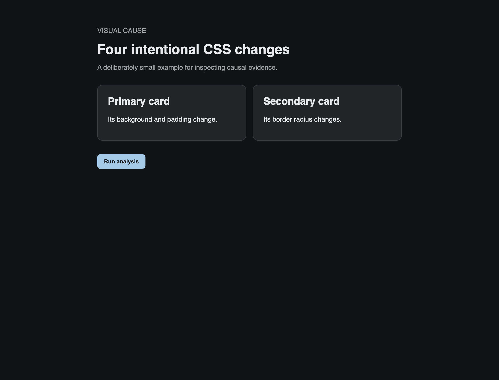
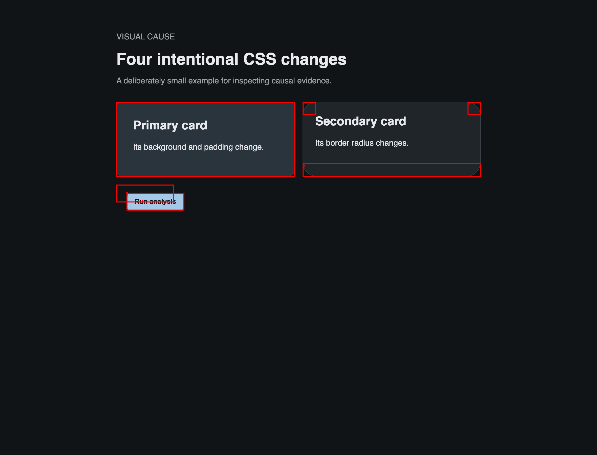
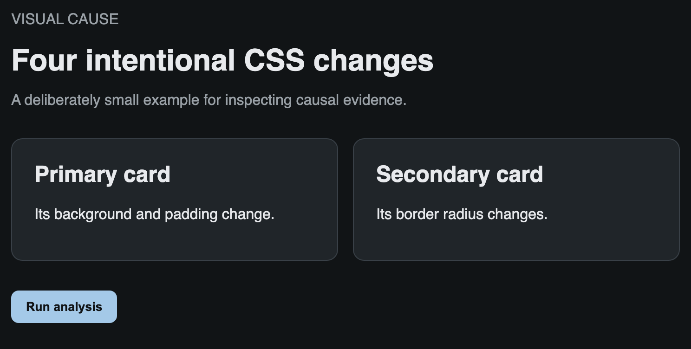
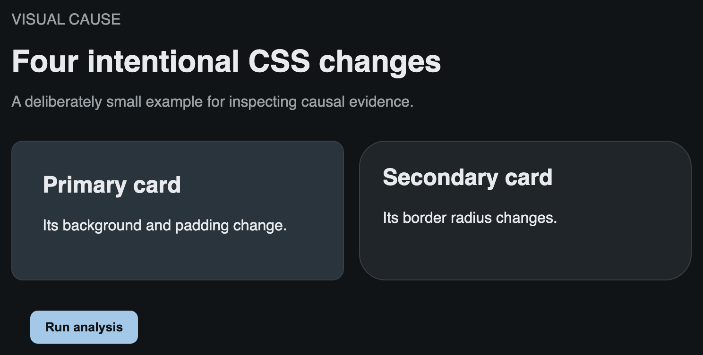

# CSS visual-causality report

This is the CSS-first view of the same counterfactual evidence stored in `report.json`.

- URL A: `http://127.0.0.1:53025/index.html`
- URL B: `http://127.0.0.1:53025/index.html`
- CSS target A: `/Users/joaolopes/Exactus/exactus/packages/visual_cause/examples/web/a.css`
- CSS target B: `/Users/joaolopes/Exactus/exactus/packages/visual_cause/examples/web/b.css`

## Visual overview

| Reference A | Changed B | Annotated changed regions |
|---|---|---|
|  |  |  |

## Executive summary

- **9** rendered nodes changed.
- **54** changed CSS properties were identified across **115** changed element/property links.
- **54** properties have declaration-level experimental support; the remainder are retained as changed matched candidates rather than hidden.
- Structural change regions cover approximately **6.61%** of the rendered canvas.
- Evidence screenshots are captured at **2.0x device-pixel density** while causal pixel metrics remain normalized to CSS pixels.

## Structural image analysis

| Structural metric | Value |
|---|---:|
| Changed regions | 8 |
| Changed-region area | 70250.0 CSS px² |
| Changed canvas share | 6.61% |
| Largest changed region | 51744.0 CSS px² |
| Affected rendered elements | 9 |

### Alignment structure

Pairs of affected elements that remain aligned within a 2 CSS-pixel tolerance:

| Edge | Pair count |
|---|---:|
| Left | 4 |
| Right | 4 |
| Top | 3 |
| Bottom | 4 |

### Repeated geometry

| Approximate size | Count |
|---|---:|
| `352x148` | 2 |

## Summary

| Measure | Count |
|---|---:|
| CSS files with causal evidence | 1 |
| Changed rules represented | 3 |
| Rules with property-level experimental support | 3 |
| Identified changed properties | 54 |
| Properties with declaration-level experimental support | 54 |
| Property → affected-element links | 115 |
| Changed DOM nodes observed | 9 |

### How to read the evidence

- **Explained visual delta** is a pixel count, not a percentage.
- **Share of baseline visual delta** is the normalized causal score.
- Zero/unchanged geometry is omitted instead of reporting `0 → 0`.
- “Other contributing properties” contains experimentally observed interaction/minimal-set companions, not merely correlated styles.

## `b.css`

### Rule 9: `.primary`

```css
.primary { background: var(--vcd-card-raised-surface); padding: var(--vcd-card-roomy-padding); }
```

#### `padding-top: `

**Causal status:** counterfactually proven

##### Affected element `html > body > main.demo`

| Metric | Evidence |
|---|---:|
| Explained visual delta | **7,612 changed pixels** |
| Share of baseline visual delta | **93.2%** |
| Baseline visual delta | 8,170 changed pixels |
| Evidence score | 0.932 |
| Impact classification | propagated-structural-or-inherited |

> **Metric meaning:** for counterfactually proven properties, “explained visual delta” is the number of changed pixels removed when this declaration is counterfactually disabled. The percentage is that reduction divided by the original A/B changed-pixel count.

###### What changed

**Box Model**

| Property | A | B |
|---|---|---|
| `height` | `335.906px` | `351.906px` |

**Color**

| Property | A | B |
|---|---|---|
| `--primary-vcd-color-steel` | `` | `#29343dff` |
| `--catalog-card-color-raised` | `` | `#29343dff` |
| `--base-vcd-color-steel` | `` | `#29343dff` |

**Transform**

| Property | A | B |
|---|---|---|
| `perspective-origin` | `360px 167.953px` | `360px 175.953px` |
| `transform-origin` | `360px 167.953px` | `360px 175.953px` |

**Other**

| Property | A | B |
|---|---|---|
| `block-size` | `335.906px` | `351.906px` |
| `--base-vcd-dimension-twenty-pixel` | `` | `calc(20 * 1px)` |
| `--catalog-card-measure-round-radius` | `` | `calc(28 * 1px)` |
| `--catalog-action-motion-nudge` | `` | `translateX(
    calc(20 * 1px)
  )` |
| `--vcd-card-roomy-padding` | `` | `calc(32 * 1px)` |
| `--vcd-card-round-radius` | `` | `calc(28 * 1px)` |
| `--vcd-card-raised-surface` | `` | `#29343dff` |
| `--base-vcd-dimension-twenty-eight-pixel` | `` | `calc(28 * 1px)` |
| `--catalog-card-measure-roomy-padding` | `` | `calc(32 * 1px)` |
| `--vcd-action-nudge` | `` | `translateX(
    calc(20 * 1px)
  )` |


**Rendered bounds (B):** `x=230.0, y=64.0, w=720.0, h=351.9`

###### Visual evidence

| A — reference | B — changed | Absolute pixel difference |
|---|---|---|
|  |  |  |

**Other contributing properties:** none detected by the completed bounded experiments

##### Affected element `html > body > main.demo > section.cards`

| Metric | Evidence |
|---|---:|
| Explained visual delta | **7,612 changed pixels** |
| Share of baseline visual delta | **93.2%** |
| Baseline visual delta | 8,170 changed pixels |
| Evidence score | 0.932 |
| Impact classification | propagated-structural-or-inherited |

> **Metric meaning:** for counterfactually proven properties, “explained visual delta” is the number of changed pixels removed when this declaration is counterfactually disabled. The percentage is that reduction divided by the original A/B changed-pixel count.

###### What changed

**Layout**

| Property | A | B |
|---|---|---|
| `grid-template-rows` | `131.906px` | `147.906px` |

**Box Model**

| Property | A | B |
|---|---|---|
| `height` | `131.906px` | `147.906px` |

**Color**

| Property | A | B |
|---|---|---|
| `--primary-vcd-color-steel` | `` | `#29343dff` |
| `--catalog-card-color-raised` | `` | `#29343dff` |
| `--base-vcd-color-steel` | `` | `#29343dff` |

**Transform**

| Property | A | B |
|---|---|---|
| `perspective-origin` | `360px 65.9531px` | `360px 73.9531px` |
| `transform-origin` | `360px 65.9531px` | `360px 73.9531px` |

**Other**

| Property | A | B |
|---|---|---|
| `block-size` | `131.906px` | `147.906px` |
| `--base-vcd-dimension-twenty-pixel` | `` | `calc(20 * 1px)` |
| `--catalog-card-measure-round-radius` | `` | `calc(28 * 1px)` |
| `--catalog-action-motion-nudge` | `` | `translateX(
    calc(20 * 1px)
  )` |
| `--vcd-card-roomy-padding` | `` | `calc(32 * 1px)` |
| `--vcd-card-round-radius` | `` | `calc(28 * 1px)` |
| `--vcd-card-raised-surface` | `` | `#29343dff` |
| `--base-vcd-dimension-twenty-eight-pixel` | `` | `calc(28 * 1px)` |
| `--catalog-card-measure-roomy-padding` | `` | `calc(32 * 1px)` |
| `--vcd-action-nudge` | `` | `translateX(
    calc(20 * 1px)
  )` |


**Rendered bounds (B):** `x=230.0, y=201.0, w=720.0, h=147.9`

###### Visual evidence

| A — reference | B — changed | Absolute pixel difference |
|---|---|---|
|  |  |  |

**Other contributing properties:** none detected by the completed bounded experiments

##### Affected element `html > body > main.demo > section.cards > article.card.primary:nth-of-type(1)`

| Metric | Evidence |
|---|---:|
| Explained visual delta | **7,612 changed pixels** |
| Share of baseline visual delta | **93.2%** |
| Baseline visual delta | 8,170 changed pixels |
| Evidence score | 0.932 |
| Impact classification | direct-local |

> **Metric meaning:** for counterfactually proven properties, “explained visual delta” is the number of changed pixels removed when this declaration is counterfactually disabled. The percentage is that reduction divided by the original A/B changed-pixel count.

###### What changed

**Box Model**

| Property | A | B |
|---|---|---|
| `height` | `131.906px` | `147.906px` |
| `padding-bottom` | `24px` | `32px` |
| `padding-left` | `24px` | `32px` |
| `padding-right` | `24px` | `32px` |
| `padding-top` | `24px` | `32px` |

**Color**

| Property | A | B |
|---|---|---|
| `background-color` | `rgb(32, 37, 41)` | `rgb(41, 52, 61)` |
| `--primary-vcd-color-steel` | `` | `#29343dff` |
| `--catalog-card-color-raised` | `` | `#29343dff` |
| `--base-vcd-color-steel` | `` | `#29343dff` |

**Transform**

| Property | A | B |
|---|---|---|
| `perspective-origin` | `176px 65.9531px` | `176px 73.9531px` |
| `transform-origin` | `176px 65.9531px` | `176px 73.9531px` |

**Other**

| Property | A | B |
|---|---|---|
| `block-size` | `131.906px` | `147.906px` |
| `padding-block-end` | `24px` | `32px` |
| `padding-block-start` | `24px` | `32px` |
| `padding-inline-end` | `24px` | `32px` |
| `padding-inline-start` | `24px` | `32px` |
| `--base-vcd-dimension-twenty-pixel` | `` | `calc(20 * 1px)` |
| `--catalog-card-measure-round-radius` | `` | `calc(28 * 1px)` |
| `--catalog-action-motion-nudge` | `` | `translateX(
    calc(20 * 1px)
  )` |
| `--vcd-card-roomy-padding` | `` | `calc(32 * 1px)` |
| `--vcd-card-round-radius` | `` | `calc(28 * 1px)` |
| `--vcd-card-raised-surface` | `` | `#29343dff` |
| `--base-vcd-dimension-twenty-eight-pixel` | `` | `calc(28 * 1px)` |
| `--catalog-card-measure-roomy-padding` | `` | `calc(32 * 1px)` |
| `--vcd-action-nudge` | `` | `translateX(
    calc(20 * 1px)
  )` |


**Rendered bounds (B):** `x=230.0, y=201.0, w=352.0, h=147.9`

###### Visual evidence

| A — reference | B — changed | Absolute pixel difference |
|---|---|---|
|  |  |  |

**Other contributing properties:** none detected by the completed bounded experiments

##### Affected element `html > body > main.demo > section.cards > article.card.primary:nth-of-type(1) > h2`

| Metric | Evidence |
|---|---:|
| Explained visual delta | **7,612 changed pixels** |
| Share of baseline visual delta | **93.2%** |
| Baseline visual delta | 8,170 changed pixels |
| Evidence score | 0.932 |
| Impact classification | propagated-structural-or-inherited |

> **Metric meaning:** for counterfactually proven properties, “explained visual delta” is the number of changed pixels removed when this declaration is counterfactually disabled. The percentage is that reduction divided by the original A/B changed-pixel count.

###### What changed

**Box Model**

| Property | A | B |
|---|---|---|
| `width` | `302px` | `286px` |

**Color**

| Property | A | B |
|---|---|---|
| `--primary-vcd-color-steel` | `` | `#29343dff` |
| `--catalog-card-color-raised` | `` | `#29343dff` |
| `--base-vcd-color-steel` | `` | `#29343dff` |

**Transform**

| Property | A | B |
|---|---|---|
| `perspective-origin` | `151px 14px` | `143px 14px` |
| `transform-origin` | `151px 14px` | `143px 14px` |

**Other**

| Property | A | B |
|---|---|---|
| `inline-size` | `302px` | `286px` |
| `--base-vcd-dimension-twenty-pixel` | `` | `calc(20 * 1px)` |
| `--catalog-card-measure-round-radius` | `` | `calc(28 * 1px)` |
| `--catalog-action-motion-nudge` | `` | `translateX(
    calc(20 * 1px)
  )` |
| `--vcd-card-roomy-padding` | `` | `calc(32 * 1px)` |
| `--vcd-card-round-radius` | `` | `calc(28 * 1px)` |
| `--vcd-card-raised-surface` | `` | `#29343dff` |
| `--base-vcd-dimension-twenty-eight-pixel` | `` | `calc(28 * 1px)` |
| `--catalog-card-measure-roomy-padding` | `` | `calc(32 * 1px)` |
| `--vcd-action-nudge` | `` | `translateX(
    calc(20 * 1px)
  )` |


**Rendered bounds (B):** `x=263.0, y=234.0, w=286.0, h=28.0`

###### Visual evidence

| A — reference | B — changed | Absolute pixel difference |
|---|---|---|
|  |  |  |

**Other contributing properties:** none detected by the completed bounded experiments

##### Affected element `html > body > main.demo > section.cards > article.card.primary:nth-of-type(1) > p`

| Metric | Evidence |
|---|---:|
| Explained visual delta | **7,612 changed pixels** |
| Share of baseline visual delta | **93.2%** |
| Baseline visual delta | 8,170 changed pixels |
| Evidence score | 0.932 |
| Impact classification | propagated-structural-or-inherited |

> **Metric meaning:** for counterfactually proven properties, “explained visual delta” is the number of changed pixels removed when this declaration is counterfactually disabled. The percentage is that reduction divided by the original A/B changed-pixel count.

###### What changed

**Box Model**

| Property | A | B |
|---|---|---|
| `width` | `302px` | `286px` |

**Color**

| Property | A | B |
|---|---|---|
| `--primary-vcd-color-steel` | `` | `#29343dff` |
| `--catalog-card-color-raised` | `` | `#29343dff` |
| `--base-vcd-color-steel` | `` | `#29343dff` |

**Transform**

| Property | A | B |
|---|---|---|
| `perspective-origin` | `151px 9px` | `143px 9px` |
| `transform-origin` | `151px 9px` | `143px 9px` |

**Other**

| Property | A | B |
|---|---|---|
| `inline-size` | `302px` | `286px` |
| `--base-vcd-dimension-twenty-pixel` | `` | `calc(20 * 1px)` |
| `--catalog-card-measure-round-radius` | `` | `calc(28 * 1px)` |
| `--catalog-action-motion-nudge` | `` | `translateX(
    calc(20 * 1px)
  )` |
| `--vcd-card-roomy-padding` | `` | `calc(32 * 1px)` |
| `--vcd-card-round-radius` | `` | `calc(28 * 1px)` |
| `--vcd-card-raised-surface` | `` | `#29343dff` |
| `--base-vcd-dimension-twenty-eight-pixel` | `` | `calc(28 * 1px)` |
| `--catalog-card-measure-roomy-padding` | `` | `calc(32 * 1px)` |
| `--vcd-action-nudge` | `` | `translateX(
    calc(20 * 1px)
  )` |


**Rendered bounds (B):** `x=263.0, y=281.9, w=286.0, h=18.0`

###### Visual evidence

| A — reference | B — changed | Absolute pixel difference |
|---|---|---|
|  |  |  |

**Other contributing properties:** none detected by the completed bounded experiments

##### Affected element `html > body > main.demo > section.cards > article.card.secondary:nth-of-type(2)`

| Metric | Evidence |
|---|---:|
| Explained visual delta | **7,612 changed pixels** |
| Share of baseline visual delta | **93.2%** |
| Baseline visual delta | 8,170 changed pixels |
| Evidence score | 0.932 |
| Impact classification | propagated-structural-or-inherited |

> **Metric meaning:** for counterfactually proven properties, “explained visual delta” is the number of changed pixels removed when this declaration is counterfactually disabled. The percentage is that reduction divided by the original A/B changed-pixel count.

###### What changed

**Box Model**

| Property | A | B |
|---|---|---|
| `border-bottom-left-radius` | `12px` | `28px` |
| `border-bottom-right-radius` | `12px` | `28px` |
| `border-top-left-radius` | `12px` | `28px` |
| `border-top-right-radius` | `12px` | `28px` |
| `height` | `131.906px` | `147.906px` |

**Color**

| Property | A | B |
|---|---|---|
| `--primary-vcd-color-steel` | `` | `#29343dff` |
| `--catalog-card-color-raised` | `` | `#29343dff` |
| `--base-vcd-color-steel` | `` | `#29343dff` |

**Transform**

| Property | A | B |
|---|---|---|
| `perspective-origin` | `176px 65.9531px` | `176px 73.9531px` |
| `transform-origin` | `176px 65.9531px` | `176px 73.9531px` |

**Other**

| Property | A | B |
|---|---|---|
| `block-size` | `131.906px` | `147.906px` |
| `border-end-end-radius` | `12px` | `28px` |
| `border-end-start-radius` | `12px` | `28px` |
| `border-start-end-radius` | `12px` | `28px` |
| `border-start-start-radius` | `12px` | `28px` |
| `--base-vcd-dimension-twenty-pixel` | `` | `calc(20 * 1px)` |
| `--catalog-card-measure-round-radius` | `` | `calc(28 * 1px)` |
| `--catalog-action-motion-nudge` | `` | `translateX(
    calc(20 * 1px)
  )` |
| `--vcd-card-roomy-padding` | `` | `calc(32 * 1px)` |
| `--vcd-card-round-radius` | `` | `calc(28 * 1px)` |
| `--vcd-card-raised-surface` | `` | `#29343dff` |
| `--base-vcd-dimension-twenty-eight-pixel` | `` | `calc(28 * 1px)` |
| `--catalog-card-measure-roomy-padding` | `` | `calc(32 * 1px)` |
| `--vcd-action-nudge` | `` | `translateX(
    calc(20 * 1px)
  )` |


**Rendered bounds (B):** `x=598.0, y=201.0, w=352.0, h=147.9`

###### Visual evidence

| A — reference | B — changed | Absolute pixel difference |
|---|---|---|
|  |  |  |

**Other contributing properties:** none detected by the completed bounded experiments

##### Affected element `html > body > main.demo > button.action`

| Metric | Evidence |
|---|---:|
| Explained visual delta | **7,612 changed pixels** |
| Share of baseline visual delta | **93.2%** |
| Baseline visual delta | 8,170 changed pixels |
| Evidence score | 0.932 |
| Impact classification | propagated-structural-or-inherited |

> **Metric meaning:** for counterfactually proven properties, “explained visual delta” is the number of changed pixels removed when this declaration is counterfactually disabled. The percentage is that reduction divided by the original A/B changed-pixel count.

###### What changed

**Color**

| Property | A | B |
|---|---|---|
| `--primary-vcd-color-steel` | `` | `#29343dff` |
| `--catalog-card-color-raised` | `` | `#29343dff` |
| `--base-vcd-color-steel` | `` | `#29343dff` |

**Transform**

| Property | A | B |
|---|---|---|
| `transform` | `matrix(1, 0, 0, 1, 0, 0)` | `matrix(1, 0, 0, 1, 20, 0)` |

**Other**

| Property | A | B |
|---|---|---|
| `--base-vcd-dimension-twenty-pixel` | `` | `calc(20 * 1px)` |
| `--catalog-card-measure-round-radius` | `` | `calc(28 * 1px)` |
| `--catalog-action-motion-nudge` | `` | `translateX(
    calc(20 * 1px)
  )` |
| `--vcd-card-roomy-padding` | `` | `calc(32 * 1px)` |
| `--vcd-card-round-radius` | `` | `calc(28 * 1px)` |
| `--vcd-card-raised-surface` | `` | `#29343dff` |
| `--base-vcd-dimension-twenty-eight-pixel` | `` | `calc(28 * 1px)` |
| `--catalog-card-measure-roomy-padding` | `` | `calc(32 * 1px)` |
| `--vcd-action-nudge` | `` | `translateX(
    calc(20 * 1px)
  )` |


**Rendered bounds (B):** `x=250.0, y=380.9, w=114.2, h=35.0`

###### Visual evidence

| A — reference | B — changed | Absolute pixel difference |
|---|---|---|
|  |  |  |

**Other contributing properties:** none detected by the completed bounded experiments

#### `padding-right: `

**Causal status:** counterfactually proven

##### Affected element `html > body > main.demo`

| Metric | Evidence |
|---|---:|
| Explained visual delta | **7,612 changed pixels** |
| Share of baseline visual delta | **93.2%** |
| Baseline visual delta | 8,170 changed pixels |
| Evidence score | 0.932 |
| Impact classification | propagated-structural-or-inherited |

> **Metric meaning:** for counterfactually proven properties, “explained visual delta” is the number of changed pixels removed when this declaration is counterfactually disabled. The percentage is that reduction divided by the original A/B changed-pixel count.

###### What changed

**Box Model**

| Property | A | B |
|---|---|---|
| `height` | `335.906px` | `351.906px` |

**Color**

| Property | A | B |
|---|---|---|
| `--primary-vcd-color-steel` | `` | `#29343dff` |
| `--catalog-card-color-raised` | `` | `#29343dff` |
| `--base-vcd-color-steel` | `` | `#29343dff` |

**Transform**

| Property | A | B |
|---|---|---|
| `perspective-origin` | `360px 167.953px` | `360px 175.953px` |
| `transform-origin` | `360px 167.953px` | `360px 175.953px` |

**Other**

| Property | A | B |
|---|---|---|
| `block-size` | `335.906px` | `351.906px` |
| `--base-vcd-dimension-twenty-pixel` | `` | `calc(20 * 1px)` |
| `--catalog-card-measure-round-radius` | `` | `calc(28 * 1px)` |
| `--catalog-action-motion-nudge` | `` | `translateX(
    calc(20 * 1px)
  )` |
| `--vcd-card-roomy-padding` | `` | `calc(32 * 1px)` |
| `--vcd-card-round-radius` | `` | `calc(28 * 1px)` |
| `--vcd-card-raised-surface` | `` | `#29343dff` |
| `--base-vcd-dimension-twenty-eight-pixel` | `` | `calc(28 * 1px)` |
| `--catalog-card-measure-roomy-padding` | `` | `calc(32 * 1px)` |
| `--vcd-action-nudge` | `` | `translateX(
    calc(20 * 1px)
  )` |


**Rendered bounds (B):** `x=230.0, y=64.0, w=720.0, h=351.9`

###### Visual evidence

| A — reference | B — changed | Absolute pixel difference |
|---|---|---|
|  |  |  |

**Other contributing properties:** none detected by the completed bounded experiments

##### Affected element `html > body > main.demo > section.cards`

| Metric | Evidence |
|---|---:|
| Explained visual delta | **7,612 changed pixels** |
| Share of baseline visual delta | **93.2%** |
| Baseline visual delta | 8,170 changed pixels |
| Evidence score | 0.932 |
| Impact classification | propagated-structural-or-inherited |

> **Metric meaning:** for counterfactually proven properties, “explained visual delta” is the number of changed pixels removed when this declaration is counterfactually disabled. The percentage is that reduction divided by the original A/B changed-pixel count.

###### What changed

**Layout**

| Property | A | B |
|---|---|---|
| `grid-template-rows` | `131.906px` | `147.906px` |

**Box Model**

| Property | A | B |
|---|---|---|
| `height` | `131.906px` | `147.906px` |

**Color**

| Property | A | B |
|---|---|---|
| `--primary-vcd-color-steel` | `` | `#29343dff` |
| `--catalog-card-color-raised` | `` | `#29343dff` |
| `--base-vcd-color-steel` | `` | `#29343dff` |

**Transform**

| Property | A | B |
|---|---|---|
| `perspective-origin` | `360px 65.9531px` | `360px 73.9531px` |
| `transform-origin` | `360px 65.9531px` | `360px 73.9531px` |

**Other**

| Property | A | B |
|---|---|---|
| `block-size` | `131.906px` | `147.906px` |
| `--base-vcd-dimension-twenty-pixel` | `` | `calc(20 * 1px)` |
| `--catalog-card-measure-round-radius` | `` | `calc(28 * 1px)` |
| `--catalog-action-motion-nudge` | `` | `translateX(
    calc(20 * 1px)
  )` |
| `--vcd-card-roomy-padding` | `` | `calc(32 * 1px)` |
| `--vcd-card-round-radius` | `` | `calc(28 * 1px)` |
| `--vcd-card-raised-surface` | `` | `#29343dff` |
| `--base-vcd-dimension-twenty-eight-pixel` | `` | `calc(28 * 1px)` |
| `--catalog-card-measure-roomy-padding` | `` | `calc(32 * 1px)` |
| `--vcd-action-nudge` | `` | `translateX(
    calc(20 * 1px)
  )` |


**Rendered bounds (B):** `x=230.0, y=201.0, w=720.0, h=147.9`

###### Visual evidence

| A — reference | B — changed | Absolute pixel difference |
|---|---|---|
|  |  |  |

**Other contributing properties:** none detected by the completed bounded experiments

##### Affected element `html > body > main.demo > section.cards > article.card.primary:nth-of-type(1)`

| Metric | Evidence |
|---|---:|
| Explained visual delta | **7,612 changed pixels** |
| Share of baseline visual delta | **93.2%** |
| Baseline visual delta | 8,170 changed pixels |
| Evidence score | 0.932 |
| Impact classification | direct-local |

> **Metric meaning:** for counterfactually proven properties, “explained visual delta” is the number of changed pixels removed when this declaration is counterfactually disabled. The percentage is that reduction divided by the original A/B changed-pixel count.

###### What changed

**Box Model**

| Property | A | B |
|---|---|---|
| `height` | `131.906px` | `147.906px` |
| `padding-bottom` | `24px` | `32px` |
| `padding-left` | `24px` | `32px` |
| `padding-right` | `24px` | `32px` |
| `padding-top` | `24px` | `32px` |

**Color**

| Property | A | B |
|---|---|---|
| `background-color` | `rgb(32, 37, 41)` | `rgb(41, 52, 61)` |
| `--primary-vcd-color-steel` | `` | `#29343dff` |
| `--catalog-card-color-raised` | `` | `#29343dff` |
| `--base-vcd-color-steel` | `` | `#29343dff` |

**Transform**

| Property | A | B |
|---|---|---|
| `perspective-origin` | `176px 65.9531px` | `176px 73.9531px` |
| `transform-origin` | `176px 65.9531px` | `176px 73.9531px` |

**Other**

| Property | A | B |
|---|---|---|
| `block-size` | `131.906px` | `147.906px` |
| `padding-block-end` | `24px` | `32px` |
| `padding-block-start` | `24px` | `32px` |
| `padding-inline-end` | `24px` | `32px` |
| `padding-inline-start` | `24px` | `32px` |
| `--base-vcd-dimension-twenty-pixel` | `` | `calc(20 * 1px)` |
| `--catalog-card-measure-round-radius` | `` | `calc(28 * 1px)` |
| `--catalog-action-motion-nudge` | `` | `translateX(
    calc(20 * 1px)
  )` |
| `--vcd-card-roomy-padding` | `` | `calc(32 * 1px)` |
| `--vcd-card-round-radius` | `` | `calc(28 * 1px)` |
| `--vcd-card-raised-surface` | `` | `#29343dff` |
| `--base-vcd-dimension-twenty-eight-pixel` | `` | `calc(28 * 1px)` |
| `--catalog-card-measure-roomy-padding` | `` | `calc(32 * 1px)` |
| `--vcd-action-nudge` | `` | `translateX(
    calc(20 * 1px)
  )` |


**Rendered bounds (B):** `x=230.0, y=201.0, w=352.0, h=147.9`

###### Visual evidence

| A — reference | B — changed | Absolute pixel difference |
|---|---|---|
|  |  |  |

**Other contributing properties:** none detected by the completed bounded experiments

##### Affected element `html > body > main.demo > section.cards > article.card.primary:nth-of-type(1) > h2`

| Metric | Evidence |
|---|---:|
| Explained visual delta | **7,612 changed pixels** |
| Share of baseline visual delta | **93.2%** |
| Baseline visual delta | 8,170 changed pixels |
| Evidence score | 0.932 |
| Impact classification | propagated-structural-or-inherited |

> **Metric meaning:** for counterfactually proven properties, “explained visual delta” is the number of changed pixels removed when this declaration is counterfactually disabled. The percentage is that reduction divided by the original A/B changed-pixel count.

###### What changed

**Box Model**

| Property | A | B |
|---|---|---|
| `width` | `302px` | `286px` |

**Color**

| Property | A | B |
|---|---|---|
| `--primary-vcd-color-steel` | `` | `#29343dff` |
| `--catalog-card-color-raised` | `` | `#29343dff` |
| `--base-vcd-color-steel` | `` | `#29343dff` |

**Transform**

| Property | A | B |
|---|---|---|
| `perspective-origin` | `151px 14px` | `143px 14px` |
| `transform-origin` | `151px 14px` | `143px 14px` |

**Other**

| Property | A | B |
|---|---|---|
| `inline-size` | `302px` | `286px` |
| `--base-vcd-dimension-twenty-pixel` | `` | `calc(20 * 1px)` |
| `--catalog-card-measure-round-radius` | `` | `calc(28 * 1px)` |
| `--catalog-action-motion-nudge` | `` | `translateX(
    calc(20 * 1px)
  )` |
| `--vcd-card-roomy-padding` | `` | `calc(32 * 1px)` |
| `--vcd-card-round-radius` | `` | `calc(28 * 1px)` |
| `--vcd-card-raised-surface` | `` | `#29343dff` |
| `--base-vcd-dimension-twenty-eight-pixel` | `` | `calc(28 * 1px)` |
| `--catalog-card-measure-roomy-padding` | `` | `calc(32 * 1px)` |
| `--vcd-action-nudge` | `` | `translateX(
    calc(20 * 1px)
  )` |


**Rendered bounds (B):** `x=263.0, y=234.0, w=286.0, h=28.0`

###### Visual evidence

| A — reference | B — changed | Absolute pixel difference |
|---|---|---|
|  |  |  |

**Other contributing properties:** none detected by the completed bounded experiments

##### Affected element `html > body > main.demo > section.cards > article.card.primary:nth-of-type(1) > p`

| Metric | Evidence |
|---|---:|
| Explained visual delta | **7,612 changed pixels** |
| Share of baseline visual delta | **93.2%** |
| Baseline visual delta | 8,170 changed pixels |
| Evidence score | 0.932 |
| Impact classification | propagated-structural-or-inherited |

> **Metric meaning:** for counterfactually proven properties, “explained visual delta” is the number of changed pixels removed when this declaration is counterfactually disabled. The percentage is that reduction divided by the original A/B changed-pixel count.

###### What changed

**Box Model**

| Property | A | B |
|---|---|---|
| `width` | `302px` | `286px` |

**Color**

| Property | A | B |
|---|---|---|
| `--primary-vcd-color-steel` | `` | `#29343dff` |
| `--catalog-card-color-raised` | `` | `#29343dff` |
| `--base-vcd-color-steel` | `` | `#29343dff` |

**Transform**

| Property | A | B |
|---|---|---|
| `perspective-origin` | `151px 9px` | `143px 9px` |
| `transform-origin` | `151px 9px` | `143px 9px` |

**Other**

| Property | A | B |
|---|---|---|
| `inline-size` | `302px` | `286px` |
| `--base-vcd-dimension-twenty-pixel` | `` | `calc(20 * 1px)` |
| `--catalog-card-measure-round-radius` | `` | `calc(28 * 1px)` |
| `--catalog-action-motion-nudge` | `` | `translateX(
    calc(20 * 1px)
  )` |
| `--vcd-card-roomy-padding` | `` | `calc(32 * 1px)` |
| `--vcd-card-round-radius` | `` | `calc(28 * 1px)` |
| `--vcd-card-raised-surface` | `` | `#29343dff` |
| `--base-vcd-dimension-twenty-eight-pixel` | `` | `calc(28 * 1px)` |
| `--catalog-card-measure-roomy-padding` | `` | `calc(32 * 1px)` |
| `--vcd-action-nudge` | `` | `translateX(
    calc(20 * 1px)
  )` |


**Rendered bounds (B):** `x=263.0, y=281.9, w=286.0, h=18.0`

###### Visual evidence

| A — reference | B — changed | Absolute pixel difference |
|---|---|---|
|  |  |  |

**Other contributing properties:** none detected by the completed bounded experiments

##### Affected element `html > body > main.demo > section.cards > article.card.secondary:nth-of-type(2)`

| Metric | Evidence |
|---|---:|
| Explained visual delta | **7,612 changed pixels** |
| Share of baseline visual delta | **93.2%** |
| Baseline visual delta | 8,170 changed pixels |
| Evidence score | 0.932 |
| Impact classification | propagated-structural-or-inherited |

> **Metric meaning:** for counterfactually proven properties, “explained visual delta” is the number of changed pixels removed when this declaration is counterfactually disabled. The percentage is that reduction divided by the original A/B changed-pixel count.

###### What changed

**Box Model**

| Property | A | B |
|---|---|---|
| `border-bottom-left-radius` | `12px` | `28px` |
| `border-bottom-right-radius` | `12px` | `28px` |
| `border-top-left-radius` | `12px` | `28px` |
| `border-top-right-radius` | `12px` | `28px` |
| `height` | `131.906px` | `147.906px` |

**Color**

| Property | A | B |
|---|---|---|
| `--primary-vcd-color-steel` | `` | `#29343dff` |
| `--catalog-card-color-raised` | `` | `#29343dff` |
| `--base-vcd-color-steel` | `` | `#29343dff` |

**Transform**

| Property | A | B |
|---|---|---|
| `perspective-origin` | `176px 65.9531px` | `176px 73.9531px` |
| `transform-origin` | `176px 65.9531px` | `176px 73.9531px` |

**Other**

| Property | A | B |
|---|---|---|
| `block-size` | `131.906px` | `147.906px` |
| `border-end-end-radius` | `12px` | `28px` |
| `border-end-start-radius` | `12px` | `28px` |
| `border-start-end-radius` | `12px` | `28px` |
| `border-start-start-radius` | `12px` | `28px` |
| `--base-vcd-dimension-twenty-pixel` | `` | `calc(20 * 1px)` |
| `--catalog-card-measure-round-radius` | `` | `calc(28 * 1px)` |
| `--catalog-action-motion-nudge` | `` | `translateX(
    calc(20 * 1px)
  )` |
| `--vcd-card-roomy-padding` | `` | `calc(32 * 1px)` |
| `--vcd-card-round-radius` | `` | `calc(28 * 1px)` |
| `--vcd-card-raised-surface` | `` | `#29343dff` |
| `--base-vcd-dimension-twenty-eight-pixel` | `` | `calc(28 * 1px)` |
| `--catalog-card-measure-roomy-padding` | `` | `calc(32 * 1px)` |
| `--vcd-action-nudge` | `` | `translateX(
    calc(20 * 1px)
  )` |


**Rendered bounds (B):** `x=598.0, y=201.0, w=352.0, h=147.9`

###### Visual evidence

| A — reference | B — changed | Absolute pixel difference |
|---|---|---|
|  |  |  |

**Other contributing properties:** none detected by the completed bounded experiments

##### Affected element `html > body > main.demo > button.action`

| Metric | Evidence |
|---|---:|
| Explained visual delta | **7,612 changed pixels** |
| Share of baseline visual delta | **93.2%** |
| Baseline visual delta | 8,170 changed pixels |
| Evidence score | 0.932 |
| Impact classification | propagated-structural-or-inherited |

> **Metric meaning:** for counterfactually proven properties, “explained visual delta” is the number of changed pixels removed when this declaration is counterfactually disabled. The percentage is that reduction divided by the original A/B changed-pixel count.

###### What changed

**Color**

| Property | A | B |
|---|---|---|
| `--primary-vcd-color-steel` | `` | `#29343dff` |
| `--catalog-card-color-raised` | `` | `#29343dff` |
| `--base-vcd-color-steel` | `` | `#29343dff` |

**Transform**

| Property | A | B |
|---|---|---|
| `transform` | `matrix(1, 0, 0, 1, 0, 0)` | `matrix(1, 0, 0, 1, 20, 0)` |

**Other**

| Property | A | B |
|---|---|---|
| `--base-vcd-dimension-twenty-pixel` | `` | `calc(20 * 1px)` |
| `--catalog-card-measure-round-radius` | `` | `calc(28 * 1px)` |
| `--catalog-action-motion-nudge` | `` | `translateX(
    calc(20 * 1px)
  )` |
| `--vcd-card-roomy-padding` | `` | `calc(32 * 1px)` |
| `--vcd-card-round-radius` | `` | `calc(28 * 1px)` |
| `--vcd-card-raised-surface` | `` | `#29343dff` |
| `--base-vcd-dimension-twenty-eight-pixel` | `` | `calc(28 * 1px)` |
| `--catalog-card-measure-roomy-padding` | `` | `calc(32 * 1px)` |
| `--vcd-action-nudge` | `` | `translateX(
    calc(20 * 1px)
  )` |


**Rendered bounds (B):** `x=250.0, y=380.9, w=114.2, h=35.0`

###### Visual evidence

| A — reference | B — changed | Absolute pixel difference |
|---|---|---|
|  |  |  |

**Other contributing properties:** none detected by the completed bounded experiments

#### `padding-bottom: `

**Causal status:** counterfactually proven

##### Affected element `html > body > main.demo`

| Metric | Evidence |
|---|---:|
| Explained visual delta | **7,612 changed pixels** |
| Share of baseline visual delta | **93.2%** |
| Baseline visual delta | 8,170 changed pixels |
| Evidence score | 0.932 |
| Impact classification | propagated-structural-or-inherited |

> **Metric meaning:** for counterfactually proven properties, “explained visual delta” is the number of changed pixels removed when this declaration is counterfactually disabled. The percentage is that reduction divided by the original A/B changed-pixel count.

###### What changed

**Box Model**

| Property | A | B |
|---|---|---|
| `height` | `335.906px` | `351.906px` |

**Color**

| Property | A | B |
|---|---|---|
| `--primary-vcd-color-steel` | `` | `#29343dff` |
| `--catalog-card-color-raised` | `` | `#29343dff` |
| `--base-vcd-color-steel` | `` | `#29343dff` |

**Transform**

| Property | A | B |
|---|---|---|
| `perspective-origin` | `360px 167.953px` | `360px 175.953px` |
| `transform-origin` | `360px 167.953px` | `360px 175.953px` |

**Other**

| Property | A | B |
|---|---|---|
| `block-size` | `335.906px` | `351.906px` |
| `--base-vcd-dimension-twenty-pixel` | `` | `calc(20 * 1px)` |
| `--catalog-card-measure-round-radius` | `` | `calc(28 * 1px)` |
| `--catalog-action-motion-nudge` | `` | `translateX(
    calc(20 * 1px)
  )` |
| `--vcd-card-roomy-padding` | `` | `calc(32 * 1px)` |
| `--vcd-card-round-radius` | `` | `calc(28 * 1px)` |
| `--vcd-card-raised-surface` | `` | `#29343dff` |
| `--base-vcd-dimension-twenty-eight-pixel` | `` | `calc(28 * 1px)` |
| `--catalog-card-measure-roomy-padding` | `` | `calc(32 * 1px)` |
| `--vcd-action-nudge` | `` | `translateX(
    calc(20 * 1px)
  )` |


**Rendered bounds (B):** `x=230.0, y=64.0, w=720.0, h=351.9`

###### Visual evidence

| A — reference | B — changed | Absolute pixel difference |
|---|---|---|
|  |  |  |

**Other contributing properties:** none detected by the completed bounded experiments

##### Affected element `html > body > main.demo > section.cards`

| Metric | Evidence |
|---|---:|
| Explained visual delta | **7,612 changed pixels** |
| Share of baseline visual delta | **93.2%** |
| Baseline visual delta | 8,170 changed pixels |
| Evidence score | 0.932 |
| Impact classification | propagated-structural-or-inherited |

> **Metric meaning:** for counterfactually proven properties, “explained visual delta” is the number of changed pixels removed when this declaration is counterfactually disabled. The percentage is that reduction divided by the original A/B changed-pixel count.

###### What changed

**Layout**

| Property | A | B |
|---|---|---|
| `grid-template-rows` | `131.906px` | `147.906px` |

**Box Model**

| Property | A | B |
|---|---|---|
| `height` | `131.906px` | `147.906px` |

**Color**

| Property | A | B |
|---|---|---|
| `--primary-vcd-color-steel` | `` | `#29343dff` |
| `--catalog-card-color-raised` | `` | `#29343dff` |
| `--base-vcd-color-steel` | `` | `#29343dff` |

**Transform**

| Property | A | B |
|---|---|---|
| `perspective-origin` | `360px 65.9531px` | `360px 73.9531px` |
| `transform-origin` | `360px 65.9531px` | `360px 73.9531px` |

**Other**

| Property | A | B |
|---|---|---|
| `block-size` | `131.906px` | `147.906px` |
| `--base-vcd-dimension-twenty-pixel` | `` | `calc(20 * 1px)` |
| `--catalog-card-measure-round-radius` | `` | `calc(28 * 1px)` |
| `--catalog-action-motion-nudge` | `` | `translateX(
    calc(20 * 1px)
  )` |
| `--vcd-card-roomy-padding` | `` | `calc(32 * 1px)` |
| `--vcd-card-round-radius` | `` | `calc(28 * 1px)` |
| `--vcd-card-raised-surface` | `` | `#29343dff` |
| `--base-vcd-dimension-twenty-eight-pixel` | `` | `calc(28 * 1px)` |
| `--catalog-card-measure-roomy-padding` | `` | `calc(32 * 1px)` |
| `--vcd-action-nudge` | `` | `translateX(
    calc(20 * 1px)
  )` |


**Rendered bounds (B):** `x=230.0, y=201.0, w=720.0, h=147.9`

###### Visual evidence

| A — reference | B — changed | Absolute pixel difference |
|---|---|---|
|  |  |  |

**Other contributing properties:** none detected by the completed bounded experiments

##### Affected element `html > body > main.demo > section.cards > article.card.primary:nth-of-type(1)`

| Metric | Evidence |
|---|---:|
| Explained visual delta | **7,612 changed pixels** |
| Share of baseline visual delta | **93.2%** |
| Baseline visual delta | 8,170 changed pixels |
| Evidence score | 0.932 |
| Impact classification | direct-local |

> **Metric meaning:** for counterfactually proven properties, “explained visual delta” is the number of changed pixels removed when this declaration is counterfactually disabled. The percentage is that reduction divided by the original A/B changed-pixel count.

###### What changed

**Box Model**

| Property | A | B |
|---|---|---|
| `height` | `131.906px` | `147.906px` |
| `padding-bottom` | `24px` | `32px` |
| `padding-left` | `24px` | `32px` |
| `padding-right` | `24px` | `32px` |
| `padding-top` | `24px` | `32px` |

**Color**

| Property | A | B |
|---|---|---|
| `background-color` | `rgb(32, 37, 41)` | `rgb(41, 52, 61)` |
| `--primary-vcd-color-steel` | `` | `#29343dff` |
| `--catalog-card-color-raised` | `` | `#29343dff` |
| `--base-vcd-color-steel` | `` | `#29343dff` |

**Transform**

| Property | A | B |
|---|---|---|
| `perspective-origin` | `176px 65.9531px` | `176px 73.9531px` |
| `transform-origin` | `176px 65.9531px` | `176px 73.9531px` |

**Other**

| Property | A | B |
|---|---|---|
| `block-size` | `131.906px` | `147.906px` |
| `padding-block-end` | `24px` | `32px` |
| `padding-block-start` | `24px` | `32px` |
| `padding-inline-end` | `24px` | `32px` |
| `padding-inline-start` | `24px` | `32px` |
| `--base-vcd-dimension-twenty-pixel` | `` | `calc(20 * 1px)` |
| `--catalog-card-measure-round-radius` | `` | `calc(28 * 1px)` |
| `--catalog-action-motion-nudge` | `` | `translateX(
    calc(20 * 1px)
  )` |
| `--vcd-card-roomy-padding` | `` | `calc(32 * 1px)` |
| `--vcd-card-round-radius` | `` | `calc(28 * 1px)` |
| `--vcd-card-raised-surface` | `` | `#29343dff` |
| `--base-vcd-dimension-twenty-eight-pixel` | `` | `calc(28 * 1px)` |
| `--catalog-card-measure-roomy-padding` | `` | `calc(32 * 1px)` |
| `--vcd-action-nudge` | `` | `translateX(
    calc(20 * 1px)
  )` |


**Rendered bounds (B):** `x=230.0, y=201.0, w=352.0, h=147.9`

###### Visual evidence

| A — reference | B — changed | Absolute pixel difference |
|---|---|---|
|  |  |  |

**Other contributing properties:** none detected by the completed bounded experiments

##### Affected element `html > body > main.demo > section.cards > article.card.primary:nth-of-type(1) > h2`

| Metric | Evidence |
|---|---:|
| Explained visual delta | **7,612 changed pixels** |
| Share of baseline visual delta | **93.2%** |
| Baseline visual delta | 8,170 changed pixels |
| Evidence score | 0.932 |
| Impact classification | propagated-structural-or-inherited |

> **Metric meaning:** for counterfactually proven properties, “explained visual delta” is the number of changed pixels removed when this declaration is counterfactually disabled. The percentage is that reduction divided by the original A/B changed-pixel count.

###### What changed

**Box Model**

| Property | A | B |
|---|---|---|
| `width` | `302px` | `286px` |

**Color**

| Property | A | B |
|---|---|---|
| `--primary-vcd-color-steel` | `` | `#29343dff` |
| `--catalog-card-color-raised` | `` | `#29343dff` |
| `--base-vcd-color-steel` | `` | `#29343dff` |

**Transform**

| Property | A | B |
|---|---|---|
| `perspective-origin` | `151px 14px` | `143px 14px` |
| `transform-origin` | `151px 14px` | `143px 14px` |

**Other**

| Property | A | B |
|---|---|---|
| `inline-size` | `302px` | `286px` |
| `--base-vcd-dimension-twenty-pixel` | `` | `calc(20 * 1px)` |
| `--catalog-card-measure-round-radius` | `` | `calc(28 * 1px)` |
| `--catalog-action-motion-nudge` | `` | `translateX(
    calc(20 * 1px)
  )` |
| `--vcd-card-roomy-padding` | `` | `calc(32 * 1px)` |
| `--vcd-card-round-radius` | `` | `calc(28 * 1px)` |
| `--vcd-card-raised-surface` | `` | `#29343dff` |
| `--base-vcd-dimension-twenty-eight-pixel` | `` | `calc(28 * 1px)` |
| `--catalog-card-measure-roomy-padding` | `` | `calc(32 * 1px)` |
| `--vcd-action-nudge` | `` | `translateX(
    calc(20 * 1px)
  )` |


**Rendered bounds (B):** `x=263.0, y=234.0, w=286.0, h=28.0`

###### Visual evidence

| A — reference | B — changed | Absolute pixel difference |
|---|---|---|
|  |  |  |

**Other contributing properties:** none detected by the completed bounded experiments

##### Affected element `html > body > main.demo > section.cards > article.card.primary:nth-of-type(1) > p`

| Metric | Evidence |
|---|---:|
| Explained visual delta | **7,612 changed pixels** |
| Share of baseline visual delta | **93.2%** |
| Baseline visual delta | 8,170 changed pixels |
| Evidence score | 0.932 |
| Impact classification | propagated-structural-or-inherited |

> **Metric meaning:** for counterfactually proven properties, “explained visual delta” is the number of changed pixels removed when this declaration is counterfactually disabled. The percentage is that reduction divided by the original A/B changed-pixel count.

###### What changed

**Box Model**

| Property | A | B |
|---|---|---|
| `width` | `302px` | `286px` |

**Color**

| Property | A | B |
|---|---|---|
| `--primary-vcd-color-steel` | `` | `#29343dff` |
| `--catalog-card-color-raised` | `` | `#29343dff` |
| `--base-vcd-color-steel` | `` | `#29343dff` |

**Transform**

| Property | A | B |
|---|---|---|
| `perspective-origin` | `151px 9px` | `143px 9px` |
| `transform-origin` | `151px 9px` | `143px 9px` |

**Other**

| Property | A | B |
|---|---|---|
| `inline-size` | `302px` | `286px` |
| `--base-vcd-dimension-twenty-pixel` | `` | `calc(20 * 1px)` |
| `--catalog-card-measure-round-radius` | `` | `calc(28 * 1px)` |
| `--catalog-action-motion-nudge` | `` | `translateX(
    calc(20 * 1px)
  )` |
| `--vcd-card-roomy-padding` | `` | `calc(32 * 1px)` |
| `--vcd-card-round-radius` | `` | `calc(28 * 1px)` |
| `--vcd-card-raised-surface` | `` | `#29343dff` |
| `--base-vcd-dimension-twenty-eight-pixel` | `` | `calc(28 * 1px)` |
| `--catalog-card-measure-roomy-padding` | `` | `calc(32 * 1px)` |
| `--vcd-action-nudge` | `` | `translateX(
    calc(20 * 1px)
  )` |


**Rendered bounds (B):** `x=263.0, y=281.9, w=286.0, h=18.0`

###### Visual evidence

| A — reference | B — changed | Absolute pixel difference |
|---|---|---|
|  |  |  |

**Other contributing properties:** none detected by the completed bounded experiments

##### Affected element `html > body > main.demo > section.cards > article.card.secondary:nth-of-type(2)`

| Metric | Evidence |
|---|---:|
| Explained visual delta | **7,612 changed pixels** |
| Share of baseline visual delta | **93.2%** |
| Baseline visual delta | 8,170 changed pixels |
| Evidence score | 0.932 |
| Impact classification | propagated-structural-or-inherited |

> **Metric meaning:** for counterfactually proven properties, “explained visual delta” is the number of changed pixels removed when this declaration is counterfactually disabled. The percentage is that reduction divided by the original A/B changed-pixel count.

###### What changed

**Box Model**

| Property | A | B |
|---|---|---|
| `border-bottom-left-radius` | `12px` | `28px` |
| `border-bottom-right-radius` | `12px` | `28px` |
| `border-top-left-radius` | `12px` | `28px` |
| `border-top-right-radius` | `12px` | `28px` |
| `height` | `131.906px` | `147.906px` |

**Color**

| Property | A | B |
|---|---|---|
| `--primary-vcd-color-steel` | `` | `#29343dff` |
| `--catalog-card-color-raised` | `` | `#29343dff` |
| `--base-vcd-color-steel` | `` | `#29343dff` |

**Transform**

| Property | A | B |
|---|---|---|
| `perspective-origin` | `176px 65.9531px` | `176px 73.9531px` |
| `transform-origin` | `176px 65.9531px` | `176px 73.9531px` |

**Other**

| Property | A | B |
|---|---|---|
| `block-size` | `131.906px` | `147.906px` |
| `border-end-end-radius` | `12px` | `28px` |
| `border-end-start-radius` | `12px` | `28px` |
| `border-start-end-radius` | `12px` | `28px` |
| `border-start-start-radius` | `12px` | `28px` |
| `--base-vcd-dimension-twenty-pixel` | `` | `calc(20 * 1px)` |
| `--catalog-card-measure-round-radius` | `` | `calc(28 * 1px)` |
| `--catalog-action-motion-nudge` | `` | `translateX(
    calc(20 * 1px)
  )` |
| `--vcd-card-roomy-padding` | `` | `calc(32 * 1px)` |
| `--vcd-card-round-radius` | `` | `calc(28 * 1px)` |
| `--vcd-card-raised-surface` | `` | `#29343dff` |
| `--base-vcd-dimension-twenty-eight-pixel` | `` | `calc(28 * 1px)` |
| `--catalog-card-measure-roomy-padding` | `` | `calc(32 * 1px)` |
| `--vcd-action-nudge` | `` | `translateX(
    calc(20 * 1px)
  )` |


**Rendered bounds (B):** `x=598.0, y=201.0, w=352.0, h=147.9`

###### Visual evidence

| A — reference | B — changed | Absolute pixel difference |
|---|---|---|
|  |  |  |

**Other contributing properties:** none detected by the completed bounded experiments

##### Affected element `html > body > main.demo > button.action`

| Metric | Evidence |
|---|---:|
| Explained visual delta | **7,612 changed pixels** |
| Share of baseline visual delta | **93.2%** |
| Baseline visual delta | 8,170 changed pixels |
| Evidence score | 0.932 |
| Impact classification | propagated-structural-or-inherited |

> **Metric meaning:** for counterfactually proven properties, “explained visual delta” is the number of changed pixels removed when this declaration is counterfactually disabled. The percentage is that reduction divided by the original A/B changed-pixel count.

###### What changed

**Color**

| Property | A | B |
|---|---|---|
| `--primary-vcd-color-steel` | `` | `#29343dff` |
| `--catalog-card-color-raised` | `` | `#29343dff` |
| `--base-vcd-color-steel` | `` | `#29343dff` |

**Transform**

| Property | A | B |
|---|---|---|
| `transform` | `matrix(1, 0, 0, 1, 0, 0)` | `matrix(1, 0, 0, 1, 20, 0)` |

**Other**

| Property | A | B |
|---|---|---|
| `--base-vcd-dimension-twenty-pixel` | `` | `calc(20 * 1px)` |
| `--catalog-card-measure-round-radius` | `` | `calc(28 * 1px)` |
| `--catalog-action-motion-nudge` | `` | `translateX(
    calc(20 * 1px)
  )` |
| `--vcd-card-roomy-padding` | `` | `calc(32 * 1px)` |
| `--vcd-card-round-radius` | `` | `calc(28 * 1px)` |
| `--vcd-card-raised-surface` | `` | `#29343dff` |
| `--base-vcd-dimension-twenty-eight-pixel` | `` | `calc(28 * 1px)` |
| `--catalog-card-measure-roomy-padding` | `` | `calc(32 * 1px)` |
| `--vcd-action-nudge` | `` | `translateX(
    calc(20 * 1px)
  )` |


**Rendered bounds (B):** `x=250.0, y=380.9, w=114.2, h=35.0`

###### Visual evidence

| A — reference | B — changed | Absolute pixel difference |
|---|---|---|
|  |  |  |

**Other contributing properties:** none detected by the completed bounded experiments

#### `padding-left: `

**Causal status:** counterfactually proven

##### Affected element `html > body > main.demo`

| Metric | Evidence |
|---|---:|
| Explained visual delta | **7,612 changed pixels** |
| Share of baseline visual delta | **93.2%** |
| Baseline visual delta | 8,170 changed pixels |
| Evidence score | 0.932 |
| Impact classification | propagated-structural-or-inherited |

> **Metric meaning:** for counterfactually proven properties, “explained visual delta” is the number of changed pixels removed when this declaration is counterfactually disabled. The percentage is that reduction divided by the original A/B changed-pixel count.

###### What changed

**Box Model**

| Property | A | B |
|---|---|---|
| `height` | `335.906px` | `351.906px` |

**Color**

| Property | A | B |
|---|---|---|
| `--primary-vcd-color-steel` | `` | `#29343dff` |
| `--catalog-card-color-raised` | `` | `#29343dff` |
| `--base-vcd-color-steel` | `` | `#29343dff` |

**Transform**

| Property | A | B |
|---|---|---|
| `perspective-origin` | `360px 167.953px` | `360px 175.953px` |
| `transform-origin` | `360px 167.953px` | `360px 175.953px` |

**Other**

| Property | A | B |
|---|---|---|
| `block-size` | `335.906px` | `351.906px` |
| `--base-vcd-dimension-twenty-pixel` | `` | `calc(20 * 1px)` |
| `--catalog-card-measure-round-radius` | `` | `calc(28 * 1px)` |
| `--catalog-action-motion-nudge` | `` | `translateX(
    calc(20 * 1px)
  )` |
| `--vcd-card-roomy-padding` | `` | `calc(32 * 1px)` |
| `--vcd-card-round-radius` | `` | `calc(28 * 1px)` |
| `--vcd-card-raised-surface` | `` | `#29343dff` |
| `--base-vcd-dimension-twenty-eight-pixel` | `` | `calc(28 * 1px)` |
| `--catalog-card-measure-roomy-padding` | `` | `calc(32 * 1px)` |
| `--vcd-action-nudge` | `` | `translateX(
    calc(20 * 1px)
  )` |


**Rendered bounds (B):** `x=230.0, y=64.0, w=720.0, h=351.9`

###### Visual evidence

| A — reference | B — changed | Absolute pixel difference |
|---|---|---|
|  |  |  |

**Other contributing properties:** none detected by the completed bounded experiments

##### Affected element `html > body > main.demo > section.cards`

| Metric | Evidence |
|---|---:|
| Explained visual delta | **7,612 changed pixels** |
| Share of baseline visual delta | **93.2%** |
| Baseline visual delta | 8,170 changed pixels |
| Evidence score | 0.932 |
| Impact classification | propagated-structural-or-inherited |

> **Metric meaning:** for counterfactually proven properties, “explained visual delta” is the number of changed pixels removed when this declaration is counterfactually disabled. The percentage is that reduction divided by the original A/B changed-pixel count.

###### What changed

**Layout**

| Property | A | B |
|---|---|---|
| `grid-template-rows` | `131.906px` | `147.906px` |

**Box Model**

| Property | A | B |
|---|---|---|
| `height` | `131.906px` | `147.906px` |

**Color**

| Property | A | B |
|---|---|---|
| `--primary-vcd-color-steel` | `` | `#29343dff` |
| `--catalog-card-color-raised` | `` | `#29343dff` |
| `--base-vcd-color-steel` | `` | `#29343dff` |

**Transform**

| Property | A | B |
|---|---|---|
| `perspective-origin` | `360px 65.9531px` | `360px 73.9531px` |
| `transform-origin` | `360px 65.9531px` | `360px 73.9531px` |

**Other**

| Property | A | B |
|---|---|---|
| `block-size` | `131.906px` | `147.906px` |
| `--base-vcd-dimension-twenty-pixel` | `` | `calc(20 * 1px)` |
| `--catalog-card-measure-round-radius` | `` | `calc(28 * 1px)` |
| `--catalog-action-motion-nudge` | `` | `translateX(
    calc(20 * 1px)
  )` |
| `--vcd-card-roomy-padding` | `` | `calc(32 * 1px)` |
| `--vcd-card-round-radius` | `` | `calc(28 * 1px)` |
| `--vcd-card-raised-surface` | `` | `#29343dff` |
| `--base-vcd-dimension-twenty-eight-pixel` | `` | `calc(28 * 1px)` |
| `--catalog-card-measure-roomy-padding` | `` | `calc(32 * 1px)` |
| `--vcd-action-nudge` | `` | `translateX(
    calc(20 * 1px)
  )` |


**Rendered bounds (B):** `x=230.0, y=201.0, w=720.0, h=147.9`

###### Visual evidence

| A — reference | B — changed | Absolute pixel difference |
|---|---|---|
|  |  |  |

**Other contributing properties:** none detected by the completed bounded experiments

##### Affected element `html > body > main.demo > section.cards > article.card.primary:nth-of-type(1)`

| Metric | Evidence |
|---|---:|
| Explained visual delta | **7,612 changed pixels** |
| Share of baseline visual delta | **93.2%** |
| Baseline visual delta | 8,170 changed pixels |
| Evidence score | 0.932 |
| Impact classification | direct-local |

> **Metric meaning:** for counterfactually proven properties, “explained visual delta” is the number of changed pixels removed when this declaration is counterfactually disabled. The percentage is that reduction divided by the original A/B changed-pixel count.

###### What changed

**Box Model**

| Property | A | B |
|---|---|---|
| `height` | `131.906px` | `147.906px` |
| `padding-bottom` | `24px` | `32px` |
| `padding-left` | `24px` | `32px` |
| `padding-right` | `24px` | `32px` |
| `padding-top` | `24px` | `32px` |

**Color**

| Property | A | B |
|---|---|---|
| `background-color` | `rgb(32, 37, 41)` | `rgb(41, 52, 61)` |
| `--primary-vcd-color-steel` | `` | `#29343dff` |
| `--catalog-card-color-raised` | `` | `#29343dff` |
| `--base-vcd-color-steel` | `` | `#29343dff` |

**Transform**

| Property | A | B |
|---|---|---|
| `perspective-origin` | `176px 65.9531px` | `176px 73.9531px` |
| `transform-origin` | `176px 65.9531px` | `176px 73.9531px` |

**Other**

| Property | A | B |
|---|---|---|
| `block-size` | `131.906px` | `147.906px` |
| `padding-block-end` | `24px` | `32px` |
| `padding-block-start` | `24px` | `32px` |
| `padding-inline-end` | `24px` | `32px` |
| `padding-inline-start` | `24px` | `32px` |
| `--base-vcd-dimension-twenty-pixel` | `` | `calc(20 * 1px)` |
| `--catalog-card-measure-round-radius` | `` | `calc(28 * 1px)` |
| `--catalog-action-motion-nudge` | `` | `translateX(
    calc(20 * 1px)
  )` |
| `--vcd-card-roomy-padding` | `` | `calc(32 * 1px)` |
| `--vcd-card-round-radius` | `` | `calc(28 * 1px)` |
| `--vcd-card-raised-surface` | `` | `#29343dff` |
| `--base-vcd-dimension-twenty-eight-pixel` | `` | `calc(28 * 1px)` |
| `--catalog-card-measure-roomy-padding` | `` | `calc(32 * 1px)` |
| `--vcd-action-nudge` | `` | `translateX(
    calc(20 * 1px)
  )` |


**Rendered bounds (B):** `x=230.0, y=201.0, w=352.0, h=147.9`

###### Visual evidence

| A — reference | B — changed | Absolute pixel difference |
|---|---|---|
|  |  |  |

**Other contributing properties:** none detected by the completed bounded experiments

##### Affected element `html > body > main.demo > section.cards > article.card.primary:nth-of-type(1) > h2`

| Metric | Evidence |
|---|---:|
| Explained visual delta | **7,612 changed pixels** |
| Share of baseline visual delta | **93.2%** |
| Baseline visual delta | 8,170 changed pixels |
| Evidence score | 0.932 |
| Impact classification | propagated-structural-or-inherited |

> **Metric meaning:** for counterfactually proven properties, “explained visual delta” is the number of changed pixels removed when this declaration is counterfactually disabled. The percentage is that reduction divided by the original A/B changed-pixel count.

###### What changed

**Box Model**

| Property | A | B |
|---|---|---|
| `width` | `302px` | `286px` |

**Color**

| Property | A | B |
|---|---|---|
| `--primary-vcd-color-steel` | `` | `#29343dff` |
| `--catalog-card-color-raised` | `` | `#29343dff` |
| `--base-vcd-color-steel` | `` | `#29343dff` |

**Transform**

| Property | A | B |
|---|---|---|
| `perspective-origin` | `151px 14px` | `143px 14px` |
| `transform-origin` | `151px 14px` | `143px 14px` |

**Other**

| Property | A | B |
|---|---|---|
| `inline-size` | `302px` | `286px` |
| `--base-vcd-dimension-twenty-pixel` | `` | `calc(20 * 1px)` |
| `--catalog-card-measure-round-radius` | `` | `calc(28 * 1px)` |
| `--catalog-action-motion-nudge` | `` | `translateX(
    calc(20 * 1px)
  )` |
| `--vcd-card-roomy-padding` | `` | `calc(32 * 1px)` |
| `--vcd-card-round-radius` | `` | `calc(28 * 1px)` |
| `--vcd-card-raised-surface` | `` | `#29343dff` |
| `--base-vcd-dimension-twenty-eight-pixel` | `` | `calc(28 * 1px)` |
| `--catalog-card-measure-roomy-padding` | `` | `calc(32 * 1px)` |
| `--vcd-action-nudge` | `` | `translateX(
    calc(20 * 1px)
  )` |


**Rendered bounds (B):** `x=263.0, y=234.0, w=286.0, h=28.0`

###### Visual evidence

| A — reference | B — changed | Absolute pixel difference |
|---|---|---|
|  |  |  |

**Other contributing properties:** none detected by the completed bounded experiments

##### Affected element `html > body > main.demo > section.cards > article.card.primary:nth-of-type(1) > p`

| Metric | Evidence |
|---|---:|
| Explained visual delta | **7,612 changed pixels** |
| Share of baseline visual delta | **93.2%** |
| Baseline visual delta | 8,170 changed pixels |
| Evidence score | 0.932 |
| Impact classification | propagated-structural-or-inherited |

> **Metric meaning:** for counterfactually proven properties, “explained visual delta” is the number of changed pixels removed when this declaration is counterfactually disabled. The percentage is that reduction divided by the original A/B changed-pixel count.

###### What changed

**Box Model**

| Property | A | B |
|---|---|---|
| `width` | `302px` | `286px` |

**Color**

| Property | A | B |
|---|---|---|
| `--primary-vcd-color-steel` | `` | `#29343dff` |
| `--catalog-card-color-raised` | `` | `#29343dff` |
| `--base-vcd-color-steel` | `` | `#29343dff` |

**Transform**

| Property | A | B |
|---|---|---|
| `perspective-origin` | `151px 9px` | `143px 9px` |
| `transform-origin` | `151px 9px` | `143px 9px` |

**Other**

| Property | A | B |
|---|---|---|
| `inline-size` | `302px` | `286px` |
| `--base-vcd-dimension-twenty-pixel` | `` | `calc(20 * 1px)` |
| `--catalog-card-measure-round-radius` | `` | `calc(28 * 1px)` |
| `--catalog-action-motion-nudge` | `` | `translateX(
    calc(20 * 1px)
  )` |
| `--vcd-card-roomy-padding` | `` | `calc(32 * 1px)` |
| `--vcd-card-round-radius` | `` | `calc(28 * 1px)` |
| `--vcd-card-raised-surface` | `` | `#29343dff` |
| `--base-vcd-dimension-twenty-eight-pixel` | `` | `calc(28 * 1px)` |
| `--catalog-card-measure-roomy-padding` | `` | `calc(32 * 1px)` |
| `--vcd-action-nudge` | `` | `translateX(
    calc(20 * 1px)
  )` |


**Rendered bounds (B):** `x=263.0, y=281.9, w=286.0, h=18.0`

###### Visual evidence

| A — reference | B — changed | Absolute pixel difference |
|---|---|---|
|  |  |  |

**Other contributing properties:** none detected by the completed bounded experiments

##### Affected element `html > body > main.demo > section.cards > article.card.secondary:nth-of-type(2)`

| Metric | Evidence |
|---|---:|
| Explained visual delta | **7,612 changed pixels** |
| Share of baseline visual delta | **93.2%** |
| Baseline visual delta | 8,170 changed pixels |
| Evidence score | 0.932 |
| Impact classification | propagated-structural-or-inherited |

> **Metric meaning:** for counterfactually proven properties, “explained visual delta” is the number of changed pixels removed when this declaration is counterfactually disabled. The percentage is that reduction divided by the original A/B changed-pixel count.

###### What changed

**Box Model**

| Property | A | B |
|---|---|---|
| `border-bottom-left-radius` | `12px` | `28px` |
| `border-bottom-right-radius` | `12px` | `28px` |
| `border-top-left-radius` | `12px` | `28px` |
| `border-top-right-radius` | `12px` | `28px` |
| `height` | `131.906px` | `147.906px` |

**Color**

| Property | A | B |
|---|---|---|
| `--primary-vcd-color-steel` | `` | `#29343dff` |
| `--catalog-card-color-raised` | `` | `#29343dff` |
| `--base-vcd-color-steel` | `` | `#29343dff` |

**Transform**

| Property | A | B |
|---|---|---|
| `perspective-origin` | `176px 65.9531px` | `176px 73.9531px` |
| `transform-origin` | `176px 65.9531px` | `176px 73.9531px` |

**Other**

| Property | A | B |
|---|---|---|
| `block-size` | `131.906px` | `147.906px` |
| `border-end-end-radius` | `12px` | `28px` |
| `border-end-start-radius` | `12px` | `28px` |
| `border-start-end-radius` | `12px` | `28px` |
| `border-start-start-radius` | `12px` | `28px` |
| `--base-vcd-dimension-twenty-pixel` | `` | `calc(20 * 1px)` |
| `--catalog-card-measure-round-radius` | `` | `calc(28 * 1px)` |
| `--catalog-action-motion-nudge` | `` | `translateX(
    calc(20 * 1px)
  )` |
| `--vcd-card-roomy-padding` | `` | `calc(32 * 1px)` |
| `--vcd-card-round-radius` | `` | `calc(28 * 1px)` |
| `--vcd-card-raised-surface` | `` | `#29343dff` |
| `--base-vcd-dimension-twenty-eight-pixel` | `` | `calc(28 * 1px)` |
| `--catalog-card-measure-roomy-padding` | `` | `calc(32 * 1px)` |
| `--vcd-action-nudge` | `` | `translateX(
    calc(20 * 1px)
  )` |


**Rendered bounds (B):** `x=598.0, y=201.0, w=352.0, h=147.9`

###### Visual evidence

| A — reference | B — changed | Absolute pixel difference |
|---|---|---|
|  |  |  |

**Other contributing properties:** none detected by the completed bounded experiments

##### Affected element `html > body > main.demo > button.action`

| Metric | Evidence |
|---|---:|
| Explained visual delta | **7,612 changed pixels** |
| Share of baseline visual delta | **93.2%** |
| Baseline visual delta | 8,170 changed pixels |
| Evidence score | 0.932 |
| Impact classification | propagated-structural-or-inherited |

> **Metric meaning:** for counterfactually proven properties, “explained visual delta” is the number of changed pixels removed when this declaration is counterfactually disabled. The percentage is that reduction divided by the original A/B changed-pixel count.

###### What changed

**Color**

| Property | A | B |
|---|---|---|
| `--primary-vcd-color-steel` | `` | `#29343dff` |
| `--catalog-card-color-raised` | `` | `#29343dff` |
| `--base-vcd-color-steel` | `` | `#29343dff` |

**Transform**

| Property | A | B |
|---|---|---|
| `transform` | `matrix(1, 0, 0, 1, 0, 0)` | `matrix(1, 0, 0, 1, 20, 0)` |

**Other**

| Property | A | B |
|---|---|---|
| `--base-vcd-dimension-twenty-pixel` | `` | `calc(20 * 1px)` |
| `--catalog-card-measure-round-radius` | `` | `calc(28 * 1px)` |
| `--catalog-action-motion-nudge` | `` | `translateX(
    calc(20 * 1px)
  )` |
| `--vcd-card-roomy-padding` | `` | `calc(32 * 1px)` |
| `--vcd-card-round-radius` | `` | `calc(28 * 1px)` |
| `--vcd-card-raised-surface` | `` | `#29343dff` |
| `--base-vcd-dimension-twenty-eight-pixel` | `` | `calc(28 * 1px)` |
| `--catalog-card-measure-roomy-padding` | `` | `calc(32 * 1px)` |
| `--vcd-action-nudge` | `` | `translateX(
    calc(20 * 1px)
  )` |


**Rendered bounds (B):** `x=250.0, y=380.9, w=114.2, h=35.0`

###### Visual evidence

| A — reference | B — changed | Absolute pixel difference |
|---|---|---|
|  |  |  |

**Other contributing properties:** none detected by the completed bounded experiments

#### `background-image: `

**Causal status:** counterfactually proven

##### Affected element `html > body > main.demo > section.cards > article.card.primary:nth-of-type(1)`

| Metric | Evidence |
|---|---:|
| Explained visual delta | **7,612 changed pixels** |
| Share of baseline visual delta | **93.2%** |
| Baseline visual delta | 8,170 changed pixels |
| Evidence score | 0.932 |
| Impact classification | matched-changed-element |

> **Metric meaning:** for counterfactually proven properties, “explained visual delta” is the number of changed pixels removed when this declaration is counterfactually disabled. The percentage is that reduction divided by the original A/B changed-pixel count.

###### What changed

**Box Model**

| Property | A | B |
|---|---|---|
| `height` | `131.906px` | `147.906px` |
| `padding-bottom` | `24px` | `32px` |
| `padding-left` | `24px` | `32px` |
| `padding-right` | `24px` | `32px` |
| `padding-top` | `24px` | `32px` |

**Color**

| Property | A | B |
|---|---|---|
| `background-color` | `rgb(32, 37, 41)` | `rgb(41, 52, 61)` |
| `--primary-vcd-color-steel` | `` | `#29343dff` |
| `--catalog-card-color-raised` | `` | `#29343dff` |
| `--base-vcd-color-steel` | `` | `#29343dff` |

**Transform**

| Property | A | B |
|---|---|---|
| `perspective-origin` | `176px 65.9531px` | `176px 73.9531px` |
| `transform-origin` | `176px 65.9531px` | `176px 73.9531px` |

**Other**

| Property | A | B |
|---|---|---|
| `block-size` | `131.906px` | `147.906px` |
| `padding-block-end` | `24px` | `32px` |
| `padding-block-start` | `24px` | `32px` |
| `padding-inline-end` | `24px` | `32px` |
| `padding-inline-start` | `24px` | `32px` |
| `--base-vcd-dimension-twenty-pixel` | `` | `calc(20 * 1px)` |
| `--catalog-card-measure-round-radius` | `` | `calc(28 * 1px)` |
| `--catalog-action-motion-nudge` | `` | `translateX(
    calc(20 * 1px)
  )` |
| `--vcd-card-roomy-padding` | `` | `calc(32 * 1px)` |
| `--vcd-card-round-radius` | `` | `calc(28 * 1px)` |
| `--vcd-card-raised-surface` | `` | `#29343dff` |
| `--base-vcd-dimension-twenty-eight-pixel` | `` | `calc(28 * 1px)` |
| `--catalog-card-measure-roomy-padding` | `` | `calc(32 * 1px)` |
| `--vcd-action-nudge` | `` | `translateX(
    calc(20 * 1px)
  )` |


**Rendered bounds (B):** `x=230.0, y=201.0, w=352.0, h=147.9`

###### Visual evidence

| A — reference | B — changed | Absolute pixel difference |
|---|---|---|
|  |  |  |

**Other contributing properties:** none detected by the completed bounded experiments

#### `background-position-x: `

**Causal status:** counterfactually proven

##### Affected element `html > body > main.demo > section.cards > article.card.primary:nth-of-type(1)`

| Metric | Evidence |
|---|---:|
| Explained visual delta | **7,612 changed pixels** |
| Share of baseline visual delta | **93.2%** |
| Baseline visual delta | 8,170 changed pixels |
| Evidence score | 0.932 |
| Impact classification | matched-changed-element |

> **Metric meaning:** for counterfactually proven properties, “explained visual delta” is the number of changed pixels removed when this declaration is counterfactually disabled. The percentage is that reduction divided by the original A/B changed-pixel count.

###### What changed

**Box Model**

| Property | A | B |
|---|---|---|
| `height` | `131.906px` | `147.906px` |
| `padding-bottom` | `24px` | `32px` |
| `padding-left` | `24px` | `32px` |
| `padding-right` | `24px` | `32px` |
| `padding-top` | `24px` | `32px` |

**Color**

| Property | A | B |
|---|---|---|
| `background-color` | `rgb(32, 37, 41)` | `rgb(41, 52, 61)` |
| `--primary-vcd-color-steel` | `` | `#29343dff` |
| `--catalog-card-color-raised` | `` | `#29343dff` |
| `--base-vcd-color-steel` | `` | `#29343dff` |

**Transform**

| Property | A | B |
|---|---|---|
| `perspective-origin` | `176px 65.9531px` | `176px 73.9531px` |
| `transform-origin` | `176px 65.9531px` | `176px 73.9531px` |

**Other**

| Property | A | B |
|---|---|---|
| `block-size` | `131.906px` | `147.906px` |
| `padding-block-end` | `24px` | `32px` |
| `padding-block-start` | `24px` | `32px` |
| `padding-inline-end` | `24px` | `32px` |
| `padding-inline-start` | `24px` | `32px` |
| `--base-vcd-dimension-twenty-pixel` | `` | `calc(20 * 1px)` |
| `--catalog-card-measure-round-radius` | `` | `calc(28 * 1px)` |
| `--catalog-action-motion-nudge` | `` | `translateX(
    calc(20 * 1px)
  )` |
| `--vcd-card-roomy-padding` | `` | `calc(32 * 1px)` |
| `--vcd-card-round-radius` | `` | `calc(28 * 1px)` |
| `--vcd-card-raised-surface` | `` | `#29343dff` |
| `--base-vcd-dimension-twenty-eight-pixel` | `` | `calc(28 * 1px)` |
| `--catalog-card-measure-roomy-padding` | `` | `calc(32 * 1px)` |
| `--vcd-action-nudge` | `` | `translateX(
    calc(20 * 1px)
  )` |


**Rendered bounds (B):** `x=230.0, y=201.0, w=352.0, h=147.9`

###### Visual evidence

| A — reference | B — changed | Absolute pixel difference |
|---|---|---|
|  |  |  |

**Other contributing properties:** none detected by the completed bounded experiments

#### `background-position-y: `

**Causal status:** counterfactually proven

##### Affected element `html > body > main.demo > section.cards > article.card.primary:nth-of-type(1)`

| Metric | Evidence |
|---|---:|
| Explained visual delta | **7,612 changed pixels** |
| Share of baseline visual delta | **93.2%** |
| Baseline visual delta | 8,170 changed pixels |
| Evidence score | 0.932 |
| Impact classification | matched-changed-element |

> **Metric meaning:** for counterfactually proven properties, “explained visual delta” is the number of changed pixels removed when this declaration is counterfactually disabled. The percentage is that reduction divided by the original A/B changed-pixel count.

###### What changed

**Box Model**

| Property | A | B |
|---|---|---|
| `height` | `131.906px` | `147.906px` |
| `padding-bottom` | `24px` | `32px` |
| `padding-left` | `24px` | `32px` |
| `padding-right` | `24px` | `32px` |
| `padding-top` | `24px` | `32px` |

**Color**

| Property | A | B |
|---|---|---|
| `background-color` | `rgb(32, 37, 41)` | `rgb(41, 52, 61)` |
| `--primary-vcd-color-steel` | `` | `#29343dff` |
| `--catalog-card-color-raised` | `` | `#29343dff` |
| `--base-vcd-color-steel` | `` | `#29343dff` |

**Transform**

| Property | A | B |
|---|---|---|
| `perspective-origin` | `176px 65.9531px` | `176px 73.9531px` |
| `transform-origin` | `176px 65.9531px` | `176px 73.9531px` |

**Other**

| Property | A | B |
|---|---|---|
| `block-size` | `131.906px` | `147.906px` |
| `padding-block-end` | `24px` | `32px` |
| `padding-block-start` | `24px` | `32px` |
| `padding-inline-end` | `24px` | `32px` |
| `padding-inline-start` | `24px` | `32px` |
| `--base-vcd-dimension-twenty-pixel` | `` | `calc(20 * 1px)` |
| `--catalog-card-measure-round-radius` | `` | `calc(28 * 1px)` |
| `--catalog-action-motion-nudge` | `` | `translateX(
    calc(20 * 1px)
  )` |
| `--vcd-card-roomy-padding` | `` | `calc(32 * 1px)` |
| `--vcd-card-round-radius` | `` | `calc(28 * 1px)` |
| `--vcd-card-raised-surface` | `` | `#29343dff` |
| `--base-vcd-dimension-twenty-eight-pixel` | `` | `calc(28 * 1px)` |
| `--catalog-card-measure-roomy-padding` | `` | `calc(32 * 1px)` |
| `--vcd-action-nudge` | `` | `translateX(
    calc(20 * 1px)
  )` |


**Rendered bounds (B):** `x=230.0, y=201.0, w=352.0, h=147.9`

###### Visual evidence

| A — reference | B — changed | Absolute pixel difference |
|---|---|---|
|  |  |  |

**Other contributing properties:** none detected by the completed bounded experiments

#### `background-size: `

**Causal status:** counterfactually proven

##### Affected element `html > body > main.demo > section.cards > article.card.primary:nth-of-type(1)`

| Metric | Evidence |
|---|---:|
| Explained visual delta | **7,612 changed pixels** |
| Share of baseline visual delta | **93.2%** |
| Baseline visual delta | 8,170 changed pixels |
| Evidence score | 0.932 |
| Impact classification | matched-changed-element |

> **Metric meaning:** for counterfactually proven properties, “explained visual delta” is the number of changed pixels removed when this declaration is counterfactually disabled. The percentage is that reduction divided by the original A/B changed-pixel count.

###### What changed

**Box Model**

| Property | A | B |
|---|---|---|
| `height` | `131.906px` | `147.906px` |
| `padding-bottom` | `24px` | `32px` |
| `padding-left` | `24px` | `32px` |
| `padding-right` | `24px` | `32px` |
| `padding-top` | `24px` | `32px` |

**Color**

| Property | A | B |
|---|---|---|
| `background-color` | `rgb(32, 37, 41)` | `rgb(41, 52, 61)` |
| `--primary-vcd-color-steel` | `` | `#29343dff` |
| `--catalog-card-color-raised` | `` | `#29343dff` |
| `--base-vcd-color-steel` | `` | `#29343dff` |

**Transform**

| Property | A | B |
|---|---|---|
| `perspective-origin` | `176px 65.9531px` | `176px 73.9531px` |
| `transform-origin` | `176px 65.9531px` | `176px 73.9531px` |

**Other**

| Property | A | B |
|---|---|---|
| `block-size` | `131.906px` | `147.906px` |
| `padding-block-end` | `24px` | `32px` |
| `padding-block-start` | `24px` | `32px` |
| `padding-inline-end` | `24px` | `32px` |
| `padding-inline-start` | `24px` | `32px` |
| `--base-vcd-dimension-twenty-pixel` | `` | `calc(20 * 1px)` |
| `--catalog-card-measure-round-radius` | `` | `calc(28 * 1px)` |
| `--catalog-action-motion-nudge` | `` | `translateX(
    calc(20 * 1px)
  )` |
| `--vcd-card-roomy-padding` | `` | `calc(32 * 1px)` |
| `--vcd-card-round-radius` | `` | `calc(28 * 1px)` |
| `--vcd-card-raised-surface` | `` | `#29343dff` |
| `--base-vcd-dimension-twenty-eight-pixel` | `` | `calc(28 * 1px)` |
| `--catalog-card-measure-roomy-padding` | `` | `calc(32 * 1px)` |
| `--vcd-action-nudge` | `` | `translateX(
    calc(20 * 1px)
  )` |


**Rendered bounds (B):** `x=230.0, y=201.0, w=352.0, h=147.9`

###### Visual evidence

| A — reference | B — changed | Absolute pixel difference |
|---|---|---|
|  |  |  |

**Other contributing properties:** none detected by the completed bounded experiments

#### `background-repeat: `

**Causal status:** counterfactually proven

##### Affected element `html > body > main.demo > section.cards > article.card.primary:nth-of-type(1)`

| Metric | Evidence |
|---|---:|
| Explained visual delta | **7,612 changed pixels** |
| Share of baseline visual delta | **93.2%** |
| Baseline visual delta | 8,170 changed pixels |
| Evidence score | 0.932 |
| Impact classification | matched-changed-element |

> **Metric meaning:** for counterfactually proven properties, “explained visual delta” is the number of changed pixels removed when this declaration is counterfactually disabled. The percentage is that reduction divided by the original A/B changed-pixel count.

###### What changed

**Box Model**

| Property | A | B |
|---|---|---|
| `height` | `131.906px` | `147.906px` |
| `padding-bottom` | `24px` | `32px` |
| `padding-left` | `24px` | `32px` |
| `padding-right` | `24px` | `32px` |
| `padding-top` | `24px` | `32px` |

**Color**

| Property | A | B |
|---|---|---|
| `background-color` | `rgb(32, 37, 41)` | `rgb(41, 52, 61)` |
| `--primary-vcd-color-steel` | `` | `#29343dff` |
| `--catalog-card-color-raised` | `` | `#29343dff` |
| `--base-vcd-color-steel` | `` | `#29343dff` |

**Transform**

| Property | A | B |
|---|---|---|
| `perspective-origin` | `176px 65.9531px` | `176px 73.9531px` |
| `transform-origin` | `176px 65.9531px` | `176px 73.9531px` |

**Other**

| Property | A | B |
|---|---|---|
| `block-size` | `131.906px` | `147.906px` |
| `padding-block-end` | `24px` | `32px` |
| `padding-block-start` | `24px` | `32px` |
| `padding-inline-end` | `24px` | `32px` |
| `padding-inline-start` | `24px` | `32px` |
| `--base-vcd-dimension-twenty-pixel` | `` | `calc(20 * 1px)` |
| `--catalog-card-measure-round-radius` | `` | `calc(28 * 1px)` |
| `--catalog-action-motion-nudge` | `` | `translateX(
    calc(20 * 1px)
  )` |
| `--vcd-card-roomy-padding` | `` | `calc(32 * 1px)` |
| `--vcd-card-round-radius` | `` | `calc(28 * 1px)` |
| `--vcd-card-raised-surface` | `` | `#29343dff` |
| `--base-vcd-dimension-twenty-eight-pixel` | `` | `calc(28 * 1px)` |
| `--catalog-card-measure-roomy-padding` | `` | `calc(32 * 1px)` |
| `--vcd-action-nudge` | `` | `translateX(
    calc(20 * 1px)
  )` |


**Rendered bounds (B):** `x=230.0, y=201.0, w=352.0, h=147.9`

###### Visual evidence

| A — reference | B — changed | Absolute pixel difference |
|---|---|---|
|  |  |  |

**Other contributing properties:** none detected by the completed bounded experiments

#### `background-attachment: `

**Causal status:** counterfactually proven

##### Affected element `html > body > main.demo > section.cards > article.card.primary:nth-of-type(1)`

| Metric | Evidence |
|---|---:|
| Explained visual delta | **7,612 changed pixels** |
| Share of baseline visual delta | **93.2%** |
| Baseline visual delta | 8,170 changed pixels |
| Evidence score | 0.932 |
| Impact classification | matched-changed-element |

> **Metric meaning:** for counterfactually proven properties, “explained visual delta” is the number of changed pixels removed when this declaration is counterfactually disabled. The percentage is that reduction divided by the original A/B changed-pixel count.

###### What changed

**Box Model**

| Property | A | B |
|---|---|---|
| `height` | `131.906px` | `147.906px` |
| `padding-bottom` | `24px` | `32px` |
| `padding-left` | `24px` | `32px` |
| `padding-right` | `24px` | `32px` |
| `padding-top` | `24px` | `32px` |

**Color**

| Property | A | B |
|---|---|---|
| `background-color` | `rgb(32, 37, 41)` | `rgb(41, 52, 61)` |
| `--primary-vcd-color-steel` | `` | `#29343dff` |
| `--catalog-card-color-raised` | `` | `#29343dff` |
| `--base-vcd-color-steel` | `` | `#29343dff` |

**Transform**

| Property | A | B |
|---|---|---|
| `perspective-origin` | `176px 65.9531px` | `176px 73.9531px` |
| `transform-origin` | `176px 65.9531px` | `176px 73.9531px` |

**Other**

| Property | A | B |
|---|---|---|
| `block-size` | `131.906px` | `147.906px` |
| `padding-block-end` | `24px` | `32px` |
| `padding-block-start` | `24px` | `32px` |
| `padding-inline-end` | `24px` | `32px` |
| `padding-inline-start` | `24px` | `32px` |
| `--base-vcd-dimension-twenty-pixel` | `` | `calc(20 * 1px)` |
| `--catalog-card-measure-round-radius` | `` | `calc(28 * 1px)` |
| `--catalog-action-motion-nudge` | `` | `translateX(
    calc(20 * 1px)
  )` |
| `--vcd-card-roomy-padding` | `` | `calc(32 * 1px)` |
| `--vcd-card-round-radius` | `` | `calc(28 * 1px)` |
| `--vcd-card-raised-surface` | `` | `#29343dff` |
| `--base-vcd-dimension-twenty-eight-pixel` | `` | `calc(28 * 1px)` |
| `--catalog-card-measure-roomy-padding` | `` | `calc(32 * 1px)` |
| `--vcd-action-nudge` | `` | `translateX(
    calc(20 * 1px)
  )` |


**Rendered bounds (B):** `x=230.0, y=201.0, w=352.0, h=147.9`

###### Visual evidence

| A — reference | B — changed | Absolute pixel difference |
|---|---|---|
|  |  |  |

**Other contributing properties:** none detected by the completed bounded experiments

#### `background-origin: `

**Causal status:** counterfactually proven

##### Affected element `html > body > main.demo > section.cards > article.card.primary:nth-of-type(1)`

| Metric | Evidence |
|---|---:|
| Explained visual delta | **7,612 changed pixels** |
| Share of baseline visual delta | **93.2%** |
| Baseline visual delta | 8,170 changed pixels |
| Evidence score | 0.932 |
| Impact classification | matched-changed-element |

> **Metric meaning:** for counterfactually proven properties, “explained visual delta” is the number of changed pixels removed when this declaration is counterfactually disabled. The percentage is that reduction divided by the original A/B changed-pixel count.

###### What changed

**Box Model**

| Property | A | B |
|---|---|---|
| `height` | `131.906px` | `147.906px` |
| `padding-bottom` | `24px` | `32px` |
| `padding-left` | `24px` | `32px` |
| `padding-right` | `24px` | `32px` |
| `padding-top` | `24px` | `32px` |

**Color**

| Property | A | B |
|---|---|---|
| `background-color` | `rgb(32, 37, 41)` | `rgb(41, 52, 61)` |
| `--primary-vcd-color-steel` | `` | `#29343dff` |
| `--catalog-card-color-raised` | `` | `#29343dff` |
| `--base-vcd-color-steel` | `` | `#29343dff` |

**Transform**

| Property | A | B |
|---|---|---|
| `perspective-origin` | `176px 65.9531px` | `176px 73.9531px` |
| `transform-origin` | `176px 65.9531px` | `176px 73.9531px` |

**Other**

| Property | A | B |
|---|---|---|
| `block-size` | `131.906px` | `147.906px` |
| `padding-block-end` | `24px` | `32px` |
| `padding-block-start` | `24px` | `32px` |
| `padding-inline-end` | `24px` | `32px` |
| `padding-inline-start` | `24px` | `32px` |
| `--base-vcd-dimension-twenty-pixel` | `` | `calc(20 * 1px)` |
| `--catalog-card-measure-round-radius` | `` | `calc(28 * 1px)` |
| `--catalog-action-motion-nudge` | `` | `translateX(
    calc(20 * 1px)
  )` |
| `--vcd-card-roomy-padding` | `` | `calc(32 * 1px)` |
| `--vcd-card-round-radius` | `` | `calc(28 * 1px)` |
| `--vcd-card-raised-surface` | `` | `#29343dff` |
| `--base-vcd-dimension-twenty-eight-pixel` | `` | `calc(28 * 1px)` |
| `--catalog-card-measure-roomy-padding` | `` | `calc(32 * 1px)` |
| `--vcd-action-nudge` | `` | `translateX(
    calc(20 * 1px)
  )` |


**Rendered bounds (B):** `x=230.0, y=201.0, w=352.0, h=147.9`

###### Visual evidence

| A — reference | B — changed | Absolute pixel difference |
|---|---|---|
|  |  |  |

**Other contributing properties:** none detected by the completed bounded experiments

#### `background-clip: `

**Causal status:** counterfactually proven

##### Affected element `html > body > main.demo > section.cards > article.card.primary:nth-of-type(1)`

| Metric | Evidence |
|---|---:|
| Explained visual delta | **7,612 changed pixels** |
| Share of baseline visual delta | **93.2%** |
| Baseline visual delta | 8,170 changed pixels |
| Evidence score | 0.932 |
| Impact classification | matched-changed-element |

> **Metric meaning:** for counterfactually proven properties, “explained visual delta” is the number of changed pixels removed when this declaration is counterfactually disabled. The percentage is that reduction divided by the original A/B changed-pixel count.

###### What changed

**Box Model**

| Property | A | B |
|---|---|---|
| `height` | `131.906px` | `147.906px` |
| `padding-bottom` | `24px` | `32px` |
| `padding-left` | `24px` | `32px` |
| `padding-right` | `24px` | `32px` |
| `padding-top` | `24px` | `32px` |

**Color**

| Property | A | B |
|---|---|---|
| `background-color` | `rgb(32, 37, 41)` | `rgb(41, 52, 61)` |
| `--primary-vcd-color-steel` | `` | `#29343dff` |
| `--catalog-card-color-raised` | `` | `#29343dff` |
| `--base-vcd-color-steel` | `` | `#29343dff` |

**Transform**

| Property | A | B |
|---|---|---|
| `perspective-origin` | `176px 65.9531px` | `176px 73.9531px` |
| `transform-origin` | `176px 65.9531px` | `176px 73.9531px` |

**Other**

| Property | A | B |
|---|---|---|
| `block-size` | `131.906px` | `147.906px` |
| `padding-block-end` | `24px` | `32px` |
| `padding-block-start` | `24px` | `32px` |
| `padding-inline-end` | `24px` | `32px` |
| `padding-inline-start` | `24px` | `32px` |
| `--base-vcd-dimension-twenty-pixel` | `` | `calc(20 * 1px)` |
| `--catalog-card-measure-round-radius` | `` | `calc(28 * 1px)` |
| `--catalog-action-motion-nudge` | `` | `translateX(
    calc(20 * 1px)
  )` |
| `--vcd-card-roomy-padding` | `` | `calc(32 * 1px)` |
| `--vcd-card-round-radius` | `` | `calc(28 * 1px)` |
| `--vcd-card-raised-surface` | `` | `#29343dff` |
| `--base-vcd-dimension-twenty-eight-pixel` | `` | `calc(28 * 1px)` |
| `--catalog-card-measure-roomy-padding` | `` | `calc(32 * 1px)` |
| `--vcd-action-nudge` | `` | `translateX(
    calc(20 * 1px)
  )` |


**Rendered bounds (B):** `x=230.0, y=201.0, w=352.0, h=147.9`

###### Visual evidence

| A — reference | B — changed | Absolute pixel difference |
|---|---|---|
|  |  |  |

**Other contributing properties:** none detected by the completed bounded experiments

#### `background-color: `

**Causal status:** counterfactually proven

##### Affected element `html > body > main.demo > section.cards > article.card.primary:nth-of-type(1)`

| Metric | Evidence |
|---|---:|
| Explained visual delta | **7,612 changed pixels** |
| Share of baseline visual delta | **93.2%** |
| Baseline visual delta | 8,170 changed pixels |
| Evidence score | 0.932 |
| Impact classification | direct-local |

> **Metric meaning:** for counterfactually proven properties, “explained visual delta” is the number of changed pixels removed when this declaration is counterfactually disabled. The percentage is that reduction divided by the original A/B changed-pixel count.

###### What changed

**Box Model**

| Property | A | B |
|---|---|---|
| `height` | `131.906px` | `147.906px` |
| `padding-bottom` | `24px` | `32px` |
| `padding-left` | `24px` | `32px` |
| `padding-right` | `24px` | `32px` |
| `padding-top` | `24px` | `32px` |

**Color**

| Property | A | B |
|---|---|---|
| `background-color` | `rgb(32, 37, 41)` | `rgb(41, 52, 61)` |
| `--primary-vcd-color-steel` | `` | `#29343dff` |
| `--catalog-card-color-raised` | `` | `#29343dff` |
| `--base-vcd-color-steel` | `` | `#29343dff` |

**Transform**

| Property | A | B |
|---|---|---|
| `perspective-origin` | `176px 65.9531px` | `176px 73.9531px` |
| `transform-origin` | `176px 65.9531px` | `176px 73.9531px` |

**Other**

| Property | A | B |
|---|---|---|
| `block-size` | `131.906px` | `147.906px` |
| `padding-block-end` | `24px` | `32px` |
| `padding-block-start` | `24px` | `32px` |
| `padding-inline-end` | `24px` | `32px` |
| `padding-inline-start` | `24px` | `32px` |
| `--base-vcd-dimension-twenty-pixel` | `` | `calc(20 * 1px)` |
| `--catalog-card-measure-round-radius` | `` | `calc(28 * 1px)` |
| `--catalog-action-motion-nudge` | `` | `translateX(
    calc(20 * 1px)
  )` |
| `--vcd-card-roomy-padding` | `` | `calc(32 * 1px)` |
| `--vcd-card-round-radius` | `` | `calc(28 * 1px)` |
| `--vcd-card-raised-surface` | `` | `#29343dff` |
| `--base-vcd-dimension-twenty-eight-pixel` | `` | `calc(28 * 1px)` |
| `--catalog-card-measure-roomy-padding` | `` | `calc(32 * 1px)` |
| `--vcd-action-nudge` | `` | `translateX(
    calc(20 * 1px)
  )` |


**Rendered bounds (B):** `x=230.0, y=201.0, w=352.0, h=147.9`

###### Visual evidence

| A — reference | B — changed | Absolute pixel difference |
|---|---|---|
|  |  |  |

**Other contributing properties:** none detected by the completed bounded experiments

### Rule 10: `.secondary`

```css
.secondary { border-radius: var(--vcd-card-round-radius); }
```

#### `border-top-left-radius: `

**Causal status:** counterfactually proven

##### Affected element `html > body > main.demo > section.cards > article.card.secondary:nth-of-type(2)`

| Metric | Evidence |
|---|---:|
| Explained visual delta | **57 changed pixels** |
| Share of baseline visual delta | **0.7%** |
| Baseline visual delta | 8,170 changed pixels |
| Evidence score | 0.007 |
| Impact classification | direct-local |

> **Metric meaning:** for counterfactually proven properties, “explained visual delta” is the number of changed pixels removed when this declaration is counterfactually disabled. The percentage is that reduction divided by the original A/B changed-pixel count.

###### What changed

**Box Model**

| Property | A | B |
|---|---|---|
| `border-bottom-left-radius` | `12px` | `28px` |
| `border-bottom-right-radius` | `12px` | `28px` |
| `border-top-left-radius` | `12px` | `28px` |
| `border-top-right-radius` | `12px` | `28px` |
| `height` | `131.906px` | `147.906px` |

**Color**

| Property | A | B |
|---|---|---|
| `--primary-vcd-color-steel` | `` | `#29343dff` |
| `--catalog-card-color-raised` | `` | `#29343dff` |
| `--base-vcd-color-steel` | `` | `#29343dff` |

**Transform**

| Property | A | B |
|---|---|---|
| `perspective-origin` | `176px 65.9531px` | `176px 73.9531px` |
| `transform-origin` | `176px 65.9531px` | `176px 73.9531px` |

**Other**

| Property | A | B |
|---|---|---|
| `block-size` | `131.906px` | `147.906px` |
| `border-end-end-radius` | `12px` | `28px` |
| `border-end-start-radius` | `12px` | `28px` |
| `border-start-end-radius` | `12px` | `28px` |
| `border-start-start-radius` | `12px` | `28px` |
| `--base-vcd-dimension-twenty-pixel` | `` | `calc(20 * 1px)` |
| `--catalog-card-measure-round-radius` | `` | `calc(28 * 1px)` |
| `--catalog-action-motion-nudge` | `` | `translateX(
    calc(20 * 1px)
  )` |
| `--vcd-card-roomy-padding` | `` | `calc(32 * 1px)` |
| `--vcd-card-round-radius` | `` | `calc(28 * 1px)` |
| `--vcd-card-raised-surface` | `` | `#29343dff` |
| `--base-vcd-dimension-twenty-eight-pixel` | `` | `calc(28 * 1px)` |
| `--catalog-card-measure-roomy-padding` | `` | `calc(32 * 1px)` |
| `--vcd-action-nudge` | `` | `translateX(
    calc(20 * 1px)
  )` |


**Rendered bounds (B):** `x=598.0, y=201.0, w=352.0, h=147.9`

###### Visual evidence

| A — reference | B — changed | Absolute pixel difference |
|---|---|---|
|  |  |  |

**Other contributing properties:** none detected by the completed bounded experiments

#### `border-top-right-radius: `

**Causal status:** counterfactually proven

##### Affected element `html > body > main.demo > section.cards > article.card.secondary:nth-of-type(2)`

| Metric | Evidence |
|---|---:|
| Explained visual delta | **57 changed pixels** |
| Share of baseline visual delta | **0.7%** |
| Baseline visual delta | 8,170 changed pixels |
| Evidence score | 0.007 |
| Impact classification | direct-local |

> **Metric meaning:** for counterfactually proven properties, “explained visual delta” is the number of changed pixels removed when this declaration is counterfactually disabled. The percentage is that reduction divided by the original A/B changed-pixel count.

###### What changed

**Box Model**

| Property | A | B |
|---|---|---|
| `border-bottom-left-radius` | `12px` | `28px` |
| `border-bottom-right-radius` | `12px` | `28px` |
| `border-top-left-radius` | `12px` | `28px` |
| `border-top-right-radius` | `12px` | `28px` |
| `height` | `131.906px` | `147.906px` |

**Color**

| Property | A | B |
|---|---|---|
| `--primary-vcd-color-steel` | `` | `#29343dff` |
| `--catalog-card-color-raised` | `` | `#29343dff` |
| `--base-vcd-color-steel` | `` | `#29343dff` |

**Transform**

| Property | A | B |
|---|---|---|
| `perspective-origin` | `176px 65.9531px` | `176px 73.9531px` |
| `transform-origin` | `176px 65.9531px` | `176px 73.9531px` |

**Other**

| Property | A | B |
|---|---|---|
| `block-size` | `131.906px` | `147.906px` |
| `border-end-end-radius` | `12px` | `28px` |
| `border-end-start-radius` | `12px` | `28px` |
| `border-start-end-radius` | `12px` | `28px` |
| `border-start-start-radius` | `12px` | `28px` |
| `--base-vcd-dimension-twenty-pixel` | `` | `calc(20 * 1px)` |
| `--catalog-card-measure-round-radius` | `` | `calc(28 * 1px)` |
| `--catalog-action-motion-nudge` | `` | `translateX(
    calc(20 * 1px)
  )` |
| `--vcd-card-roomy-padding` | `` | `calc(32 * 1px)` |
| `--vcd-card-round-radius` | `` | `calc(28 * 1px)` |
| `--vcd-card-raised-surface` | `` | `#29343dff` |
| `--base-vcd-dimension-twenty-eight-pixel` | `` | `calc(28 * 1px)` |
| `--catalog-card-measure-roomy-padding` | `` | `calc(32 * 1px)` |
| `--vcd-action-nudge` | `` | `translateX(
    calc(20 * 1px)
  )` |


**Rendered bounds (B):** `x=598.0, y=201.0, w=352.0, h=147.9`

###### Visual evidence

| A — reference | B — changed | Absolute pixel difference |
|---|---|---|
|  |  |  |

**Other contributing properties:** none detected by the completed bounded experiments

#### `border-bottom-right-radius: `

**Causal status:** counterfactually proven

##### Affected element `html > body > main.demo > section.cards > article.card.secondary:nth-of-type(2)`

| Metric | Evidence |
|---|---:|
| Explained visual delta | **57 changed pixels** |
| Share of baseline visual delta | **0.7%** |
| Baseline visual delta | 8,170 changed pixels |
| Evidence score | 0.007 |
| Impact classification | direct-local |

> **Metric meaning:** for counterfactually proven properties, “explained visual delta” is the number of changed pixels removed when this declaration is counterfactually disabled. The percentage is that reduction divided by the original A/B changed-pixel count.

###### What changed

**Box Model**

| Property | A | B |
|---|---|---|
| `border-bottom-left-radius` | `12px` | `28px` |
| `border-bottom-right-radius` | `12px` | `28px` |
| `border-top-left-radius` | `12px` | `28px` |
| `border-top-right-radius` | `12px` | `28px` |
| `height` | `131.906px` | `147.906px` |

**Color**

| Property | A | B |
|---|---|---|
| `--primary-vcd-color-steel` | `` | `#29343dff` |
| `--catalog-card-color-raised` | `` | `#29343dff` |
| `--base-vcd-color-steel` | `` | `#29343dff` |

**Transform**

| Property | A | B |
|---|---|---|
| `perspective-origin` | `176px 65.9531px` | `176px 73.9531px` |
| `transform-origin` | `176px 65.9531px` | `176px 73.9531px` |

**Other**

| Property | A | B |
|---|---|---|
| `block-size` | `131.906px` | `147.906px` |
| `border-end-end-radius` | `12px` | `28px` |
| `border-end-start-radius` | `12px` | `28px` |
| `border-start-end-radius` | `12px` | `28px` |
| `border-start-start-radius` | `12px` | `28px` |
| `--base-vcd-dimension-twenty-pixel` | `` | `calc(20 * 1px)` |
| `--catalog-card-measure-round-radius` | `` | `calc(28 * 1px)` |
| `--catalog-action-motion-nudge` | `` | `translateX(
    calc(20 * 1px)
  )` |
| `--vcd-card-roomy-padding` | `` | `calc(32 * 1px)` |
| `--vcd-card-round-radius` | `` | `calc(28 * 1px)` |
| `--vcd-card-raised-surface` | `` | `#29343dff` |
| `--base-vcd-dimension-twenty-eight-pixel` | `` | `calc(28 * 1px)` |
| `--catalog-card-measure-roomy-padding` | `` | `calc(32 * 1px)` |
| `--vcd-action-nudge` | `` | `translateX(
    calc(20 * 1px)
  )` |


**Rendered bounds (B):** `x=598.0, y=201.0, w=352.0, h=147.9`

###### Visual evidence

| A — reference | B — changed | Absolute pixel difference |
|---|---|---|
|  |  |  |

**Other contributing properties:** none detected by the completed bounded experiments

#### `border-bottom-left-radius: `

**Causal status:** counterfactually proven

##### Affected element `html > body > main.demo > section.cards > article.card.secondary:nth-of-type(2)`

| Metric | Evidence |
|---|---:|
| Explained visual delta | **57 changed pixels** |
| Share of baseline visual delta | **0.7%** |
| Baseline visual delta | 8,170 changed pixels |
| Evidence score | 0.007 |
| Impact classification | direct-local |

> **Metric meaning:** for counterfactually proven properties, “explained visual delta” is the number of changed pixels removed when this declaration is counterfactually disabled. The percentage is that reduction divided by the original A/B changed-pixel count.

###### What changed

**Box Model**

| Property | A | B |
|---|---|---|
| `border-bottom-left-radius` | `12px` | `28px` |
| `border-bottom-right-radius` | `12px` | `28px` |
| `border-top-left-radius` | `12px` | `28px` |
| `border-top-right-radius` | `12px` | `28px` |
| `height` | `131.906px` | `147.906px` |

**Color**

| Property | A | B |
|---|---|---|
| `--primary-vcd-color-steel` | `` | `#29343dff` |
| `--catalog-card-color-raised` | `` | `#29343dff` |
| `--base-vcd-color-steel` | `` | `#29343dff` |

**Transform**

| Property | A | B |
|---|---|---|
| `perspective-origin` | `176px 65.9531px` | `176px 73.9531px` |
| `transform-origin` | `176px 65.9531px` | `176px 73.9531px` |

**Other**

| Property | A | B |
|---|---|---|
| `block-size` | `131.906px` | `147.906px` |
| `border-end-end-radius` | `12px` | `28px` |
| `border-end-start-radius` | `12px` | `28px` |
| `border-start-end-radius` | `12px` | `28px` |
| `border-start-start-radius` | `12px` | `28px` |
| `--base-vcd-dimension-twenty-pixel` | `` | `calc(20 * 1px)` |
| `--catalog-card-measure-round-radius` | `` | `calc(28 * 1px)` |
| `--catalog-action-motion-nudge` | `` | `translateX(
    calc(20 * 1px)
  )` |
| `--vcd-card-roomy-padding` | `` | `calc(32 * 1px)` |
| `--vcd-card-round-radius` | `` | `calc(28 * 1px)` |
| `--vcd-card-raised-surface` | `` | `#29343dff` |
| `--base-vcd-dimension-twenty-eight-pixel` | `` | `calc(28 * 1px)` |
| `--catalog-card-measure-roomy-padding` | `` | `calc(32 * 1px)` |
| `--vcd-action-nudge` | `` | `translateX(
    calc(20 * 1px)
  )` |


**Rendered bounds (B):** `x=598.0, y=201.0, w=352.0, h=147.9`

###### Visual evidence

| A — reference | B — changed | Absolute pixel difference |
|---|---|---|
|  |  |  |

**Other contributing properties:** none detected by the completed bounded experiments

### Rule 11: `.action`

```css
.action { padding: var(--vcd-action-padding); border: var(--vcd-action-border); border-radius: var(--vcd-action-radius); background: var(--vcd-action-background); color: var(--vcd-action-text); font-weight: var(--vcd-action-weight); transform: var(--vcd-action-nudge); }
```

#### `padding-top: `

**Causal status:** counterfactually proven

##### Affected element `html > body > main.demo`

| Metric | Evidence |
|---|---:|
| Explained visual delta | **182 changed pixels** |
| Share of baseline visual delta | **2.2%** |
| Baseline visual delta | 8,170 changed pixels |
| Evidence score | 0.022 |
| Impact classification | propagated-structural-or-inherited |

> **Metric meaning:** for counterfactually proven properties, “explained visual delta” is the number of changed pixels removed when this declaration is counterfactually disabled. The percentage is that reduction divided by the original A/B changed-pixel count.

###### What changed

**Box Model**

| Property | A | B |
|---|---|---|
| `height` | `335.906px` | `351.906px` |

**Color**

| Property | A | B |
|---|---|---|
| `--primary-vcd-color-steel` | `` | `#29343dff` |
| `--catalog-card-color-raised` | `` | `#29343dff` |
| `--base-vcd-color-steel` | `` | `#29343dff` |

**Transform**

| Property | A | B |
|---|---|---|
| `perspective-origin` | `360px 167.953px` | `360px 175.953px` |
| `transform-origin` | `360px 167.953px` | `360px 175.953px` |

**Other**

| Property | A | B |
|---|---|---|
| `block-size` | `335.906px` | `351.906px` |
| `--base-vcd-dimension-twenty-pixel` | `` | `calc(20 * 1px)` |
| `--catalog-card-measure-round-radius` | `` | `calc(28 * 1px)` |
| `--catalog-action-motion-nudge` | `` | `translateX(
    calc(20 * 1px)
  )` |
| `--vcd-card-roomy-padding` | `` | `calc(32 * 1px)` |
| `--vcd-card-round-radius` | `` | `calc(28 * 1px)` |
| `--vcd-card-raised-surface` | `` | `#29343dff` |
| `--base-vcd-dimension-twenty-eight-pixel` | `` | `calc(28 * 1px)` |
| `--catalog-card-measure-roomy-padding` | `` | `calc(32 * 1px)` |
| `--vcd-action-nudge` | `` | `translateX(
    calc(20 * 1px)
  )` |


**Rendered bounds (B):** `x=230.0, y=64.0, w=720.0, h=351.9`

###### Visual evidence

| A — reference | B — changed | Absolute pixel difference |
|---|---|---|
|  |  |  |

**Other contributing properties:** none detected by the completed bounded experiments

##### Affected element `html > body > main.demo > button.action`

| Metric | Evidence |
|---|---:|
| Explained visual delta | **182 changed pixels** |
| Share of baseline visual delta | **2.2%** |
| Baseline visual delta | 8,170 changed pixels |
| Evidence score | 0.022 |
| Impact classification | matched-changed-element |

> **Metric meaning:** for counterfactually proven properties, “explained visual delta” is the number of changed pixels removed when this declaration is counterfactually disabled. The percentage is that reduction divided by the original A/B changed-pixel count.

###### What changed

**Color**

| Property | A | B |
|---|---|---|
| `--primary-vcd-color-steel` | `` | `#29343dff` |
| `--catalog-card-color-raised` | `` | `#29343dff` |
| `--base-vcd-color-steel` | `` | `#29343dff` |

**Transform**

| Property | A | B |
|---|---|---|
| `transform` | `matrix(1, 0, 0, 1, 0, 0)` | `matrix(1, 0, 0, 1, 20, 0)` |

**Other**

| Property | A | B |
|---|---|---|
| `--base-vcd-dimension-twenty-pixel` | `` | `calc(20 * 1px)` |
| `--catalog-card-measure-round-radius` | `` | `calc(28 * 1px)` |
| `--catalog-action-motion-nudge` | `` | `translateX(
    calc(20 * 1px)
  )` |
| `--vcd-card-roomy-padding` | `` | `calc(32 * 1px)` |
| `--vcd-card-round-radius` | `` | `calc(28 * 1px)` |
| `--vcd-card-raised-surface` | `` | `#29343dff` |
| `--base-vcd-dimension-twenty-eight-pixel` | `` | `calc(28 * 1px)` |
| `--catalog-card-measure-roomy-padding` | `` | `calc(32 * 1px)` |
| `--vcd-action-nudge` | `` | `translateX(
    calc(20 * 1px)
  )` |


**Rendered bounds (B):** `x=250.0, y=380.9, w=114.2, h=35.0`

###### Visual evidence

| A — reference | B — changed | Absolute pixel difference |
|---|---|---|
|  |  |  |

**Other contributing properties:** none detected by the completed bounded experiments

#### `padding-right: `

**Causal status:** counterfactually proven

##### Affected element `html > body > main.demo`

| Metric | Evidence |
|---|---:|
| Explained visual delta | **182 changed pixels** |
| Share of baseline visual delta | **2.2%** |
| Baseline visual delta | 8,170 changed pixels |
| Evidence score | 0.022 |
| Impact classification | propagated-structural-or-inherited |

> **Metric meaning:** for counterfactually proven properties, “explained visual delta” is the number of changed pixels removed when this declaration is counterfactually disabled. The percentage is that reduction divided by the original A/B changed-pixel count.

###### What changed

**Box Model**

| Property | A | B |
|---|---|---|
| `height` | `335.906px` | `351.906px` |

**Color**

| Property | A | B |
|---|---|---|
| `--primary-vcd-color-steel` | `` | `#29343dff` |
| `--catalog-card-color-raised` | `` | `#29343dff` |
| `--base-vcd-color-steel` | `` | `#29343dff` |

**Transform**

| Property | A | B |
|---|---|---|
| `perspective-origin` | `360px 167.953px` | `360px 175.953px` |
| `transform-origin` | `360px 167.953px` | `360px 175.953px` |

**Other**

| Property | A | B |
|---|---|---|
| `block-size` | `335.906px` | `351.906px` |
| `--base-vcd-dimension-twenty-pixel` | `` | `calc(20 * 1px)` |
| `--catalog-card-measure-round-radius` | `` | `calc(28 * 1px)` |
| `--catalog-action-motion-nudge` | `` | `translateX(
    calc(20 * 1px)
  )` |
| `--vcd-card-roomy-padding` | `` | `calc(32 * 1px)` |
| `--vcd-card-round-radius` | `` | `calc(28 * 1px)` |
| `--vcd-card-raised-surface` | `` | `#29343dff` |
| `--base-vcd-dimension-twenty-eight-pixel` | `` | `calc(28 * 1px)` |
| `--catalog-card-measure-roomy-padding` | `` | `calc(32 * 1px)` |
| `--vcd-action-nudge` | `` | `translateX(
    calc(20 * 1px)
  )` |


**Rendered bounds (B):** `x=230.0, y=64.0, w=720.0, h=351.9`

###### Visual evidence

| A — reference | B — changed | Absolute pixel difference |
|---|---|---|
|  |  |  |

**Other contributing properties:** none detected by the completed bounded experiments

##### Affected element `html > body > main.demo > button.action`

| Metric | Evidence |
|---|---:|
| Explained visual delta | **182 changed pixels** |
| Share of baseline visual delta | **2.2%** |
| Baseline visual delta | 8,170 changed pixels |
| Evidence score | 0.022 |
| Impact classification | matched-changed-element |

> **Metric meaning:** for counterfactually proven properties, “explained visual delta” is the number of changed pixels removed when this declaration is counterfactually disabled. The percentage is that reduction divided by the original A/B changed-pixel count.

###### What changed

**Color**

| Property | A | B |
|---|---|---|
| `--primary-vcd-color-steel` | `` | `#29343dff` |
| `--catalog-card-color-raised` | `` | `#29343dff` |
| `--base-vcd-color-steel` | `` | `#29343dff` |

**Transform**

| Property | A | B |
|---|---|---|
| `transform` | `matrix(1, 0, 0, 1, 0, 0)` | `matrix(1, 0, 0, 1, 20, 0)` |

**Other**

| Property | A | B |
|---|---|---|
| `--base-vcd-dimension-twenty-pixel` | `` | `calc(20 * 1px)` |
| `--catalog-card-measure-round-radius` | `` | `calc(28 * 1px)` |
| `--catalog-action-motion-nudge` | `` | `translateX(
    calc(20 * 1px)
  )` |
| `--vcd-card-roomy-padding` | `` | `calc(32 * 1px)` |
| `--vcd-card-round-radius` | `` | `calc(28 * 1px)` |
| `--vcd-card-raised-surface` | `` | `#29343dff` |
| `--base-vcd-dimension-twenty-eight-pixel` | `` | `calc(28 * 1px)` |
| `--catalog-card-measure-roomy-padding` | `` | `calc(32 * 1px)` |
| `--vcd-action-nudge` | `` | `translateX(
    calc(20 * 1px)
  )` |


**Rendered bounds (B):** `x=250.0, y=380.9, w=114.2, h=35.0`

###### Visual evidence

| A — reference | B — changed | Absolute pixel difference |
|---|---|---|
|  |  |  |

**Other contributing properties:** none detected by the completed bounded experiments

#### `padding-bottom: `

**Causal status:** counterfactually proven

##### Affected element `html > body > main.demo`

| Metric | Evidence |
|---|---:|
| Explained visual delta | **182 changed pixels** |
| Share of baseline visual delta | **2.2%** |
| Baseline visual delta | 8,170 changed pixels |
| Evidence score | 0.022 |
| Impact classification | propagated-structural-or-inherited |

> **Metric meaning:** for counterfactually proven properties, “explained visual delta” is the number of changed pixels removed when this declaration is counterfactually disabled. The percentage is that reduction divided by the original A/B changed-pixel count.

###### What changed

**Box Model**

| Property | A | B |
|---|---|---|
| `height` | `335.906px` | `351.906px` |

**Color**

| Property | A | B |
|---|---|---|
| `--primary-vcd-color-steel` | `` | `#29343dff` |
| `--catalog-card-color-raised` | `` | `#29343dff` |
| `--base-vcd-color-steel` | `` | `#29343dff` |

**Transform**

| Property | A | B |
|---|---|---|
| `perspective-origin` | `360px 167.953px` | `360px 175.953px` |
| `transform-origin` | `360px 167.953px` | `360px 175.953px` |

**Other**

| Property | A | B |
|---|---|---|
| `block-size` | `335.906px` | `351.906px` |
| `--base-vcd-dimension-twenty-pixel` | `` | `calc(20 * 1px)` |
| `--catalog-card-measure-round-radius` | `` | `calc(28 * 1px)` |
| `--catalog-action-motion-nudge` | `` | `translateX(
    calc(20 * 1px)
  )` |
| `--vcd-card-roomy-padding` | `` | `calc(32 * 1px)` |
| `--vcd-card-round-radius` | `` | `calc(28 * 1px)` |
| `--vcd-card-raised-surface` | `` | `#29343dff` |
| `--base-vcd-dimension-twenty-eight-pixel` | `` | `calc(28 * 1px)` |
| `--catalog-card-measure-roomy-padding` | `` | `calc(32 * 1px)` |
| `--vcd-action-nudge` | `` | `translateX(
    calc(20 * 1px)
  )` |


**Rendered bounds (B):** `x=230.0, y=64.0, w=720.0, h=351.9`

###### Visual evidence

| A — reference | B — changed | Absolute pixel difference |
|---|---|---|
|  |  |  |

**Other contributing properties:** none detected by the completed bounded experiments

##### Affected element `html > body > main.demo > button.action`

| Metric | Evidence |
|---|---:|
| Explained visual delta | **182 changed pixels** |
| Share of baseline visual delta | **2.2%** |
| Baseline visual delta | 8,170 changed pixels |
| Evidence score | 0.022 |
| Impact classification | matched-changed-element |

> **Metric meaning:** for counterfactually proven properties, “explained visual delta” is the number of changed pixels removed when this declaration is counterfactually disabled. The percentage is that reduction divided by the original A/B changed-pixel count.

###### What changed

**Color**

| Property | A | B |
|---|---|---|
| `--primary-vcd-color-steel` | `` | `#29343dff` |
| `--catalog-card-color-raised` | `` | `#29343dff` |
| `--base-vcd-color-steel` | `` | `#29343dff` |

**Transform**

| Property | A | B |
|---|---|---|
| `transform` | `matrix(1, 0, 0, 1, 0, 0)` | `matrix(1, 0, 0, 1, 20, 0)` |

**Other**

| Property | A | B |
|---|---|---|
| `--base-vcd-dimension-twenty-pixel` | `` | `calc(20 * 1px)` |
| `--catalog-card-measure-round-radius` | `` | `calc(28 * 1px)` |
| `--catalog-action-motion-nudge` | `` | `translateX(
    calc(20 * 1px)
  )` |
| `--vcd-card-roomy-padding` | `` | `calc(32 * 1px)` |
| `--vcd-card-round-radius` | `` | `calc(28 * 1px)` |
| `--vcd-card-raised-surface` | `` | `#29343dff` |
| `--base-vcd-dimension-twenty-eight-pixel` | `` | `calc(28 * 1px)` |
| `--catalog-card-measure-roomy-padding` | `` | `calc(32 * 1px)` |
| `--vcd-action-nudge` | `` | `translateX(
    calc(20 * 1px)
  )` |


**Rendered bounds (B):** `x=250.0, y=380.9, w=114.2, h=35.0`

###### Visual evidence

| A — reference | B — changed | Absolute pixel difference |
|---|---|---|
|  |  |  |

**Other contributing properties:** none detected by the completed bounded experiments

#### `padding-left: `

**Causal status:** counterfactually proven

##### Affected element `html > body > main.demo`

| Metric | Evidence |
|---|---:|
| Explained visual delta | **182 changed pixels** |
| Share of baseline visual delta | **2.2%** |
| Baseline visual delta | 8,170 changed pixels |
| Evidence score | 0.022 |
| Impact classification | propagated-structural-or-inherited |

> **Metric meaning:** for counterfactually proven properties, “explained visual delta” is the number of changed pixels removed when this declaration is counterfactually disabled. The percentage is that reduction divided by the original A/B changed-pixel count.

###### What changed

**Box Model**

| Property | A | B |
|---|---|---|
| `height` | `335.906px` | `351.906px` |

**Color**

| Property | A | B |
|---|---|---|
| `--primary-vcd-color-steel` | `` | `#29343dff` |
| `--catalog-card-color-raised` | `` | `#29343dff` |
| `--base-vcd-color-steel` | `` | `#29343dff` |

**Transform**

| Property | A | B |
|---|---|---|
| `perspective-origin` | `360px 167.953px` | `360px 175.953px` |
| `transform-origin` | `360px 167.953px` | `360px 175.953px` |

**Other**

| Property | A | B |
|---|---|---|
| `block-size` | `335.906px` | `351.906px` |
| `--base-vcd-dimension-twenty-pixel` | `` | `calc(20 * 1px)` |
| `--catalog-card-measure-round-radius` | `` | `calc(28 * 1px)` |
| `--catalog-action-motion-nudge` | `` | `translateX(
    calc(20 * 1px)
  )` |
| `--vcd-card-roomy-padding` | `` | `calc(32 * 1px)` |
| `--vcd-card-round-radius` | `` | `calc(28 * 1px)` |
| `--vcd-card-raised-surface` | `` | `#29343dff` |
| `--base-vcd-dimension-twenty-eight-pixel` | `` | `calc(28 * 1px)` |
| `--catalog-card-measure-roomy-padding` | `` | `calc(32 * 1px)` |
| `--vcd-action-nudge` | `` | `translateX(
    calc(20 * 1px)
  )` |


**Rendered bounds (B):** `x=230.0, y=64.0, w=720.0, h=351.9`

###### Visual evidence

| A — reference | B — changed | Absolute pixel difference |
|---|---|---|
|  |  |  |

**Other contributing properties:** none detected by the completed bounded experiments

##### Affected element `html > body > main.demo > button.action`

| Metric | Evidence |
|---|---:|
| Explained visual delta | **182 changed pixels** |
| Share of baseline visual delta | **2.2%** |
| Baseline visual delta | 8,170 changed pixels |
| Evidence score | 0.022 |
| Impact classification | matched-changed-element |

> **Metric meaning:** for counterfactually proven properties, “explained visual delta” is the number of changed pixels removed when this declaration is counterfactually disabled. The percentage is that reduction divided by the original A/B changed-pixel count.

###### What changed

**Color**

| Property | A | B |
|---|---|---|
| `--primary-vcd-color-steel` | `` | `#29343dff` |
| `--catalog-card-color-raised` | `` | `#29343dff` |
| `--base-vcd-color-steel` | `` | `#29343dff` |

**Transform**

| Property | A | B |
|---|---|---|
| `transform` | `matrix(1, 0, 0, 1, 0, 0)` | `matrix(1, 0, 0, 1, 20, 0)` |

**Other**

| Property | A | B |
|---|---|---|
| `--base-vcd-dimension-twenty-pixel` | `` | `calc(20 * 1px)` |
| `--catalog-card-measure-round-radius` | `` | `calc(28 * 1px)` |
| `--catalog-action-motion-nudge` | `` | `translateX(
    calc(20 * 1px)
  )` |
| `--vcd-card-roomy-padding` | `` | `calc(32 * 1px)` |
| `--vcd-card-round-radius` | `` | `calc(28 * 1px)` |
| `--vcd-card-raised-surface` | `` | `#29343dff` |
| `--base-vcd-dimension-twenty-eight-pixel` | `` | `calc(28 * 1px)` |
| `--catalog-card-measure-roomy-padding` | `` | `calc(32 * 1px)` |
| `--vcd-action-nudge` | `` | `translateX(
    calc(20 * 1px)
  )` |


**Rendered bounds (B):** `x=250.0, y=380.9, w=114.2, h=35.0`

###### Visual evidence

| A — reference | B — changed | Absolute pixel difference |
|---|---|---|
|  |  |  |

**Other contributing properties:** none detected by the completed bounded experiments

#### `border-top-color: `

**Causal status:** counterfactually proven

##### Affected element `html > body > main.demo`

| Metric | Evidence |
|---|---:|
| Explained visual delta | **182 changed pixels** |
| Share of baseline visual delta | **2.2%** |
| Baseline visual delta | 8,170 changed pixels |
| Evidence score | 0.022 |
| Impact classification | propagated-structural-or-inherited |

> **Metric meaning:** for counterfactually proven properties, “explained visual delta” is the number of changed pixels removed when this declaration is counterfactually disabled. The percentage is that reduction divided by the original A/B changed-pixel count.

###### What changed

**Box Model**

| Property | A | B |
|---|---|---|
| `height` | `335.906px` | `351.906px` |

**Color**

| Property | A | B |
|---|---|---|
| `--primary-vcd-color-steel` | `` | `#29343dff` |
| `--catalog-card-color-raised` | `` | `#29343dff` |
| `--base-vcd-color-steel` | `` | `#29343dff` |

**Transform**

| Property | A | B |
|---|---|---|
| `perspective-origin` | `360px 167.953px` | `360px 175.953px` |
| `transform-origin` | `360px 167.953px` | `360px 175.953px` |

**Other**

| Property | A | B |
|---|---|---|
| `block-size` | `335.906px` | `351.906px` |
| `--base-vcd-dimension-twenty-pixel` | `` | `calc(20 * 1px)` |
| `--catalog-card-measure-round-radius` | `` | `calc(28 * 1px)` |
| `--catalog-action-motion-nudge` | `` | `translateX(
    calc(20 * 1px)
  )` |
| `--vcd-card-roomy-padding` | `` | `calc(32 * 1px)` |
| `--vcd-card-round-radius` | `` | `calc(28 * 1px)` |
| `--vcd-card-raised-surface` | `` | `#29343dff` |
| `--base-vcd-dimension-twenty-eight-pixel` | `` | `calc(28 * 1px)` |
| `--catalog-card-measure-roomy-padding` | `` | `calc(32 * 1px)` |
| `--vcd-action-nudge` | `` | `translateX(
    calc(20 * 1px)
  )` |


**Rendered bounds (B):** `x=230.0, y=64.0, w=720.0, h=351.9`

###### Visual evidence

| A — reference | B — changed | Absolute pixel difference |
|---|---|---|
|  |  |  |

**Other contributing properties:** none detected by the completed bounded experiments

##### Affected element `html > body > main.demo > button.action`

| Metric | Evidence |
|---|---:|
| Explained visual delta | **182 changed pixels** |
| Share of baseline visual delta | **2.2%** |
| Baseline visual delta | 8,170 changed pixels |
| Evidence score | 0.022 |
| Impact classification | matched-changed-element |

> **Metric meaning:** for counterfactually proven properties, “explained visual delta” is the number of changed pixels removed when this declaration is counterfactually disabled. The percentage is that reduction divided by the original A/B changed-pixel count.

###### What changed

**Color**

| Property | A | B |
|---|---|---|
| `--primary-vcd-color-steel` | `` | `#29343dff` |
| `--catalog-card-color-raised` | `` | `#29343dff` |
| `--base-vcd-color-steel` | `` | `#29343dff` |

**Transform**

| Property | A | B |
|---|---|---|
| `transform` | `matrix(1, 0, 0, 1, 0, 0)` | `matrix(1, 0, 0, 1, 20, 0)` |

**Other**

| Property | A | B |
|---|---|---|
| `--base-vcd-dimension-twenty-pixel` | `` | `calc(20 * 1px)` |
| `--catalog-card-measure-round-radius` | `` | `calc(28 * 1px)` |
| `--catalog-action-motion-nudge` | `` | `translateX(
    calc(20 * 1px)
  )` |
| `--vcd-card-roomy-padding` | `` | `calc(32 * 1px)` |
| `--vcd-card-round-radius` | `` | `calc(28 * 1px)` |
| `--vcd-card-raised-surface` | `` | `#29343dff` |
| `--base-vcd-dimension-twenty-eight-pixel` | `` | `calc(28 * 1px)` |
| `--catalog-card-measure-roomy-padding` | `` | `calc(32 * 1px)` |
| `--vcd-action-nudge` | `` | `translateX(
    calc(20 * 1px)
  )` |


**Rendered bounds (B):** `x=250.0, y=380.9, w=114.2, h=35.0`

###### Visual evidence

| A — reference | B — changed | Absolute pixel difference |
|---|---|---|
|  |  |  |

**Other contributing properties:** none detected by the completed bounded experiments

#### `border-top-style: `

**Causal status:** counterfactually proven

##### Affected element `html > body > main.demo`

| Metric | Evidence |
|---|---:|
| Explained visual delta | **182 changed pixels** |
| Share of baseline visual delta | **2.2%** |
| Baseline visual delta | 8,170 changed pixels |
| Evidence score | 0.022 |
| Impact classification | propagated-structural-or-inherited |

> **Metric meaning:** for counterfactually proven properties, “explained visual delta” is the number of changed pixels removed when this declaration is counterfactually disabled. The percentage is that reduction divided by the original A/B changed-pixel count.

###### What changed

**Box Model**

| Property | A | B |
|---|---|---|
| `height` | `335.906px` | `351.906px` |

**Color**

| Property | A | B |
|---|---|---|
| `--primary-vcd-color-steel` | `` | `#29343dff` |
| `--catalog-card-color-raised` | `` | `#29343dff` |
| `--base-vcd-color-steel` | `` | `#29343dff` |

**Transform**

| Property | A | B |
|---|---|---|
| `perspective-origin` | `360px 167.953px` | `360px 175.953px` |
| `transform-origin` | `360px 167.953px` | `360px 175.953px` |

**Other**

| Property | A | B |
|---|---|---|
| `block-size` | `335.906px` | `351.906px` |
| `--base-vcd-dimension-twenty-pixel` | `` | `calc(20 * 1px)` |
| `--catalog-card-measure-round-radius` | `` | `calc(28 * 1px)` |
| `--catalog-action-motion-nudge` | `` | `translateX(
    calc(20 * 1px)
  )` |
| `--vcd-card-roomy-padding` | `` | `calc(32 * 1px)` |
| `--vcd-card-round-radius` | `` | `calc(28 * 1px)` |
| `--vcd-card-raised-surface` | `` | `#29343dff` |
| `--base-vcd-dimension-twenty-eight-pixel` | `` | `calc(28 * 1px)` |
| `--catalog-card-measure-roomy-padding` | `` | `calc(32 * 1px)` |
| `--vcd-action-nudge` | `` | `translateX(
    calc(20 * 1px)
  )` |


**Rendered bounds (B):** `x=230.0, y=64.0, w=720.0, h=351.9`

###### Visual evidence

| A — reference | B — changed | Absolute pixel difference |
|---|---|---|
|  |  |  |

**Other contributing properties:** none detected by the completed bounded experiments

##### Affected element `html > body > main.demo > button.action`

| Metric | Evidence |
|---|---:|
| Explained visual delta | **182 changed pixels** |
| Share of baseline visual delta | **2.2%** |
| Baseline visual delta | 8,170 changed pixels |
| Evidence score | 0.022 |
| Impact classification | matched-changed-element |

> **Metric meaning:** for counterfactually proven properties, “explained visual delta” is the number of changed pixels removed when this declaration is counterfactually disabled. The percentage is that reduction divided by the original A/B changed-pixel count.

###### What changed

**Color**

| Property | A | B |
|---|---|---|
| `--primary-vcd-color-steel` | `` | `#29343dff` |
| `--catalog-card-color-raised` | `` | `#29343dff` |
| `--base-vcd-color-steel` | `` | `#29343dff` |

**Transform**

| Property | A | B |
|---|---|---|
| `transform` | `matrix(1, 0, 0, 1, 0, 0)` | `matrix(1, 0, 0, 1, 20, 0)` |

**Other**

| Property | A | B |
|---|---|---|
| `--base-vcd-dimension-twenty-pixel` | `` | `calc(20 * 1px)` |
| `--catalog-card-measure-round-radius` | `` | `calc(28 * 1px)` |
| `--catalog-action-motion-nudge` | `` | `translateX(
    calc(20 * 1px)
  )` |
| `--vcd-card-roomy-padding` | `` | `calc(32 * 1px)` |
| `--vcd-card-round-radius` | `` | `calc(28 * 1px)` |
| `--vcd-card-raised-surface` | `` | `#29343dff` |
| `--base-vcd-dimension-twenty-eight-pixel` | `` | `calc(28 * 1px)` |
| `--catalog-card-measure-roomy-padding` | `` | `calc(32 * 1px)` |
| `--vcd-action-nudge` | `` | `translateX(
    calc(20 * 1px)
  )` |


**Rendered bounds (B):** `x=250.0, y=380.9, w=114.2, h=35.0`

###### Visual evidence

| A — reference | B — changed | Absolute pixel difference |
|---|---|---|
|  |  |  |

**Other contributing properties:** none detected by the completed bounded experiments

#### `border-top-width: `

**Causal status:** counterfactually proven

##### Affected element `html > body > main.demo`

| Metric | Evidence |
|---|---:|
| Explained visual delta | **182 changed pixels** |
| Share of baseline visual delta | **2.2%** |
| Baseline visual delta | 8,170 changed pixels |
| Evidence score | 0.022 |
| Impact classification | propagated-structural-or-inherited |

> **Metric meaning:** for counterfactually proven properties, “explained visual delta” is the number of changed pixels removed when this declaration is counterfactually disabled. The percentage is that reduction divided by the original A/B changed-pixel count.

###### What changed

**Box Model**

| Property | A | B |
|---|---|---|
| `height` | `335.906px` | `351.906px` |

**Color**

| Property | A | B |
|---|---|---|
| `--primary-vcd-color-steel` | `` | `#29343dff` |
| `--catalog-card-color-raised` | `` | `#29343dff` |
| `--base-vcd-color-steel` | `` | `#29343dff` |

**Transform**

| Property | A | B |
|---|---|---|
| `perspective-origin` | `360px 167.953px` | `360px 175.953px` |
| `transform-origin` | `360px 167.953px` | `360px 175.953px` |

**Other**

| Property | A | B |
|---|---|---|
| `block-size` | `335.906px` | `351.906px` |
| `--base-vcd-dimension-twenty-pixel` | `` | `calc(20 * 1px)` |
| `--catalog-card-measure-round-radius` | `` | `calc(28 * 1px)` |
| `--catalog-action-motion-nudge` | `` | `translateX(
    calc(20 * 1px)
  )` |
| `--vcd-card-roomy-padding` | `` | `calc(32 * 1px)` |
| `--vcd-card-round-radius` | `` | `calc(28 * 1px)` |
| `--vcd-card-raised-surface` | `` | `#29343dff` |
| `--base-vcd-dimension-twenty-eight-pixel` | `` | `calc(28 * 1px)` |
| `--catalog-card-measure-roomy-padding` | `` | `calc(32 * 1px)` |
| `--vcd-action-nudge` | `` | `translateX(
    calc(20 * 1px)
  )` |


**Rendered bounds (B):** `x=230.0, y=64.0, w=720.0, h=351.9`

###### Visual evidence

| A — reference | B — changed | Absolute pixel difference |
|---|---|---|
|  |  |  |

**Other contributing properties:** none detected by the completed bounded experiments

##### Affected element `html > body > main.demo > button.action`

| Metric | Evidence |
|---|---:|
| Explained visual delta | **182 changed pixels** |
| Share of baseline visual delta | **2.2%** |
| Baseline visual delta | 8,170 changed pixels |
| Evidence score | 0.022 |
| Impact classification | matched-changed-element |

> **Metric meaning:** for counterfactually proven properties, “explained visual delta” is the number of changed pixels removed when this declaration is counterfactually disabled. The percentage is that reduction divided by the original A/B changed-pixel count.

###### What changed

**Color**

| Property | A | B |
|---|---|---|
| `--primary-vcd-color-steel` | `` | `#29343dff` |
| `--catalog-card-color-raised` | `` | `#29343dff` |
| `--base-vcd-color-steel` | `` | `#29343dff` |

**Transform**

| Property | A | B |
|---|---|---|
| `transform` | `matrix(1, 0, 0, 1, 0, 0)` | `matrix(1, 0, 0, 1, 20, 0)` |

**Other**

| Property | A | B |
|---|---|---|
| `--base-vcd-dimension-twenty-pixel` | `` | `calc(20 * 1px)` |
| `--catalog-card-measure-round-radius` | `` | `calc(28 * 1px)` |
| `--catalog-action-motion-nudge` | `` | `translateX(
    calc(20 * 1px)
  )` |
| `--vcd-card-roomy-padding` | `` | `calc(32 * 1px)` |
| `--vcd-card-round-radius` | `` | `calc(28 * 1px)` |
| `--vcd-card-raised-surface` | `` | `#29343dff` |
| `--base-vcd-dimension-twenty-eight-pixel` | `` | `calc(28 * 1px)` |
| `--catalog-card-measure-roomy-padding` | `` | `calc(32 * 1px)` |
| `--vcd-action-nudge` | `` | `translateX(
    calc(20 * 1px)
  )` |


**Rendered bounds (B):** `x=250.0, y=380.9, w=114.2, h=35.0`

###### Visual evidence

| A — reference | B — changed | Absolute pixel difference |
|---|---|---|
|  |  |  |

**Other contributing properties:** none detected by the completed bounded experiments

#### `border-right-color: `

**Causal status:** counterfactually proven

##### Affected element `html > body > main.demo`

| Metric | Evidence |
|---|---:|
| Explained visual delta | **182 changed pixels** |
| Share of baseline visual delta | **2.2%** |
| Baseline visual delta | 8,170 changed pixels |
| Evidence score | 0.022 |
| Impact classification | propagated-structural-or-inherited |

> **Metric meaning:** for counterfactually proven properties, “explained visual delta” is the number of changed pixels removed when this declaration is counterfactually disabled. The percentage is that reduction divided by the original A/B changed-pixel count.

###### What changed

**Box Model**

| Property | A | B |
|---|---|---|
| `height` | `335.906px` | `351.906px` |

**Color**

| Property | A | B |
|---|---|---|
| `--primary-vcd-color-steel` | `` | `#29343dff` |
| `--catalog-card-color-raised` | `` | `#29343dff` |
| `--base-vcd-color-steel` | `` | `#29343dff` |

**Transform**

| Property | A | B |
|---|---|---|
| `perspective-origin` | `360px 167.953px` | `360px 175.953px` |
| `transform-origin` | `360px 167.953px` | `360px 175.953px` |

**Other**

| Property | A | B |
|---|---|---|
| `block-size` | `335.906px` | `351.906px` |
| `--base-vcd-dimension-twenty-pixel` | `` | `calc(20 * 1px)` |
| `--catalog-card-measure-round-radius` | `` | `calc(28 * 1px)` |
| `--catalog-action-motion-nudge` | `` | `translateX(
    calc(20 * 1px)
  )` |
| `--vcd-card-roomy-padding` | `` | `calc(32 * 1px)` |
| `--vcd-card-round-radius` | `` | `calc(28 * 1px)` |
| `--vcd-card-raised-surface` | `` | `#29343dff` |
| `--base-vcd-dimension-twenty-eight-pixel` | `` | `calc(28 * 1px)` |
| `--catalog-card-measure-roomy-padding` | `` | `calc(32 * 1px)` |
| `--vcd-action-nudge` | `` | `translateX(
    calc(20 * 1px)
  )` |


**Rendered bounds (B):** `x=230.0, y=64.0, w=720.0, h=351.9`

###### Visual evidence

| A — reference | B — changed | Absolute pixel difference |
|---|---|---|
|  |  |  |

**Other contributing properties:** none detected by the completed bounded experiments

##### Affected element `html > body > main.demo > button.action`

| Metric | Evidence |
|---|---:|
| Explained visual delta | **182 changed pixels** |
| Share of baseline visual delta | **2.2%** |
| Baseline visual delta | 8,170 changed pixels |
| Evidence score | 0.022 |
| Impact classification | matched-changed-element |

> **Metric meaning:** for counterfactually proven properties, “explained visual delta” is the number of changed pixels removed when this declaration is counterfactually disabled. The percentage is that reduction divided by the original A/B changed-pixel count.

###### What changed

**Color**

| Property | A | B |
|---|---|---|
| `--primary-vcd-color-steel` | `` | `#29343dff` |
| `--catalog-card-color-raised` | `` | `#29343dff` |
| `--base-vcd-color-steel` | `` | `#29343dff` |

**Transform**

| Property | A | B |
|---|---|---|
| `transform` | `matrix(1, 0, 0, 1, 0, 0)` | `matrix(1, 0, 0, 1, 20, 0)` |

**Other**

| Property | A | B |
|---|---|---|
| `--base-vcd-dimension-twenty-pixel` | `` | `calc(20 * 1px)` |
| `--catalog-card-measure-round-radius` | `` | `calc(28 * 1px)` |
| `--catalog-action-motion-nudge` | `` | `translateX(
    calc(20 * 1px)
  )` |
| `--vcd-card-roomy-padding` | `` | `calc(32 * 1px)` |
| `--vcd-card-round-radius` | `` | `calc(28 * 1px)` |
| `--vcd-card-raised-surface` | `` | `#29343dff` |
| `--base-vcd-dimension-twenty-eight-pixel` | `` | `calc(28 * 1px)` |
| `--catalog-card-measure-roomy-padding` | `` | `calc(32 * 1px)` |
| `--vcd-action-nudge` | `` | `translateX(
    calc(20 * 1px)
  )` |


**Rendered bounds (B):** `x=250.0, y=380.9, w=114.2, h=35.0`

###### Visual evidence

| A — reference | B — changed | Absolute pixel difference |
|---|---|---|
|  |  |  |

**Other contributing properties:** none detected by the completed bounded experiments

#### `border-right-style: `

**Causal status:** counterfactually proven

##### Affected element `html > body > main.demo`

| Metric | Evidence |
|---|---:|
| Explained visual delta | **182 changed pixels** |
| Share of baseline visual delta | **2.2%** |
| Baseline visual delta | 8,170 changed pixels |
| Evidence score | 0.022 |
| Impact classification | propagated-structural-or-inherited |

> **Metric meaning:** for counterfactually proven properties, “explained visual delta” is the number of changed pixels removed when this declaration is counterfactually disabled. The percentage is that reduction divided by the original A/B changed-pixel count.

###### What changed

**Box Model**

| Property | A | B |
|---|---|---|
| `height` | `335.906px` | `351.906px` |

**Color**

| Property | A | B |
|---|---|---|
| `--primary-vcd-color-steel` | `` | `#29343dff` |
| `--catalog-card-color-raised` | `` | `#29343dff` |
| `--base-vcd-color-steel` | `` | `#29343dff` |

**Transform**

| Property | A | B |
|---|---|---|
| `perspective-origin` | `360px 167.953px` | `360px 175.953px` |
| `transform-origin` | `360px 167.953px` | `360px 175.953px` |

**Other**

| Property | A | B |
|---|---|---|
| `block-size` | `335.906px` | `351.906px` |
| `--base-vcd-dimension-twenty-pixel` | `` | `calc(20 * 1px)` |
| `--catalog-card-measure-round-radius` | `` | `calc(28 * 1px)` |
| `--catalog-action-motion-nudge` | `` | `translateX(
    calc(20 * 1px)
  )` |
| `--vcd-card-roomy-padding` | `` | `calc(32 * 1px)` |
| `--vcd-card-round-radius` | `` | `calc(28 * 1px)` |
| `--vcd-card-raised-surface` | `` | `#29343dff` |
| `--base-vcd-dimension-twenty-eight-pixel` | `` | `calc(28 * 1px)` |
| `--catalog-card-measure-roomy-padding` | `` | `calc(32 * 1px)` |
| `--vcd-action-nudge` | `` | `translateX(
    calc(20 * 1px)
  )` |


**Rendered bounds (B):** `x=230.0, y=64.0, w=720.0, h=351.9`

###### Visual evidence

| A — reference | B — changed | Absolute pixel difference |
|---|---|---|
|  |  |  |

**Other contributing properties:** none detected by the completed bounded experiments

##### Affected element `html > body > main.demo > button.action`

| Metric | Evidence |
|---|---:|
| Explained visual delta | **182 changed pixels** |
| Share of baseline visual delta | **2.2%** |
| Baseline visual delta | 8,170 changed pixels |
| Evidence score | 0.022 |
| Impact classification | matched-changed-element |

> **Metric meaning:** for counterfactually proven properties, “explained visual delta” is the number of changed pixels removed when this declaration is counterfactually disabled. The percentage is that reduction divided by the original A/B changed-pixel count.

###### What changed

**Color**

| Property | A | B |
|---|---|---|
| `--primary-vcd-color-steel` | `` | `#29343dff` |
| `--catalog-card-color-raised` | `` | `#29343dff` |
| `--base-vcd-color-steel` | `` | `#29343dff` |

**Transform**

| Property | A | B |
|---|---|---|
| `transform` | `matrix(1, 0, 0, 1, 0, 0)` | `matrix(1, 0, 0, 1, 20, 0)` |

**Other**

| Property | A | B |
|---|---|---|
| `--base-vcd-dimension-twenty-pixel` | `` | `calc(20 * 1px)` |
| `--catalog-card-measure-round-radius` | `` | `calc(28 * 1px)` |
| `--catalog-action-motion-nudge` | `` | `translateX(
    calc(20 * 1px)
  )` |
| `--vcd-card-roomy-padding` | `` | `calc(32 * 1px)` |
| `--vcd-card-round-radius` | `` | `calc(28 * 1px)` |
| `--vcd-card-raised-surface` | `` | `#29343dff` |
| `--base-vcd-dimension-twenty-eight-pixel` | `` | `calc(28 * 1px)` |
| `--catalog-card-measure-roomy-padding` | `` | `calc(32 * 1px)` |
| `--vcd-action-nudge` | `` | `translateX(
    calc(20 * 1px)
  )` |


**Rendered bounds (B):** `x=250.0, y=380.9, w=114.2, h=35.0`

###### Visual evidence

| A — reference | B — changed | Absolute pixel difference |
|---|---|---|
|  |  |  |

**Other contributing properties:** none detected by the completed bounded experiments

#### `border-right-width: `

**Causal status:** counterfactually proven

##### Affected element `html > body > main.demo`

| Metric | Evidence |
|---|---:|
| Explained visual delta | **182 changed pixels** |
| Share of baseline visual delta | **2.2%** |
| Baseline visual delta | 8,170 changed pixels |
| Evidence score | 0.022 |
| Impact classification | propagated-structural-or-inherited |

> **Metric meaning:** for counterfactually proven properties, “explained visual delta” is the number of changed pixels removed when this declaration is counterfactually disabled. The percentage is that reduction divided by the original A/B changed-pixel count.

###### What changed

**Box Model**

| Property | A | B |
|---|---|---|
| `height` | `335.906px` | `351.906px` |

**Color**

| Property | A | B |
|---|---|---|
| `--primary-vcd-color-steel` | `` | `#29343dff` |
| `--catalog-card-color-raised` | `` | `#29343dff` |
| `--base-vcd-color-steel` | `` | `#29343dff` |

**Transform**

| Property | A | B |
|---|---|---|
| `perspective-origin` | `360px 167.953px` | `360px 175.953px` |
| `transform-origin` | `360px 167.953px` | `360px 175.953px` |

**Other**

| Property | A | B |
|---|---|---|
| `block-size` | `335.906px` | `351.906px` |
| `--base-vcd-dimension-twenty-pixel` | `` | `calc(20 * 1px)` |
| `--catalog-card-measure-round-radius` | `` | `calc(28 * 1px)` |
| `--catalog-action-motion-nudge` | `` | `translateX(
    calc(20 * 1px)
  )` |
| `--vcd-card-roomy-padding` | `` | `calc(32 * 1px)` |
| `--vcd-card-round-radius` | `` | `calc(28 * 1px)` |
| `--vcd-card-raised-surface` | `` | `#29343dff` |
| `--base-vcd-dimension-twenty-eight-pixel` | `` | `calc(28 * 1px)` |
| `--catalog-card-measure-roomy-padding` | `` | `calc(32 * 1px)` |
| `--vcd-action-nudge` | `` | `translateX(
    calc(20 * 1px)
  )` |


**Rendered bounds (B):** `x=230.0, y=64.0, w=720.0, h=351.9`

###### Visual evidence

| A — reference | B — changed | Absolute pixel difference |
|---|---|---|
|  |  |  |

**Other contributing properties:** none detected by the completed bounded experiments

##### Affected element `html > body > main.demo > button.action`

| Metric | Evidence |
|---|---:|
| Explained visual delta | **182 changed pixels** |
| Share of baseline visual delta | **2.2%** |
| Baseline visual delta | 8,170 changed pixels |
| Evidence score | 0.022 |
| Impact classification | matched-changed-element |

> **Metric meaning:** for counterfactually proven properties, “explained visual delta” is the number of changed pixels removed when this declaration is counterfactually disabled. The percentage is that reduction divided by the original A/B changed-pixel count.

###### What changed

**Color**

| Property | A | B |
|---|---|---|
| `--primary-vcd-color-steel` | `` | `#29343dff` |
| `--catalog-card-color-raised` | `` | `#29343dff` |
| `--base-vcd-color-steel` | `` | `#29343dff` |

**Transform**

| Property | A | B |
|---|---|---|
| `transform` | `matrix(1, 0, 0, 1, 0, 0)` | `matrix(1, 0, 0, 1, 20, 0)` |

**Other**

| Property | A | B |
|---|---|---|
| `--base-vcd-dimension-twenty-pixel` | `` | `calc(20 * 1px)` |
| `--catalog-card-measure-round-radius` | `` | `calc(28 * 1px)` |
| `--catalog-action-motion-nudge` | `` | `translateX(
    calc(20 * 1px)
  )` |
| `--vcd-card-roomy-padding` | `` | `calc(32 * 1px)` |
| `--vcd-card-round-radius` | `` | `calc(28 * 1px)` |
| `--vcd-card-raised-surface` | `` | `#29343dff` |
| `--base-vcd-dimension-twenty-eight-pixel` | `` | `calc(28 * 1px)` |
| `--catalog-card-measure-roomy-padding` | `` | `calc(32 * 1px)` |
| `--vcd-action-nudge` | `` | `translateX(
    calc(20 * 1px)
  )` |


**Rendered bounds (B):** `x=250.0, y=380.9, w=114.2, h=35.0`

###### Visual evidence

| A — reference | B — changed | Absolute pixel difference |
|---|---|---|
|  |  |  |

**Other contributing properties:** none detected by the completed bounded experiments

#### `border-bottom-color: `

**Causal status:** counterfactually proven

##### Affected element `html > body > main.demo`

| Metric | Evidence |
|---|---:|
| Explained visual delta | **182 changed pixels** |
| Share of baseline visual delta | **2.2%** |
| Baseline visual delta | 8,170 changed pixels |
| Evidence score | 0.022 |
| Impact classification | propagated-structural-or-inherited |

> **Metric meaning:** for counterfactually proven properties, “explained visual delta” is the number of changed pixels removed when this declaration is counterfactually disabled. The percentage is that reduction divided by the original A/B changed-pixel count.

###### What changed

**Box Model**

| Property | A | B |
|---|---|---|
| `height` | `335.906px` | `351.906px` |

**Color**

| Property | A | B |
|---|---|---|
| `--primary-vcd-color-steel` | `` | `#29343dff` |
| `--catalog-card-color-raised` | `` | `#29343dff` |
| `--base-vcd-color-steel` | `` | `#29343dff` |

**Transform**

| Property | A | B |
|---|---|---|
| `perspective-origin` | `360px 167.953px` | `360px 175.953px` |
| `transform-origin` | `360px 167.953px` | `360px 175.953px` |

**Other**

| Property | A | B |
|---|---|---|
| `block-size` | `335.906px` | `351.906px` |
| `--base-vcd-dimension-twenty-pixel` | `` | `calc(20 * 1px)` |
| `--catalog-card-measure-round-radius` | `` | `calc(28 * 1px)` |
| `--catalog-action-motion-nudge` | `` | `translateX(
    calc(20 * 1px)
  )` |
| `--vcd-card-roomy-padding` | `` | `calc(32 * 1px)` |
| `--vcd-card-round-radius` | `` | `calc(28 * 1px)` |
| `--vcd-card-raised-surface` | `` | `#29343dff` |
| `--base-vcd-dimension-twenty-eight-pixel` | `` | `calc(28 * 1px)` |
| `--catalog-card-measure-roomy-padding` | `` | `calc(32 * 1px)` |
| `--vcd-action-nudge` | `` | `translateX(
    calc(20 * 1px)
  )` |


**Rendered bounds (B):** `x=230.0, y=64.0, w=720.0, h=351.9`

###### Visual evidence

| A — reference | B — changed | Absolute pixel difference |
|---|---|---|
|  |  |  |

**Other contributing properties:** none detected by the completed bounded experiments

##### Affected element `html > body > main.demo > button.action`

| Metric | Evidence |
|---|---:|
| Explained visual delta | **182 changed pixels** |
| Share of baseline visual delta | **2.2%** |
| Baseline visual delta | 8,170 changed pixels |
| Evidence score | 0.022 |
| Impact classification | matched-changed-element |

> **Metric meaning:** for counterfactually proven properties, “explained visual delta” is the number of changed pixels removed when this declaration is counterfactually disabled. The percentage is that reduction divided by the original A/B changed-pixel count.

###### What changed

**Color**

| Property | A | B |
|---|---|---|
| `--primary-vcd-color-steel` | `` | `#29343dff` |
| `--catalog-card-color-raised` | `` | `#29343dff` |
| `--base-vcd-color-steel` | `` | `#29343dff` |

**Transform**

| Property | A | B |
|---|---|---|
| `transform` | `matrix(1, 0, 0, 1, 0, 0)` | `matrix(1, 0, 0, 1, 20, 0)` |

**Other**

| Property | A | B |
|---|---|---|
| `--base-vcd-dimension-twenty-pixel` | `` | `calc(20 * 1px)` |
| `--catalog-card-measure-round-radius` | `` | `calc(28 * 1px)` |
| `--catalog-action-motion-nudge` | `` | `translateX(
    calc(20 * 1px)
  )` |
| `--vcd-card-roomy-padding` | `` | `calc(32 * 1px)` |
| `--vcd-card-round-radius` | `` | `calc(28 * 1px)` |
| `--vcd-card-raised-surface` | `` | `#29343dff` |
| `--base-vcd-dimension-twenty-eight-pixel` | `` | `calc(28 * 1px)` |
| `--catalog-card-measure-roomy-padding` | `` | `calc(32 * 1px)` |
| `--vcd-action-nudge` | `` | `translateX(
    calc(20 * 1px)
  )` |


**Rendered bounds (B):** `x=250.0, y=380.9, w=114.2, h=35.0`

###### Visual evidence

| A — reference | B — changed | Absolute pixel difference |
|---|---|---|
|  |  |  |

**Other contributing properties:** none detected by the completed bounded experiments

#### `border-bottom-style: `

**Causal status:** counterfactually proven

##### Affected element `html > body > main.demo`

| Metric | Evidence |
|---|---:|
| Explained visual delta | **182 changed pixels** |
| Share of baseline visual delta | **2.2%** |
| Baseline visual delta | 8,170 changed pixels |
| Evidence score | 0.022 |
| Impact classification | propagated-structural-or-inherited |

> **Metric meaning:** for counterfactually proven properties, “explained visual delta” is the number of changed pixels removed when this declaration is counterfactually disabled. The percentage is that reduction divided by the original A/B changed-pixel count.

###### What changed

**Box Model**

| Property | A | B |
|---|---|---|
| `height` | `335.906px` | `351.906px` |

**Color**

| Property | A | B |
|---|---|---|
| `--primary-vcd-color-steel` | `` | `#29343dff` |
| `--catalog-card-color-raised` | `` | `#29343dff` |
| `--base-vcd-color-steel` | `` | `#29343dff` |

**Transform**

| Property | A | B |
|---|---|---|
| `perspective-origin` | `360px 167.953px` | `360px 175.953px` |
| `transform-origin` | `360px 167.953px` | `360px 175.953px` |

**Other**

| Property | A | B |
|---|---|---|
| `block-size` | `335.906px` | `351.906px` |
| `--base-vcd-dimension-twenty-pixel` | `` | `calc(20 * 1px)` |
| `--catalog-card-measure-round-radius` | `` | `calc(28 * 1px)` |
| `--catalog-action-motion-nudge` | `` | `translateX(
    calc(20 * 1px)
  )` |
| `--vcd-card-roomy-padding` | `` | `calc(32 * 1px)` |
| `--vcd-card-round-radius` | `` | `calc(28 * 1px)` |
| `--vcd-card-raised-surface` | `` | `#29343dff` |
| `--base-vcd-dimension-twenty-eight-pixel` | `` | `calc(28 * 1px)` |
| `--catalog-card-measure-roomy-padding` | `` | `calc(32 * 1px)` |
| `--vcd-action-nudge` | `` | `translateX(
    calc(20 * 1px)
  )` |


**Rendered bounds (B):** `x=230.0, y=64.0, w=720.0, h=351.9`

###### Visual evidence

| A — reference | B — changed | Absolute pixel difference |
|---|---|---|
|  |  |  |

**Other contributing properties:** none detected by the completed bounded experiments

##### Affected element `html > body > main.demo > button.action`

| Metric | Evidence |
|---|---:|
| Explained visual delta | **182 changed pixels** |
| Share of baseline visual delta | **2.2%** |
| Baseline visual delta | 8,170 changed pixels |
| Evidence score | 0.022 |
| Impact classification | matched-changed-element |

> **Metric meaning:** for counterfactually proven properties, “explained visual delta” is the number of changed pixels removed when this declaration is counterfactually disabled. The percentage is that reduction divided by the original A/B changed-pixel count.

###### What changed

**Color**

| Property | A | B |
|---|---|---|
| `--primary-vcd-color-steel` | `` | `#29343dff` |
| `--catalog-card-color-raised` | `` | `#29343dff` |
| `--base-vcd-color-steel` | `` | `#29343dff` |

**Transform**

| Property | A | B |
|---|---|---|
| `transform` | `matrix(1, 0, 0, 1, 0, 0)` | `matrix(1, 0, 0, 1, 20, 0)` |

**Other**

| Property | A | B |
|---|---|---|
| `--base-vcd-dimension-twenty-pixel` | `` | `calc(20 * 1px)` |
| `--catalog-card-measure-round-radius` | `` | `calc(28 * 1px)` |
| `--catalog-action-motion-nudge` | `` | `translateX(
    calc(20 * 1px)
  )` |
| `--vcd-card-roomy-padding` | `` | `calc(32 * 1px)` |
| `--vcd-card-round-radius` | `` | `calc(28 * 1px)` |
| `--vcd-card-raised-surface` | `` | `#29343dff` |
| `--base-vcd-dimension-twenty-eight-pixel` | `` | `calc(28 * 1px)` |
| `--catalog-card-measure-roomy-padding` | `` | `calc(32 * 1px)` |
| `--vcd-action-nudge` | `` | `translateX(
    calc(20 * 1px)
  )` |


**Rendered bounds (B):** `x=250.0, y=380.9, w=114.2, h=35.0`

###### Visual evidence

| A — reference | B — changed | Absolute pixel difference |
|---|---|---|
|  |  |  |

**Other contributing properties:** none detected by the completed bounded experiments

#### `border-bottom-width: `

**Causal status:** counterfactually proven

##### Affected element `html > body > main.demo`

| Metric | Evidence |
|---|---:|
| Explained visual delta | **182 changed pixels** |
| Share of baseline visual delta | **2.2%** |
| Baseline visual delta | 8,170 changed pixels |
| Evidence score | 0.022 |
| Impact classification | propagated-structural-or-inherited |

> **Metric meaning:** for counterfactually proven properties, “explained visual delta” is the number of changed pixels removed when this declaration is counterfactually disabled. The percentage is that reduction divided by the original A/B changed-pixel count.

###### What changed

**Box Model**

| Property | A | B |
|---|---|---|
| `height` | `335.906px` | `351.906px` |

**Color**

| Property | A | B |
|---|---|---|
| `--primary-vcd-color-steel` | `` | `#29343dff` |
| `--catalog-card-color-raised` | `` | `#29343dff` |
| `--base-vcd-color-steel` | `` | `#29343dff` |

**Transform**

| Property | A | B |
|---|---|---|
| `perspective-origin` | `360px 167.953px` | `360px 175.953px` |
| `transform-origin` | `360px 167.953px` | `360px 175.953px` |

**Other**

| Property | A | B |
|---|---|---|
| `block-size` | `335.906px` | `351.906px` |
| `--base-vcd-dimension-twenty-pixel` | `` | `calc(20 * 1px)` |
| `--catalog-card-measure-round-radius` | `` | `calc(28 * 1px)` |
| `--catalog-action-motion-nudge` | `` | `translateX(
    calc(20 * 1px)
  )` |
| `--vcd-card-roomy-padding` | `` | `calc(32 * 1px)` |
| `--vcd-card-round-radius` | `` | `calc(28 * 1px)` |
| `--vcd-card-raised-surface` | `` | `#29343dff` |
| `--base-vcd-dimension-twenty-eight-pixel` | `` | `calc(28 * 1px)` |
| `--catalog-card-measure-roomy-padding` | `` | `calc(32 * 1px)` |
| `--vcd-action-nudge` | `` | `translateX(
    calc(20 * 1px)
  )` |


**Rendered bounds (B):** `x=230.0, y=64.0, w=720.0, h=351.9`

###### Visual evidence

| A — reference | B — changed | Absolute pixel difference |
|---|---|---|
|  |  |  |

**Other contributing properties:** none detected by the completed bounded experiments

##### Affected element `html > body > main.demo > button.action`

| Metric | Evidence |
|---|---:|
| Explained visual delta | **182 changed pixels** |
| Share of baseline visual delta | **2.2%** |
| Baseline visual delta | 8,170 changed pixels |
| Evidence score | 0.022 |
| Impact classification | matched-changed-element |

> **Metric meaning:** for counterfactually proven properties, “explained visual delta” is the number of changed pixels removed when this declaration is counterfactually disabled. The percentage is that reduction divided by the original A/B changed-pixel count.

###### What changed

**Color**

| Property | A | B |
|---|---|---|
| `--primary-vcd-color-steel` | `` | `#29343dff` |
| `--catalog-card-color-raised` | `` | `#29343dff` |
| `--base-vcd-color-steel` | `` | `#29343dff` |

**Transform**

| Property | A | B |
|---|---|---|
| `transform` | `matrix(1, 0, 0, 1, 0, 0)` | `matrix(1, 0, 0, 1, 20, 0)` |

**Other**

| Property | A | B |
|---|---|---|
| `--base-vcd-dimension-twenty-pixel` | `` | `calc(20 * 1px)` |
| `--catalog-card-measure-round-radius` | `` | `calc(28 * 1px)` |
| `--catalog-action-motion-nudge` | `` | `translateX(
    calc(20 * 1px)
  )` |
| `--vcd-card-roomy-padding` | `` | `calc(32 * 1px)` |
| `--vcd-card-round-radius` | `` | `calc(28 * 1px)` |
| `--vcd-card-raised-surface` | `` | `#29343dff` |
| `--base-vcd-dimension-twenty-eight-pixel` | `` | `calc(28 * 1px)` |
| `--catalog-card-measure-roomy-padding` | `` | `calc(32 * 1px)` |
| `--vcd-action-nudge` | `` | `translateX(
    calc(20 * 1px)
  )` |


**Rendered bounds (B):** `x=250.0, y=380.9, w=114.2, h=35.0`

###### Visual evidence

| A — reference | B — changed | Absolute pixel difference |
|---|---|---|
|  |  |  |

**Other contributing properties:** none detected by the completed bounded experiments

#### `border-left-color: `

**Causal status:** counterfactually proven

##### Affected element `html > body > main.demo`

| Metric | Evidence |
|---|---:|
| Explained visual delta | **182 changed pixels** |
| Share of baseline visual delta | **2.2%** |
| Baseline visual delta | 8,170 changed pixels |
| Evidence score | 0.022 |
| Impact classification | propagated-structural-or-inherited |

> **Metric meaning:** for counterfactually proven properties, “explained visual delta” is the number of changed pixels removed when this declaration is counterfactually disabled. The percentage is that reduction divided by the original A/B changed-pixel count.

###### What changed

**Box Model**

| Property | A | B |
|---|---|---|
| `height` | `335.906px` | `351.906px` |

**Color**

| Property | A | B |
|---|---|---|
| `--primary-vcd-color-steel` | `` | `#29343dff` |
| `--catalog-card-color-raised` | `` | `#29343dff` |
| `--base-vcd-color-steel` | `` | `#29343dff` |

**Transform**

| Property | A | B |
|---|---|---|
| `perspective-origin` | `360px 167.953px` | `360px 175.953px` |
| `transform-origin` | `360px 167.953px` | `360px 175.953px` |

**Other**

| Property | A | B |
|---|---|---|
| `block-size` | `335.906px` | `351.906px` |
| `--base-vcd-dimension-twenty-pixel` | `` | `calc(20 * 1px)` |
| `--catalog-card-measure-round-radius` | `` | `calc(28 * 1px)` |
| `--catalog-action-motion-nudge` | `` | `translateX(
    calc(20 * 1px)
  )` |
| `--vcd-card-roomy-padding` | `` | `calc(32 * 1px)` |
| `--vcd-card-round-radius` | `` | `calc(28 * 1px)` |
| `--vcd-card-raised-surface` | `` | `#29343dff` |
| `--base-vcd-dimension-twenty-eight-pixel` | `` | `calc(28 * 1px)` |
| `--catalog-card-measure-roomy-padding` | `` | `calc(32 * 1px)` |
| `--vcd-action-nudge` | `` | `translateX(
    calc(20 * 1px)
  )` |


**Rendered bounds (B):** `x=230.0, y=64.0, w=720.0, h=351.9`

###### Visual evidence

| A — reference | B — changed | Absolute pixel difference |
|---|---|---|
|  |  |  |

**Other contributing properties:** none detected by the completed bounded experiments

##### Affected element `html > body > main.demo > button.action`

| Metric | Evidence |
|---|---:|
| Explained visual delta | **182 changed pixels** |
| Share of baseline visual delta | **2.2%** |
| Baseline visual delta | 8,170 changed pixels |
| Evidence score | 0.022 |
| Impact classification | matched-changed-element |

> **Metric meaning:** for counterfactually proven properties, “explained visual delta” is the number of changed pixels removed when this declaration is counterfactually disabled. The percentage is that reduction divided by the original A/B changed-pixel count.

###### What changed

**Color**

| Property | A | B |
|---|---|---|
| `--primary-vcd-color-steel` | `` | `#29343dff` |
| `--catalog-card-color-raised` | `` | `#29343dff` |
| `--base-vcd-color-steel` | `` | `#29343dff` |

**Transform**

| Property | A | B |
|---|---|---|
| `transform` | `matrix(1, 0, 0, 1, 0, 0)` | `matrix(1, 0, 0, 1, 20, 0)` |

**Other**

| Property | A | B |
|---|---|---|
| `--base-vcd-dimension-twenty-pixel` | `` | `calc(20 * 1px)` |
| `--catalog-card-measure-round-radius` | `` | `calc(28 * 1px)` |
| `--catalog-action-motion-nudge` | `` | `translateX(
    calc(20 * 1px)
  )` |
| `--vcd-card-roomy-padding` | `` | `calc(32 * 1px)` |
| `--vcd-card-round-radius` | `` | `calc(28 * 1px)` |
| `--vcd-card-raised-surface` | `` | `#29343dff` |
| `--base-vcd-dimension-twenty-eight-pixel` | `` | `calc(28 * 1px)` |
| `--catalog-card-measure-roomy-padding` | `` | `calc(32 * 1px)` |
| `--vcd-action-nudge` | `` | `translateX(
    calc(20 * 1px)
  )` |


**Rendered bounds (B):** `x=250.0, y=380.9, w=114.2, h=35.0`

###### Visual evidence

| A — reference | B — changed | Absolute pixel difference |
|---|---|---|
|  |  |  |

**Other contributing properties:** none detected by the completed bounded experiments

#### `border-left-style: `

**Causal status:** counterfactually proven

##### Affected element `html > body > main.demo`

| Metric | Evidence |
|---|---:|
| Explained visual delta | **182 changed pixels** |
| Share of baseline visual delta | **2.2%** |
| Baseline visual delta | 8,170 changed pixels |
| Evidence score | 0.022 |
| Impact classification | propagated-structural-or-inherited |

> **Metric meaning:** for counterfactually proven properties, “explained visual delta” is the number of changed pixels removed when this declaration is counterfactually disabled. The percentage is that reduction divided by the original A/B changed-pixel count.

###### What changed

**Box Model**

| Property | A | B |
|---|---|---|
| `height` | `335.906px` | `351.906px` |

**Color**

| Property | A | B |
|---|---|---|
| `--primary-vcd-color-steel` | `` | `#29343dff` |
| `--catalog-card-color-raised` | `` | `#29343dff` |
| `--base-vcd-color-steel` | `` | `#29343dff` |

**Transform**

| Property | A | B |
|---|---|---|
| `perspective-origin` | `360px 167.953px` | `360px 175.953px` |
| `transform-origin` | `360px 167.953px` | `360px 175.953px` |

**Other**

| Property | A | B |
|---|---|---|
| `block-size` | `335.906px` | `351.906px` |
| `--base-vcd-dimension-twenty-pixel` | `` | `calc(20 * 1px)` |
| `--catalog-card-measure-round-radius` | `` | `calc(28 * 1px)` |
| `--catalog-action-motion-nudge` | `` | `translateX(
    calc(20 * 1px)
  )` |
| `--vcd-card-roomy-padding` | `` | `calc(32 * 1px)` |
| `--vcd-card-round-radius` | `` | `calc(28 * 1px)` |
| `--vcd-card-raised-surface` | `` | `#29343dff` |
| `--base-vcd-dimension-twenty-eight-pixel` | `` | `calc(28 * 1px)` |
| `--catalog-card-measure-roomy-padding` | `` | `calc(32 * 1px)` |
| `--vcd-action-nudge` | `` | `translateX(
    calc(20 * 1px)
  )` |


**Rendered bounds (B):** `x=230.0, y=64.0, w=720.0, h=351.9`

###### Visual evidence

| A — reference | B — changed | Absolute pixel difference |
|---|---|---|
|  |  |  |

**Other contributing properties:** none detected by the completed bounded experiments

##### Affected element `html > body > main.demo > button.action`

| Metric | Evidence |
|---|---:|
| Explained visual delta | **182 changed pixels** |
| Share of baseline visual delta | **2.2%** |
| Baseline visual delta | 8,170 changed pixels |
| Evidence score | 0.022 |
| Impact classification | matched-changed-element |

> **Metric meaning:** for counterfactually proven properties, “explained visual delta” is the number of changed pixels removed when this declaration is counterfactually disabled. The percentage is that reduction divided by the original A/B changed-pixel count.

###### What changed

**Color**

| Property | A | B |
|---|---|---|
| `--primary-vcd-color-steel` | `` | `#29343dff` |
| `--catalog-card-color-raised` | `` | `#29343dff` |
| `--base-vcd-color-steel` | `` | `#29343dff` |

**Transform**

| Property | A | B |
|---|---|---|
| `transform` | `matrix(1, 0, 0, 1, 0, 0)` | `matrix(1, 0, 0, 1, 20, 0)` |

**Other**

| Property | A | B |
|---|---|---|
| `--base-vcd-dimension-twenty-pixel` | `` | `calc(20 * 1px)` |
| `--catalog-card-measure-round-radius` | `` | `calc(28 * 1px)` |
| `--catalog-action-motion-nudge` | `` | `translateX(
    calc(20 * 1px)
  )` |
| `--vcd-card-roomy-padding` | `` | `calc(32 * 1px)` |
| `--vcd-card-round-radius` | `` | `calc(28 * 1px)` |
| `--vcd-card-raised-surface` | `` | `#29343dff` |
| `--base-vcd-dimension-twenty-eight-pixel` | `` | `calc(28 * 1px)` |
| `--catalog-card-measure-roomy-padding` | `` | `calc(32 * 1px)` |
| `--vcd-action-nudge` | `` | `translateX(
    calc(20 * 1px)
  )` |


**Rendered bounds (B):** `x=250.0, y=380.9, w=114.2, h=35.0`

###### Visual evidence

| A — reference | B — changed | Absolute pixel difference |
|---|---|---|
|  |  |  |

**Other contributing properties:** none detected by the completed bounded experiments

#### `border-left-width: `

**Causal status:** counterfactually proven

##### Affected element `html > body > main.demo`

| Metric | Evidence |
|---|---:|
| Explained visual delta | **182 changed pixels** |
| Share of baseline visual delta | **2.2%** |
| Baseline visual delta | 8,170 changed pixels |
| Evidence score | 0.022 |
| Impact classification | propagated-structural-or-inherited |

> **Metric meaning:** for counterfactually proven properties, “explained visual delta” is the number of changed pixels removed when this declaration is counterfactually disabled. The percentage is that reduction divided by the original A/B changed-pixel count.

###### What changed

**Box Model**

| Property | A | B |
|---|---|---|
| `height` | `335.906px` | `351.906px` |

**Color**

| Property | A | B |
|---|---|---|
| `--primary-vcd-color-steel` | `` | `#29343dff` |
| `--catalog-card-color-raised` | `` | `#29343dff` |
| `--base-vcd-color-steel` | `` | `#29343dff` |

**Transform**

| Property | A | B |
|---|---|---|
| `perspective-origin` | `360px 167.953px` | `360px 175.953px` |
| `transform-origin` | `360px 167.953px` | `360px 175.953px` |

**Other**

| Property | A | B |
|---|---|---|
| `block-size` | `335.906px` | `351.906px` |
| `--base-vcd-dimension-twenty-pixel` | `` | `calc(20 * 1px)` |
| `--catalog-card-measure-round-radius` | `` | `calc(28 * 1px)` |
| `--catalog-action-motion-nudge` | `` | `translateX(
    calc(20 * 1px)
  )` |
| `--vcd-card-roomy-padding` | `` | `calc(32 * 1px)` |
| `--vcd-card-round-radius` | `` | `calc(28 * 1px)` |
| `--vcd-card-raised-surface` | `` | `#29343dff` |
| `--base-vcd-dimension-twenty-eight-pixel` | `` | `calc(28 * 1px)` |
| `--catalog-card-measure-roomy-padding` | `` | `calc(32 * 1px)` |
| `--vcd-action-nudge` | `` | `translateX(
    calc(20 * 1px)
  )` |


**Rendered bounds (B):** `x=230.0, y=64.0, w=720.0, h=351.9`

###### Visual evidence

| A — reference | B — changed | Absolute pixel difference |
|---|---|---|
|  |  |  |

**Other contributing properties:** none detected by the completed bounded experiments

##### Affected element `html > body > main.demo > button.action`

| Metric | Evidence |
|---|---:|
| Explained visual delta | **182 changed pixels** |
| Share of baseline visual delta | **2.2%** |
| Baseline visual delta | 8,170 changed pixels |
| Evidence score | 0.022 |
| Impact classification | matched-changed-element |

> **Metric meaning:** for counterfactually proven properties, “explained visual delta” is the number of changed pixels removed when this declaration is counterfactually disabled. The percentage is that reduction divided by the original A/B changed-pixel count.

###### What changed

**Color**

| Property | A | B |
|---|---|---|
| `--primary-vcd-color-steel` | `` | `#29343dff` |
| `--catalog-card-color-raised` | `` | `#29343dff` |
| `--base-vcd-color-steel` | `` | `#29343dff` |

**Transform**

| Property | A | B |
|---|---|---|
| `transform` | `matrix(1, 0, 0, 1, 0, 0)` | `matrix(1, 0, 0, 1, 20, 0)` |

**Other**

| Property | A | B |
|---|---|---|
| `--base-vcd-dimension-twenty-pixel` | `` | `calc(20 * 1px)` |
| `--catalog-card-measure-round-radius` | `` | `calc(28 * 1px)` |
| `--catalog-action-motion-nudge` | `` | `translateX(
    calc(20 * 1px)
  )` |
| `--vcd-card-roomy-padding` | `` | `calc(32 * 1px)` |
| `--vcd-card-round-radius` | `` | `calc(28 * 1px)` |
| `--vcd-card-raised-surface` | `` | `#29343dff` |
| `--base-vcd-dimension-twenty-eight-pixel` | `` | `calc(28 * 1px)` |
| `--catalog-card-measure-roomy-padding` | `` | `calc(32 * 1px)` |
| `--vcd-action-nudge` | `` | `translateX(
    calc(20 * 1px)
  )` |


**Rendered bounds (B):** `x=250.0, y=380.9, w=114.2, h=35.0`

###### Visual evidence

| A — reference | B — changed | Absolute pixel difference |
|---|---|---|
|  |  |  |

**Other contributing properties:** none detected by the completed bounded experiments

#### `border-image-source: `

**Causal status:** counterfactually proven

##### Affected element `html > body > main.demo`

| Metric | Evidence |
|---|---:|
| Explained visual delta | **182 changed pixels** |
| Share of baseline visual delta | **2.2%** |
| Baseline visual delta | 8,170 changed pixels |
| Evidence score | 0.022 |
| Impact classification | propagated-structural-or-inherited |

> **Metric meaning:** for counterfactually proven properties, “explained visual delta” is the number of changed pixels removed when this declaration is counterfactually disabled. The percentage is that reduction divided by the original A/B changed-pixel count.

###### What changed

**Box Model**

| Property | A | B |
|---|---|---|
| `height` | `335.906px` | `351.906px` |

**Color**

| Property | A | B |
|---|---|---|
| `--primary-vcd-color-steel` | `` | `#29343dff` |
| `--catalog-card-color-raised` | `` | `#29343dff` |
| `--base-vcd-color-steel` | `` | `#29343dff` |

**Transform**

| Property | A | B |
|---|---|---|
| `perspective-origin` | `360px 167.953px` | `360px 175.953px` |
| `transform-origin` | `360px 167.953px` | `360px 175.953px` |

**Other**

| Property | A | B |
|---|---|---|
| `block-size` | `335.906px` | `351.906px` |
| `--base-vcd-dimension-twenty-pixel` | `` | `calc(20 * 1px)` |
| `--catalog-card-measure-round-radius` | `` | `calc(28 * 1px)` |
| `--catalog-action-motion-nudge` | `` | `translateX(
    calc(20 * 1px)
  )` |
| `--vcd-card-roomy-padding` | `` | `calc(32 * 1px)` |
| `--vcd-card-round-radius` | `` | `calc(28 * 1px)` |
| `--vcd-card-raised-surface` | `` | `#29343dff` |
| `--base-vcd-dimension-twenty-eight-pixel` | `` | `calc(28 * 1px)` |
| `--catalog-card-measure-roomy-padding` | `` | `calc(32 * 1px)` |
| `--vcd-action-nudge` | `` | `translateX(
    calc(20 * 1px)
  )` |


**Rendered bounds (B):** `x=230.0, y=64.0, w=720.0, h=351.9`

###### Visual evidence

| A — reference | B — changed | Absolute pixel difference |
|---|---|---|
|  |  |  |

**Other contributing properties:** none detected by the completed bounded experiments

##### Affected element `html > body > main.demo > button.action`

| Metric | Evidence |
|---|---:|
| Explained visual delta | **182 changed pixels** |
| Share of baseline visual delta | **2.2%** |
| Baseline visual delta | 8,170 changed pixels |
| Evidence score | 0.022 |
| Impact classification | matched-changed-element |

> **Metric meaning:** for counterfactually proven properties, “explained visual delta” is the number of changed pixels removed when this declaration is counterfactually disabled. The percentage is that reduction divided by the original A/B changed-pixel count.

###### What changed

**Color**

| Property | A | B |
|---|---|---|
| `--primary-vcd-color-steel` | `` | `#29343dff` |
| `--catalog-card-color-raised` | `` | `#29343dff` |
| `--base-vcd-color-steel` | `` | `#29343dff` |

**Transform**

| Property | A | B |
|---|---|---|
| `transform` | `matrix(1, 0, 0, 1, 0, 0)` | `matrix(1, 0, 0, 1, 20, 0)` |

**Other**

| Property | A | B |
|---|---|---|
| `--base-vcd-dimension-twenty-pixel` | `` | `calc(20 * 1px)` |
| `--catalog-card-measure-round-radius` | `` | `calc(28 * 1px)` |
| `--catalog-action-motion-nudge` | `` | `translateX(
    calc(20 * 1px)
  )` |
| `--vcd-card-roomy-padding` | `` | `calc(32 * 1px)` |
| `--vcd-card-round-radius` | `` | `calc(28 * 1px)` |
| `--vcd-card-raised-surface` | `` | `#29343dff` |
| `--base-vcd-dimension-twenty-eight-pixel` | `` | `calc(28 * 1px)` |
| `--catalog-card-measure-roomy-padding` | `` | `calc(32 * 1px)` |
| `--vcd-action-nudge` | `` | `translateX(
    calc(20 * 1px)
  )` |


**Rendered bounds (B):** `x=250.0, y=380.9, w=114.2, h=35.0`

###### Visual evidence

| A — reference | B — changed | Absolute pixel difference |
|---|---|---|
|  |  |  |

**Other contributing properties:** none detected by the completed bounded experiments

#### `border-image-slice: `

**Causal status:** counterfactually proven

##### Affected element `html > body > main.demo`

| Metric | Evidence |
|---|---:|
| Explained visual delta | **182 changed pixels** |
| Share of baseline visual delta | **2.2%** |
| Baseline visual delta | 8,170 changed pixels |
| Evidence score | 0.022 |
| Impact classification | propagated-structural-or-inherited |

> **Metric meaning:** for counterfactually proven properties, “explained visual delta” is the number of changed pixels removed when this declaration is counterfactually disabled. The percentage is that reduction divided by the original A/B changed-pixel count.

###### What changed

**Box Model**

| Property | A | B |
|---|---|---|
| `height` | `335.906px` | `351.906px` |

**Color**

| Property | A | B |
|---|---|---|
| `--primary-vcd-color-steel` | `` | `#29343dff` |
| `--catalog-card-color-raised` | `` | `#29343dff` |
| `--base-vcd-color-steel` | `` | `#29343dff` |

**Transform**

| Property | A | B |
|---|---|---|
| `perspective-origin` | `360px 167.953px` | `360px 175.953px` |
| `transform-origin` | `360px 167.953px` | `360px 175.953px` |

**Other**

| Property | A | B |
|---|---|---|
| `block-size` | `335.906px` | `351.906px` |
| `--base-vcd-dimension-twenty-pixel` | `` | `calc(20 * 1px)` |
| `--catalog-card-measure-round-radius` | `` | `calc(28 * 1px)` |
| `--catalog-action-motion-nudge` | `` | `translateX(
    calc(20 * 1px)
  )` |
| `--vcd-card-roomy-padding` | `` | `calc(32 * 1px)` |
| `--vcd-card-round-radius` | `` | `calc(28 * 1px)` |
| `--vcd-card-raised-surface` | `` | `#29343dff` |
| `--base-vcd-dimension-twenty-eight-pixel` | `` | `calc(28 * 1px)` |
| `--catalog-card-measure-roomy-padding` | `` | `calc(32 * 1px)` |
| `--vcd-action-nudge` | `` | `translateX(
    calc(20 * 1px)
  )` |


**Rendered bounds (B):** `x=230.0, y=64.0, w=720.0, h=351.9`

###### Visual evidence

| A — reference | B — changed | Absolute pixel difference |
|---|---|---|
|  |  |  |

**Other contributing properties:** none detected by the completed bounded experiments

##### Affected element `html > body > main.demo > button.action`

| Metric | Evidence |
|---|---:|
| Explained visual delta | **182 changed pixels** |
| Share of baseline visual delta | **2.2%** |
| Baseline visual delta | 8,170 changed pixels |
| Evidence score | 0.022 |
| Impact classification | matched-changed-element |

> **Metric meaning:** for counterfactually proven properties, “explained visual delta” is the number of changed pixels removed when this declaration is counterfactually disabled. The percentage is that reduction divided by the original A/B changed-pixel count.

###### What changed

**Color**

| Property | A | B |
|---|---|---|
| `--primary-vcd-color-steel` | `` | `#29343dff` |
| `--catalog-card-color-raised` | `` | `#29343dff` |
| `--base-vcd-color-steel` | `` | `#29343dff` |

**Transform**

| Property | A | B |
|---|---|---|
| `transform` | `matrix(1, 0, 0, 1, 0, 0)` | `matrix(1, 0, 0, 1, 20, 0)` |

**Other**

| Property | A | B |
|---|---|---|
| `--base-vcd-dimension-twenty-pixel` | `` | `calc(20 * 1px)` |
| `--catalog-card-measure-round-radius` | `` | `calc(28 * 1px)` |
| `--catalog-action-motion-nudge` | `` | `translateX(
    calc(20 * 1px)
  )` |
| `--vcd-card-roomy-padding` | `` | `calc(32 * 1px)` |
| `--vcd-card-round-radius` | `` | `calc(28 * 1px)` |
| `--vcd-card-raised-surface` | `` | `#29343dff` |
| `--base-vcd-dimension-twenty-eight-pixel` | `` | `calc(28 * 1px)` |
| `--catalog-card-measure-roomy-padding` | `` | `calc(32 * 1px)` |
| `--vcd-action-nudge` | `` | `translateX(
    calc(20 * 1px)
  )` |


**Rendered bounds (B):** `x=250.0, y=380.9, w=114.2, h=35.0`

###### Visual evidence

| A — reference | B — changed | Absolute pixel difference |
|---|---|---|
|  |  |  |

**Other contributing properties:** none detected by the completed bounded experiments

#### `border-image-width: `

**Causal status:** counterfactually proven

##### Affected element `html > body > main.demo`

| Metric | Evidence |
|---|---:|
| Explained visual delta | **182 changed pixels** |
| Share of baseline visual delta | **2.2%** |
| Baseline visual delta | 8,170 changed pixels |
| Evidence score | 0.022 |
| Impact classification | propagated-structural-or-inherited |

> **Metric meaning:** for counterfactually proven properties, “explained visual delta” is the number of changed pixels removed when this declaration is counterfactually disabled. The percentage is that reduction divided by the original A/B changed-pixel count.

###### What changed

**Box Model**

| Property | A | B |
|---|---|---|
| `height` | `335.906px` | `351.906px` |

**Color**

| Property | A | B |
|---|---|---|
| `--primary-vcd-color-steel` | `` | `#29343dff` |
| `--catalog-card-color-raised` | `` | `#29343dff` |
| `--base-vcd-color-steel` | `` | `#29343dff` |

**Transform**

| Property | A | B |
|---|---|---|
| `perspective-origin` | `360px 167.953px` | `360px 175.953px` |
| `transform-origin` | `360px 167.953px` | `360px 175.953px` |

**Other**

| Property | A | B |
|---|---|---|
| `block-size` | `335.906px` | `351.906px` |
| `--base-vcd-dimension-twenty-pixel` | `` | `calc(20 * 1px)` |
| `--catalog-card-measure-round-radius` | `` | `calc(28 * 1px)` |
| `--catalog-action-motion-nudge` | `` | `translateX(
    calc(20 * 1px)
  )` |
| `--vcd-card-roomy-padding` | `` | `calc(32 * 1px)` |
| `--vcd-card-round-radius` | `` | `calc(28 * 1px)` |
| `--vcd-card-raised-surface` | `` | `#29343dff` |
| `--base-vcd-dimension-twenty-eight-pixel` | `` | `calc(28 * 1px)` |
| `--catalog-card-measure-roomy-padding` | `` | `calc(32 * 1px)` |
| `--vcd-action-nudge` | `` | `translateX(
    calc(20 * 1px)
  )` |


**Rendered bounds (B):** `x=230.0, y=64.0, w=720.0, h=351.9`

###### Visual evidence

| A — reference | B — changed | Absolute pixel difference |
|---|---|---|
|  |  |  |

**Other contributing properties:** none detected by the completed bounded experiments

##### Affected element `html > body > main.demo > button.action`

| Metric | Evidence |
|---|---:|
| Explained visual delta | **182 changed pixels** |
| Share of baseline visual delta | **2.2%** |
| Baseline visual delta | 8,170 changed pixels |
| Evidence score | 0.022 |
| Impact classification | matched-changed-element |

> **Metric meaning:** for counterfactually proven properties, “explained visual delta” is the number of changed pixels removed when this declaration is counterfactually disabled. The percentage is that reduction divided by the original A/B changed-pixel count.

###### What changed

**Color**

| Property | A | B |
|---|---|---|
| `--primary-vcd-color-steel` | `` | `#29343dff` |
| `--catalog-card-color-raised` | `` | `#29343dff` |
| `--base-vcd-color-steel` | `` | `#29343dff` |

**Transform**

| Property | A | B |
|---|---|---|
| `transform` | `matrix(1, 0, 0, 1, 0, 0)` | `matrix(1, 0, 0, 1, 20, 0)` |

**Other**

| Property | A | B |
|---|---|---|
| `--base-vcd-dimension-twenty-pixel` | `` | `calc(20 * 1px)` |
| `--catalog-card-measure-round-radius` | `` | `calc(28 * 1px)` |
| `--catalog-action-motion-nudge` | `` | `translateX(
    calc(20 * 1px)
  )` |
| `--vcd-card-roomy-padding` | `` | `calc(32 * 1px)` |
| `--vcd-card-round-radius` | `` | `calc(28 * 1px)` |
| `--vcd-card-raised-surface` | `` | `#29343dff` |
| `--base-vcd-dimension-twenty-eight-pixel` | `` | `calc(28 * 1px)` |
| `--catalog-card-measure-roomy-padding` | `` | `calc(32 * 1px)` |
| `--vcd-action-nudge` | `` | `translateX(
    calc(20 * 1px)
  )` |


**Rendered bounds (B):** `x=250.0, y=380.9, w=114.2, h=35.0`

###### Visual evidence

| A — reference | B — changed | Absolute pixel difference |
|---|---|---|
|  |  |  |

**Other contributing properties:** none detected by the completed bounded experiments

#### `border-image-outset: `

**Causal status:** counterfactually proven

##### Affected element `html > body > main.demo`

| Metric | Evidence |
|---|---:|
| Explained visual delta | **182 changed pixels** |
| Share of baseline visual delta | **2.2%** |
| Baseline visual delta | 8,170 changed pixels |
| Evidence score | 0.022 |
| Impact classification | propagated-structural-or-inherited |

> **Metric meaning:** for counterfactually proven properties, “explained visual delta” is the number of changed pixels removed when this declaration is counterfactually disabled. The percentage is that reduction divided by the original A/B changed-pixel count.

###### What changed

**Box Model**

| Property | A | B |
|---|---|---|
| `height` | `335.906px` | `351.906px` |

**Color**

| Property | A | B |
|---|---|---|
| `--primary-vcd-color-steel` | `` | `#29343dff` |
| `--catalog-card-color-raised` | `` | `#29343dff` |
| `--base-vcd-color-steel` | `` | `#29343dff` |

**Transform**

| Property | A | B |
|---|---|---|
| `perspective-origin` | `360px 167.953px` | `360px 175.953px` |
| `transform-origin` | `360px 167.953px` | `360px 175.953px` |

**Other**

| Property | A | B |
|---|---|---|
| `block-size` | `335.906px` | `351.906px` |
| `--base-vcd-dimension-twenty-pixel` | `` | `calc(20 * 1px)` |
| `--catalog-card-measure-round-radius` | `` | `calc(28 * 1px)` |
| `--catalog-action-motion-nudge` | `` | `translateX(
    calc(20 * 1px)
  )` |
| `--vcd-card-roomy-padding` | `` | `calc(32 * 1px)` |
| `--vcd-card-round-radius` | `` | `calc(28 * 1px)` |
| `--vcd-card-raised-surface` | `` | `#29343dff` |
| `--base-vcd-dimension-twenty-eight-pixel` | `` | `calc(28 * 1px)` |
| `--catalog-card-measure-roomy-padding` | `` | `calc(32 * 1px)` |
| `--vcd-action-nudge` | `` | `translateX(
    calc(20 * 1px)
  )` |


**Rendered bounds (B):** `x=230.0, y=64.0, w=720.0, h=351.9`

###### Visual evidence

| A — reference | B — changed | Absolute pixel difference |
|---|---|---|
|  |  |  |

**Other contributing properties:** none detected by the completed bounded experiments

##### Affected element `html > body > main.demo > button.action`

| Metric | Evidence |
|---|---:|
| Explained visual delta | **182 changed pixels** |
| Share of baseline visual delta | **2.2%** |
| Baseline visual delta | 8,170 changed pixels |
| Evidence score | 0.022 |
| Impact classification | matched-changed-element |

> **Metric meaning:** for counterfactually proven properties, “explained visual delta” is the number of changed pixels removed when this declaration is counterfactually disabled. The percentage is that reduction divided by the original A/B changed-pixel count.

###### What changed

**Color**

| Property | A | B |
|---|---|---|
| `--primary-vcd-color-steel` | `` | `#29343dff` |
| `--catalog-card-color-raised` | `` | `#29343dff` |
| `--base-vcd-color-steel` | `` | `#29343dff` |

**Transform**

| Property | A | B |
|---|---|---|
| `transform` | `matrix(1, 0, 0, 1, 0, 0)` | `matrix(1, 0, 0, 1, 20, 0)` |

**Other**

| Property | A | B |
|---|---|---|
| `--base-vcd-dimension-twenty-pixel` | `` | `calc(20 * 1px)` |
| `--catalog-card-measure-round-radius` | `` | `calc(28 * 1px)` |
| `--catalog-action-motion-nudge` | `` | `translateX(
    calc(20 * 1px)
  )` |
| `--vcd-card-roomy-padding` | `` | `calc(32 * 1px)` |
| `--vcd-card-round-radius` | `` | `calc(28 * 1px)` |
| `--vcd-card-raised-surface` | `` | `#29343dff` |
| `--base-vcd-dimension-twenty-eight-pixel` | `` | `calc(28 * 1px)` |
| `--catalog-card-measure-roomy-padding` | `` | `calc(32 * 1px)` |
| `--vcd-action-nudge` | `` | `translateX(
    calc(20 * 1px)
  )` |


**Rendered bounds (B):** `x=250.0, y=380.9, w=114.2, h=35.0`

###### Visual evidence

| A — reference | B — changed | Absolute pixel difference |
|---|---|---|
|  |  |  |

**Other contributing properties:** none detected by the completed bounded experiments

#### `border-image-repeat: `

**Causal status:** counterfactually proven

##### Affected element `html > body > main.demo`

| Metric | Evidence |
|---|---:|
| Explained visual delta | **182 changed pixels** |
| Share of baseline visual delta | **2.2%** |
| Baseline visual delta | 8,170 changed pixels |
| Evidence score | 0.022 |
| Impact classification | propagated-structural-or-inherited |

> **Metric meaning:** for counterfactually proven properties, “explained visual delta” is the number of changed pixels removed when this declaration is counterfactually disabled. The percentage is that reduction divided by the original A/B changed-pixel count.

###### What changed

**Box Model**

| Property | A | B |
|---|---|---|
| `height` | `335.906px` | `351.906px` |

**Color**

| Property | A | B |
|---|---|---|
| `--primary-vcd-color-steel` | `` | `#29343dff` |
| `--catalog-card-color-raised` | `` | `#29343dff` |
| `--base-vcd-color-steel` | `` | `#29343dff` |

**Transform**

| Property | A | B |
|---|---|---|
| `perspective-origin` | `360px 167.953px` | `360px 175.953px` |
| `transform-origin` | `360px 167.953px` | `360px 175.953px` |

**Other**

| Property | A | B |
|---|---|---|
| `block-size` | `335.906px` | `351.906px` |
| `--base-vcd-dimension-twenty-pixel` | `` | `calc(20 * 1px)` |
| `--catalog-card-measure-round-radius` | `` | `calc(28 * 1px)` |
| `--catalog-action-motion-nudge` | `` | `translateX(
    calc(20 * 1px)
  )` |
| `--vcd-card-roomy-padding` | `` | `calc(32 * 1px)` |
| `--vcd-card-round-radius` | `` | `calc(28 * 1px)` |
| `--vcd-card-raised-surface` | `` | `#29343dff` |
| `--base-vcd-dimension-twenty-eight-pixel` | `` | `calc(28 * 1px)` |
| `--catalog-card-measure-roomy-padding` | `` | `calc(32 * 1px)` |
| `--vcd-action-nudge` | `` | `translateX(
    calc(20 * 1px)
  )` |


**Rendered bounds (B):** `x=230.0, y=64.0, w=720.0, h=351.9`

###### Visual evidence

| A — reference | B — changed | Absolute pixel difference |
|---|---|---|
|  |  |  |

**Other contributing properties:** none detected by the completed bounded experiments

##### Affected element `html > body > main.demo > button.action`

| Metric | Evidence |
|---|---:|
| Explained visual delta | **182 changed pixels** |
| Share of baseline visual delta | **2.2%** |
| Baseline visual delta | 8,170 changed pixels |
| Evidence score | 0.022 |
| Impact classification | matched-changed-element |

> **Metric meaning:** for counterfactually proven properties, “explained visual delta” is the number of changed pixels removed when this declaration is counterfactually disabled. The percentage is that reduction divided by the original A/B changed-pixel count.

###### What changed

**Color**

| Property | A | B |
|---|---|---|
| `--primary-vcd-color-steel` | `` | `#29343dff` |
| `--catalog-card-color-raised` | `` | `#29343dff` |
| `--base-vcd-color-steel` | `` | `#29343dff` |

**Transform**

| Property | A | B |
|---|---|---|
| `transform` | `matrix(1, 0, 0, 1, 0, 0)` | `matrix(1, 0, 0, 1, 20, 0)` |

**Other**

| Property | A | B |
|---|---|---|
| `--base-vcd-dimension-twenty-pixel` | `` | `calc(20 * 1px)` |
| `--catalog-card-measure-round-radius` | `` | `calc(28 * 1px)` |
| `--catalog-action-motion-nudge` | `` | `translateX(
    calc(20 * 1px)
  )` |
| `--vcd-card-roomy-padding` | `` | `calc(32 * 1px)` |
| `--vcd-card-round-radius` | `` | `calc(28 * 1px)` |
| `--vcd-card-raised-surface` | `` | `#29343dff` |
| `--base-vcd-dimension-twenty-eight-pixel` | `` | `calc(28 * 1px)` |
| `--catalog-card-measure-roomy-padding` | `` | `calc(32 * 1px)` |
| `--vcd-action-nudge` | `` | `translateX(
    calc(20 * 1px)
  )` |


**Rendered bounds (B):** `x=250.0, y=380.9, w=114.2, h=35.0`

###### Visual evidence

| A — reference | B — changed | Absolute pixel difference |
|---|---|---|
|  |  |  |

**Other contributing properties:** none detected by the completed bounded experiments

#### `border-top-left-radius: `

**Causal status:** counterfactually proven

##### Affected element `html > body > main.demo`

| Metric | Evidence |
|---|---:|
| Explained visual delta | **182 changed pixels** |
| Share of baseline visual delta | **2.2%** |
| Baseline visual delta | 8,170 changed pixels |
| Evidence score | 0.022 |
| Impact classification | propagated-structural-or-inherited |

> **Metric meaning:** for counterfactually proven properties, “explained visual delta” is the number of changed pixels removed when this declaration is counterfactually disabled. The percentage is that reduction divided by the original A/B changed-pixel count.

###### What changed

**Box Model**

| Property | A | B |
|---|---|---|
| `height` | `335.906px` | `351.906px` |

**Color**

| Property | A | B |
|---|---|---|
| `--primary-vcd-color-steel` | `` | `#29343dff` |
| `--catalog-card-color-raised` | `` | `#29343dff` |
| `--base-vcd-color-steel` | `` | `#29343dff` |

**Transform**

| Property | A | B |
|---|---|---|
| `perspective-origin` | `360px 167.953px` | `360px 175.953px` |
| `transform-origin` | `360px 167.953px` | `360px 175.953px` |

**Other**

| Property | A | B |
|---|---|---|
| `block-size` | `335.906px` | `351.906px` |
| `--base-vcd-dimension-twenty-pixel` | `` | `calc(20 * 1px)` |
| `--catalog-card-measure-round-radius` | `` | `calc(28 * 1px)` |
| `--catalog-action-motion-nudge` | `` | `translateX(
    calc(20 * 1px)
  )` |
| `--vcd-card-roomy-padding` | `` | `calc(32 * 1px)` |
| `--vcd-card-round-radius` | `` | `calc(28 * 1px)` |
| `--vcd-card-raised-surface` | `` | `#29343dff` |
| `--base-vcd-dimension-twenty-eight-pixel` | `` | `calc(28 * 1px)` |
| `--catalog-card-measure-roomy-padding` | `` | `calc(32 * 1px)` |
| `--vcd-action-nudge` | `` | `translateX(
    calc(20 * 1px)
  )` |


**Rendered bounds (B):** `x=230.0, y=64.0, w=720.0, h=351.9`

###### Visual evidence

| A — reference | B — changed | Absolute pixel difference |
|---|---|---|
|  |  |  |

**Other contributing properties:** none detected by the completed bounded experiments

##### Affected element `html > body > main.demo > button.action`

| Metric | Evidence |
|---|---:|
| Explained visual delta | **182 changed pixels** |
| Share of baseline visual delta | **2.2%** |
| Baseline visual delta | 8,170 changed pixels |
| Evidence score | 0.022 |
| Impact classification | matched-changed-element |

> **Metric meaning:** for counterfactually proven properties, “explained visual delta” is the number of changed pixels removed when this declaration is counterfactually disabled. The percentage is that reduction divided by the original A/B changed-pixel count.

###### What changed

**Color**

| Property | A | B |
|---|---|---|
| `--primary-vcd-color-steel` | `` | `#29343dff` |
| `--catalog-card-color-raised` | `` | `#29343dff` |
| `--base-vcd-color-steel` | `` | `#29343dff` |

**Transform**

| Property | A | B |
|---|---|---|
| `transform` | `matrix(1, 0, 0, 1, 0, 0)` | `matrix(1, 0, 0, 1, 20, 0)` |

**Other**

| Property | A | B |
|---|---|---|
| `--base-vcd-dimension-twenty-pixel` | `` | `calc(20 * 1px)` |
| `--catalog-card-measure-round-radius` | `` | `calc(28 * 1px)` |
| `--catalog-action-motion-nudge` | `` | `translateX(
    calc(20 * 1px)
  )` |
| `--vcd-card-roomy-padding` | `` | `calc(32 * 1px)` |
| `--vcd-card-round-radius` | `` | `calc(28 * 1px)` |
| `--vcd-card-raised-surface` | `` | `#29343dff` |
| `--base-vcd-dimension-twenty-eight-pixel` | `` | `calc(28 * 1px)` |
| `--catalog-card-measure-roomy-padding` | `` | `calc(32 * 1px)` |
| `--vcd-action-nudge` | `` | `translateX(
    calc(20 * 1px)
  )` |


**Rendered bounds (B):** `x=250.0, y=380.9, w=114.2, h=35.0`

###### Visual evidence

| A — reference | B — changed | Absolute pixel difference |
|---|---|---|
|  |  |  |

**Other contributing properties:** none detected by the completed bounded experiments

#### `border-top-right-radius: `

**Causal status:** counterfactually proven

##### Affected element `html > body > main.demo`

| Metric | Evidence |
|---|---:|
| Explained visual delta | **182 changed pixels** |
| Share of baseline visual delta | **2.2%** |
| Baseline visual delta | 8,170 changed pixels |
| Evidence score | 0.022 |
| Impact classification | propagated-structural-or-inherited |

> **Metric meaning:** for counterfactually proven properties, “explained visual delta” is the number of changed pixels removed when this declaration is counterfactually disabled. The percentage is that reduction divided by the original A/B changed-pixel count.

###### What changed

**Box Model**

| Property | A | B |
|---|---|---|
| `height` | `335.906px` | `351.906px` |

**Color**

| Property | A | B |
|---|---|---|
| `--primary-vcd-color-steel` | `` | `#29343dff` |
| `--catalog-card-color-raised` | `` | `#29343dff` |
| `--base-vcd-color-steel` | `` | `#29343dff` |

**Transform**

| Property | A | B |
|---|---|---|
| `perspective-origin` | `360px 167.953px` | `360px 175.953px` |
| `transform-origin` | `360px 167.953px` | `360px 175.953px` |

**Other**

| Property | A | B |
|---|---|---|
| `block-size` | `335.906px` | `351.906px` |
| `--base-vcd-dimension-twenty-pixel` | `` | `calc(20 * 1px)` |
| `--catalog-card-measure-round-radius` | `` | `calc(28 * 1px)` |
| `--catalog-action-motion-nudge` | `` | `translateX(
    calc(20 * 1px)
  )` |
| `--vcd-card-roomy-padding` | `` | `calc(32 * 1px)` |
| `--vcd-card-round-radius` | `` | `calc(28 * 1px)` |
| `--vcd-card-raised-surface` | `` | `#29343dff` |
| `--base-vcd-dimension-twenty-eight-pixel` | `` | `calc(28 * 1px)` |
| `--catalog-card-measure-roomy-padding` | `` | `calc(32 * 1px)` |
| `--vcd-action-nudge` | `` | `translateX(
    calc(20 * 1px)
  )` |


**Rendered bounds (B):** `x=230.0, y=64.0, w=720.0, h=351.9`

###### Visual evidence

| A — reference | B — changed | Absolute pixel difference |
|---|---|---|
|  |  |  |

**Other contributing properties:** none detected by the completed bounded experiments

##### Affected element `html > body > main.demo > button.action`

| Metric | Evidence |
|---|---:|
| Explained visual delta | **182 changed pixels** |
| Share of baseline visual delta | **2.2%** |
| Baseline visual delta | 8,170 changed pixels |
| Evidence score | 0.022 |
| Impact classification | matched-changed-element |

> **Metric meaning:** for counterfactually proven properties, “explained visual delta” is the number of changed pixels removed when this declaration is counterfactually disabled. The percentage is that reduction divided by the original A/B changed-pixel count.

###### What changed

**Color**

| Property | A | B |
|---|---|---|
| `--primary-vcd-color-steel` | `` | `#29343dff` |
| `--catalog-card-color-raised` | `` | `#29343dff` |
| `--base-vcd-color-steel` | `` | `#29343dff` |

**Transform**

| Property | A | B |
|---|---|---|
| `transform` | `matrix(1, 0, 0, 1, 0, 0)` | `matrix(1, 0, 0, 1, 20, 0)` |

**Other**

| Property | A | B |
|---|---|---|
| `--base-vcd-dimension-twenty-pixel` | `` | `calc(20 * 1px)` |
| `--catalog-card-measure-round-radius` | `` | `calc(28 * 1px)` |
| `--catalog-action-motion-nudge` | `` | `translateX(
    calc(20 * 1px)
  )` |
| `--vcd-card-roomy-padding` | `` | `calc(32 * 1px)` |
| `--vcd-card-round-radius` | `` | `calc(28 * 1px)` |
| `--vcd-card-raised-surface` | `` | `#29343dff` |
| `--base-vcd-dimension-twenty-eight-pixel` | `` | `calc(28 * 1px)` |
| `--catalog-card-measure-roomy-padding` | `` | `calc(32 * 1px)` |
| `--vcd-action-nudge` | `` | `translateX(
    calc(20 * 1px)
  )` |


**Rendered bounds (B):** `x=250.0, y=380.9, w=114.2, h=35.0`

###### Visual evidence

| A — reference | B — changed | Absolute pixel difference |
|---|---|---|
|  |  |  |

**Other contributing properties:** none detected by the completed bounded experiments

#### `border-bottom-right-radius: `

**Causal status:** counterfactually proven

##### Affected element `html > body > main.demo`

| Metric | Evidence |
|---|---:|
| Explained visual delta | **182 changed pixels** |
| Share of baseline visual delta | **2.2%** |
| Baseline visual delta | 8,170 changed pixels |
| Evidence score | 0.022 |
| Impact classification | propagated-structural-or-inherited |

> **Metric meaning:** for counterfactually proven properties, “explained visual delta” is the number of changed pixels removed when this declaration is counterfactually disabled. The percentage is that reduction divided by the original A/B changed-pixel count.

###### What changed

**Box Model**

| Property | A | B |
|---|---|---|
| `height` | `335.906px` | `351.906px` |

**Color**

| Property | A | B |
|---|---|---|
| `--primary-vcd-color-steel` | `` | `#29343dff` |
| `--catalog-card-color-raised` | `` | `#29343dff` |
| `--base-vcd-color-steel` | `` | `#29343dff` |

**Transform**

| Property | A | B |
|---|---|---|
| `perspective-origin` | `360px 167.953px` | `360px 175.953px` |
| `transform-origin` | `360px 167.953px` | `360px 175.953px` |

**Other**

| Property | A | B |
|---|---|---|
| `block-size` | `335.906px` | `351.906px` |
| `--base-vcd-dimension-twenty-pixel` | `` | `calc(20 * 1px)` |
| `--catalog-card-measure-round-radius` | `` | `calc(28 * 1px)` |
| `--catalog-action-motion-nudge` | `` | `translateX(
    calc(20 * 1px)
  )` |
| `--vcd-card-roomy-padding` | `` | `calc(32 * 1px)` |
| `--vcd-card-round-radius` | `` | `calc(28 * 1px)` |
| `--vcd-card-raised-surface` | `` | `#29343dff` |
| `--base-vcd-dimension-twenty-eight-pixel` | `` | `calc(28 * 1px)` |
| `--catalog-card-measure-roomy-padding` | `` | `calc(32 * 1px)` |
| `--vcd-action-nudge` | `` | `translateX(
    calc(20 * 1px)
  )` |


**Rendered bounds (B):** `x=230.0, y=64.0, w=720.0, h=351.9`

###### Visual evidence

| A — reference | B — changed | Absolute pixel difference |
|---|---|---|
|  |  |  |

**Other contributing properties:** none detected by the completed bounded experiments

##### Affected element `html > body > main.demo > button.action`

| Metric | Evidence |
|---|---:|
| Explained visual delta | **182 changed pixels** |
| Share of baseline visual delta | **2.2%** |
| Baseline visual delta | 8,170 changed pixels |
| Evidence score | 0.022 |
| Impact classification | matched-changed-element |

> **Metric meaning:** for counterfactually proven properties, “explained visual delta” is the number of changed pixels removed when this declaration is counterfactually disabled. The percentage is that reduction divided by the original A/B changed-pixel count.

###### What changed

**Color**

| Property | A | B |
|---|---|---|
| `--primary-vcd-color-steel` | `` | `#29343dff` |
| `--catalog-card-color-raised` | `` | `#29343dff` |
| `--base-vcd-color-steel` | `` | `#29343dff` |

**Transform**

| Property | A | B |
|---|---|---|
| `transform` | `matrix(1, 0, 0, 1, 0, 0)` | `matrix(1, 0, 0, 1, 20, 0)` |

**Other**

| Property | A | B |
|---|---|---|
| `--base-vcd-dimension-twenty-pixel` | `` | `calc(20 * 1px)` |
| `--catalog-card-measure-round-radius` | `` | `calc(28 * 1px)` |
| `--catalog-action-motion-nudge` | `` | `translateX(
    calc(20 * 1px)
  )` |
| `--vcd-card-roomy-padding` | `` | `calc(32 * 1px)` |
| `--vcd-card-round-radius` | `` | `calc(28 * 1px)` |
| `--vcd-card-raised-surface` | `` | `#29343dff` |
| `--base-vcd-dimension-twenty-eight-pixel` | `` | `calc(28 * 1px)` |
| `--catalog-card-measure-roomy-padding` | `` | `calc(32 * 1px)` |
| `--vcd-action-nudge` | `` | `translateX(
    calc(20 * 1px)
  )` |


**Rendered bounds (B):** `x=250.0, y=380.9, w=114.2, h=35.0`

###### Visual evidence

| A — reference | B — changed | Absolute pixel difference |
|---|---|---|
|  |  |  |

**Other contributing properties:** none detected by the completed bounded experiments

#### `border-bottom-left-radius: `

**Causal status:** counterfactually proven

##### Affected element `html > body > main.demo`

| Metric | Evidence |
|---|---:|
| Explained visual delta | **182 changed pixels** |
| Share of baseline visual delta | **2.2%** |
| Baseline visual delta | 8,170 changed pixels |
| Evidence score | 0.022 |
| Impact classification | propagated-structural-or-inherited |

> **Metric meaning:** for counterfactually proven properties, “explained visual delta” is the number of changed pixels removed when this declaration is counterfactually disabled. The percentage is that reduction divided by the original A/B changed-pixel count.

###### What changed

**Box Model**

| Property | A | B |
|---|---|---|
| `height` | `335.906px` | `351.906px` |

**Color**

| Property | A | B |
|---|---|---|
| `--primary-vcd-color-steel` | `` | `#29343dff` |
| `--catalog-card-color-raised` | `` | `#29343dff` |
| `--base-vcd-color-steel` | `` | `#29343dff` |

**Transform**

| Property | A | B |
|---|---|---|
| `perspective-origin` | `360px 167.953px` | `360px 175.953px` |
| `transform-origin` | `360px 167.953px` | `360px 175.953px` |

**Other**

| Property | A | B |
|---|---|---|
| `block-size` | `335.906px` | `351.906px` |
| `--base-vcd-dimension-twenty-pixel` | `` | `calc(20 * 1px)` |
| `--catalog-card-measure-round-radius` | `` | `calc(28 * 1px)` |
| `--catalog-action-motion-nudge` | `` | `translateX(
    calc(20 * 1px)
  )` |
| `--vcd-card-roomy-padding` | `` | `calc(32 * 1px)` |
| `--vcd-card-round-radius` | `` | `calc(28 * 1px)` |
| `--vcd-card-raised-surface` | `` | `#29343dff` |
| `--base-vcd-dimension-twenty-eight-pixel` | `` | `calc(28 * 1px)` |
| `--catalog-card-measure-roomy-padding` | `` | `calc(32 * 1px)` |
| `--vcd-action-nudge` | `` | `translateX(
    calc(20 * 1px)
  )` |


**Rendered bounds (B):** `x=230.0, y=64.0, w=720.0, h=351.9`

###### Visual evidence

| A — reference | B — changed | Absolute pixel difference |
|---|---|---|
|  |  |  |

**Other contributing properties:** none detected by the completed bounded experiments

##### Affected element `html > body > main.demo > button.action`

| Metric | Evidence |
|---|---:|
| Explained visual delta | **182 changed pixels** |
| Share of baseline visual delta | **2.2%** |
| Baseline visual delta | 8,170 changed pixels |
| Evidence score | 0.022 |
| Impact classification | matched-changed-element |

> **Metric meaning:** for counterfactually proven properties, “explained visual delta” is the number of changed pixels removed when this declaration is counterfactually disabled. The percentage is that reduction divided by the original A/B changed-pixel count.

###### What changed

**Color**

| Property | A | B |
|---|---|---|
| `--primary-vcd-color-steel` | `` | `#29343dff` |
| `--catalog-card-color-raised` | `` | `#29343dff` |
| `--base-vcd-color-steel` | `` | `#29343dff` |

**Transform**

| Property | A | B |
|---|---|---|
| `transform` | `matrix(1, 0, 0, 1, 0, 0)` | `matrix(1, 0, 0, 1, 20, 0)` |

**Other**

| Property | A | B |
|---|---|---|
| `--base-vcd-dimension-twenty-pixel` | `` | `calc(20 * 1px)` |
| `--catalog-card-measure-round-radius` | `` | `calc(28 * 1px)` |
| `--catalog-action-motion-nudge` | `` | `translateX(
    calc(20 * 1px)
  )` |
| `--vcd-card-roomy-padding` | `` | `calc(32 * 1px)` |
| `--vcd-card-round-radius` | `` | `calc(28 * 1px)` |
| `--vcd-card-raised-surface` | `` | `#29343dff` |
| `--base-vcd-dimension-twenty-eight-pixel` | `` | `calc(28 * 1px)` |
| `--catalog-card-measure-roomy-padding` | `` | `calc(32 * 1px)` |
| `--vcd-action-nudge` | `` | `translateX(
    calc(20 * 1px)
  )` |


**Rendered bounds (B):** `x=250.0, y=380.9, w=114.2, h=35.0`

###### Visual evidence

| A — reference | B — changed | Absolute pixel difference |
|---|---|---|
|  |  |  |

**Other contributing properties:** none detected by the completed bounded experiments

#### `background-image: `

**Causal status:** counterfactually proven

##### Affected element `html > body > main.demo`

| Metric | Evidence |
|---|---:|
| Explained visual delta | **182 changed pixels** |
| Share of baseline visual delta | **2.2%** |
| Baseline visual delta | 8,170 changed pixels |
| Evidence score | 0.022 |
| Impact classification | propagated-structural-or-inherited |

> **Metric meaning:** for counterfactually proven properties, “explained visual delta” is the number of changed pixels removed when this declaration is counterfactually disabled. The percentage is that reduction divided by the original A/B changed-pixel count.

###### What changed

**Box Model**

| Property | A | B |
|---|---|---|
| `height` | `335.906px` | `351.906px` |

**Color**

| Property | A | B |
|---|---|---|
| `--primary-vcd-color-steel` | `` | `#29343dff` |
| `--catalog-card-color-raised` | `` | `#29343dff` |
| `--base-vcd-color-steel` | `` | `#29343dff` |

**Transform**

| Property | A | B |
|---|---|---|
| `perspective-origin` | `360px 167.953px` | `360px 175.953px` |
| `transform-origin` | `360px 167.953px` | `360px 175.953px` |

**Other**

| Property | A | B |
|---|---|---|
| `block-size` | `335.906px` | `351.906px` |
| `--base-vcd-dimension-twenty-pixel` | `` | `calc(20 * 1px)` |
| `--catalog-card-measure-round-radius` | `` | `calc(28 * 1px)` |
| `--catalog-action-motion-nudge` | `` | `translateX(
    calc(20 * 1px)
  )` |
| `--vcd-card-roomy-padding` | `` | `calc(32 * 1px)` |
| `--vcd-card-round-radius` | `` | `calc(28 * 1px)` |
| `--vcd-card-raised-surface` | `` | `#29343dff` |
| `--base-vcd-dimension-twenty-eight-pixel` | `` | `calc(28 * 1px)` |
| `--catalog-card-measure-roomy-padding` | `` | `calc(32 * 1px)` |
| `--vcd-action-nudge` | `` | `translateX(
    calc(20 * 1px)
  )` |


**Rendered bounds (B):** `x=230.0, y=64.0, w=720.0, h=351.9`

###### Visual evidence

| A — reference | B — changed | Absolute pixel difference |
|---|---|---|
|  |  |  |

**Other contributing properties:** none detected by the completed bounded experiments

##### Affected element `html > body > main.demo > button.action`

| Metric | Evidence |
|---|---:|
| Explained visual delta | **182 changed pixels** |
| Share of baseline visual delta | **2.2%** |
| Baseline visual delta | 8,170 changed pixels |
| Evidence score | 0.022 |
| Impact classification | matched-changed-element |

> **Metric meaning:** for counterfactually proven properties, “explained visual delta” is the number of changed pixels removed when this declaration is counterfactually disabled. The percentage is that reduction divided by the original A/B changed-pixel count.

###### What changed

**Color**

| Property | A | B |
|---|---|---|
| `--primary-vcd-color-steel` | `` | `#29343dff` |
| `--catalog-card-color-raised` | `` | `#29343dff` |
| `--base-vcd-color-steel` | `` | `#29343dff` |

**Transform**

| Property | A | B |
|---|---|---|
| `transform` | `matrix(1, 0, 0, 1, 0, 0)` | `matrix(1, 0, 0, 1, 20, 0)` |

**Other**

| Property | A | B |
|---|---|---|
| `--base-vcd-dimension-twenty-pixel` | `` | `calc(20 * 1px)` |
| `--catalog-card-measure-round-radius` | `` | `calc(28 * 1px)` |
| `--catalog-action-motion-nudge` | `` | `translateX(
    calc(20 * 1px)
  )` |
| `--vcd-card-roomy-padding` | `` | `calc(32 * 1px)` |
| `--vcd-card-round-radius` | `` | `calc(28 * 1px)` |
| `--vcd-card-raised-surface` | `` | `#29343dff` |
| `--base-vcd-dimension-twenty-eight-pixel` | `` | `calc(28 * 1px)` |
| `--catalog-card-measure-roomy-padding` | `` | `calc(32 * 1px)` |
| `--vcd-action-nudge` | `` | `translateX(
    calc(20 * 1px)
  )` |


**Rendered bounds (B):** `x=250.0, y=380.9, w=114.2, h=35.0`

###### Visual evidence

| A — reference | B — changed | Absolute pixel difference |
|---|---|---|
|  |  |  |

**Other contributing properties:** none detected by the completed bounded experiments

#### `background-position-x: `

**Causal status:** counterfactually proven

##### Affected element `html > body > main.demo`

| Metric | Evidence |
|---|---:|
| Explained visual delta | **182 changed pixels** |
| Share of baseline visual delta | **2.2%** |
| Baseline visual delta | 8,170 changed pixels |
| Evidence score | 0.022 |
| Impact classification | propagated-structural-or-inherited |

> **Metric meaning:** for counterfactually proven properties, “explained visual delta” is the number of changed pixels removed when this declaration is counterfactually disabled. The percentage is that reduction divided by the original A/B changed-pixel count.

###### What changed

**Box Model**

| Property | A | B |
|---|---|---|
| `height` | `335.906px` | `351.906px` |

**Color**

| Property | A | B |
|---|---|---|
| `--primary-vcd-color-steel` | `` | `#29343dff` |
| `--catalog-card-color-raised` | `` | `#29343dff` |
| `--base-vcd-color-steel` | `` | `#29343dff` |

**Transform**

| Property | A | B |
|---|---|---|
| `perspective-origin` | `360px 167.953px` | `360px 175.953px` |
| `transform-origin` | `360px 167.953px` | `360px 175.953px` |

**Other**

| Property | A | B |
|---|---|---|
| `block-size` | `335.906px` | `351.906px` |
| `--base-vcd-dimension-twenty-pixel` | `` | `calc(20 * 1px)` |
| `--catalog-card-measure-round-radius` | `` | `calc(28 * 1px)` |
| `--catalog-action-motion-nudge` | `` | `translateX(
    calc(20 * 1px)
  )` |
| `--vcd-card-roomy-padding` | `` | `calc(32 * 1px)` |
| `--vcd-card-round-radius` | `` | `calc(28 * 1px)` |
| `--vcd-card-raised-surface` | `` | `#29343dff` |
| `--base-vcd-dimension-twenty-eight-pixel` | `` | `calc(28 * 1px)` |
| `--catalog-card-measure-roomy-padding` | `` | `calc(32 * 1px)` |
| `--vcd-action-nudge` | `` | `translateX(
    calc(20 * 1px)
  )` |


**Rendered bounds (B):** `x=230.0, y=64.0, w=720.0, h=351.9`

###### Visual evidence

| A — reference | B — changed | Absolute pixel difference |
|---|---|---|
|  |  |  |

**Other contributing properties:** none detected by the completed bounded experiments

##### Affected element `html > body > main.demo > button.action`

| Metric | Evidence |
|---|---:|
| Explained visual delta | **182 changed pixels** |
| Share of baseline visual delta | **2.2%** |
| Baseline visual delta | 8,170 changed pixels |
| Evidence score | 0.022 |
| Impact classification | matched-changed-element |

> **Metric meaning:** for counterfactually proven properties, “explained visual delta” is the number of changed pixels removed when this declaration is counterfactually disabled. The percentage is that reduction divided by the original A/B changed-pixel count.

###### What changed

**Color**

| Property | A | B |
|---|---|---|
| `--primary-vcd-color-steel` | `` | `#29343dff` |
| `--catalog-card-color-raised` | `` | `#29343dff` |
| `--base-vcd-color-steel` | `` | `#29343dff` |

**Transform**

| Property | A | B |
|---|---|---|
| `transform` | `matrix(1, 0, 0, 1, 0, 0)` | `matrix(1, 0, 0, 1, 20, 0)` |

**Other**

| Property | A | B |
|---|---|---|
| `--base-vcd-dimension-twenty-pixel` | `` | `calc(20 * 1px)` |
| `--catalog-card-measure-round-radius` | `` | `calc(28 * 1px)` |
| `--catalog-action-motion-nudge` | `` | `translateX(
    calc(20 * 1px)
  )` |
| `--vcd-card-roomy-padding` | `` | `calc(32 * 1px)` |
| `--vcd-card-round-radius` | `` | `calc(28 * 1px)` |
| `--vcd-card-raised-surface` | `` | `#29343dff` |
| `--base-vcd-dimension-twenty-eight-pixel` | `` | `calc(28 * 1px)` |
| `--catalog-card-measure-roomy-padding` | `` | `calc(32 * 1px)` |
| `--vcd-action-nudge` | `` | `translateX(
    calc(20 * 1px)
  )` |


**Rendered bounds (B):** `x=250.0, y=380.9, w=114.2, h=35.0`

###### Visual evidence

| A — reference | B — changed | Absolute pixel difference |
|---|---|---|
|  |  |  |

**Other contributing properties:** none detected by the completed bounded experiments

#### `background-position-y: `

**Causal status:** counterfactually proven

##### Affected element `html > body > main.demo`

| Metric | Evidence |
|---|---:|
| Explained visual delta | **182 changed pixels** |
| Share of baseline visual delta | **2.2%** |
| Baseline visual delta | 8,170 changed pixels |
| Evidence score | 0.022 |
| Impact classification | propagated-structural-or-inherited |

> **Metric meaning:** for counterfactually proven properties, “explained visual delta” is the number of changed pixels removed when this declaration is counterfactually disabled. The percentage is that reduction divided by the original A/B changed-pixel count.

###### What changed

**Box Model**

| Property | A | B |
|---|---|---|
| `height` | `335.906px` | `351.906px` |

**Color**

| Property | A | B |
|---|---|---|
| `--primary-vcd-color-steel` | `` | `#29343dff` |
| `--catalog-card-color-raised` | `` | `#29343dff` |
| `--base-vcd-color-steel` | `` | `#29343dff` |

**Transform**

| Property | A | B |
|---|---|---|
| `perspective-origin` | `360px 167.953px` | `360px 175.953px` |
| `transform-origin` | `360px 167.953px` | `360px 175.953px` |

**Other**

| Property | A | B |
|---|---|---|
| `block-size` | `335.906px` | `351.906px` |
| `--base-vcd-dimension-twenty-pixel` | `` | `calc(20 * 1px)` |
| `--catalog-card-measure-round-radius` | `` | `calc(28 * 1px)` |
| `--catalog-action-motion-nudge` | `` | `translateX(
    calc(20 * 1px)
  )` |
| `--vcd-card-roomy-padding` | `` | `calc(32 * 1px)` |
| `--vcd-card-round-radius` | `` | `calc(28 * 1px)` |
| `--vcd-card-raised-surface` | `` | `#29343dff` |
| `--base-vcd-dimension-twenty-eight-pixel` | `` | `calc(28 * 1px)` |
| `--catalog-card-measure-roomy-padding` | `` | `calc(32 * 1px)` |
| `--vcd-action-nudge` | `` | `translateX(
    calc(20 * 1px)
  )` |


**Rendered bounds (B):** `x=230.0, y=64.0, w=720.0, h=351.9`

###### Visual evidence

| A — reference | B — changed | Absolute pixel difference |
|---|---|---|
|  |  |  |

**Other contributing properties:** none detected by the completed bounded experiments

##### Affected element `html > body > main.demo > button.action`

| Metric | Evidence |
|---|---:|
| Explained visual delta | **182 changed pixels** |
| Share of baseline visual delta | **2.2%** |
| Baseline visual delta | 8,170 changed pixels |
| Evidence score | 0.022 |
| Impact classification | matched-changed-element |

> **Metric meaning:** for counterfactually proven properties, “explained visual delta” is the number of changed pixels removed when this declaration is counterfactually disabled. The percentage is that reduction divided by the original A/B changed-pixel count.

###### What changed

**Color**

| Property | A | B |
|---|---|---|
| `--primary-vcd-color-steel` | `` | `#29343dff` |
| `--catalog-card-color-raised` | `` | `#29343dff` |
| `--base-vcd-color-steel` | `` | `#29343dff` |

**Transform**

| Property | A | B |
|---|---|---|
| `transform` | `matrix(1, 0, 0, 1, 0, 0)` | `matrix(1, 0, 0, 1, 20, 0)` |

**Other**

| Property | A | B |
|---|---|---|
| `--base-vcd-dimension-twenty-pixel` | `` | `calc(20 * 1px)` |
| `--catalog-card-measure-round-radius` | `` | `calc(28 * 1px)` |
| `--catalog-action-motion-nudge` | `` | `translateX(
    calc(20 * 1px)
  )` |
| `--vcd-card-roomy-padding` | `` | `calc(32 * 1px)` |
| `--vcd-card-round-radius` | `` | `calc(28 * 1px)` |
| `--vcd-card-raised-surface` | `` | `#29343dff` |
| `--base-vcd-dimension-twenty-eight-pixel` | `` | `calc(28 * 1px)` |
| `--catalog-card-measure-roomy-padding` | `` | `calc(32 * 1px)` |
| `--vcd-action-nudge` | `` | `translateX(
    calc(20 * 1px)
  )` |


**Rendered bounds (B):** `x=250.0, y=380.9, w=114.2, h=35.0`

###### Visual evidence

| A — reference | B — changed | Absolute pixel difference |
|---|---|---|
|  |  |  |

**Other contributing properties:** none detected by the completed bounded experiments

#### `background-size: `

**Causal status:** counterfactually proven

##### Affected element `html > body > main.demo`

| Metric | Evidence |
|---|---:|
| Explained visual delta | **182 changed pixels** |
| Share of baseline visual delta | **2.2%** |
| Baseline visual delta | 8,170 changed pixels |
| Evidence score | 0.022 |
| Impact classification | propagated-structural-or-inherited |

> **Metric meaning:** for counterfactually proven properties, “explained visual delta” is the number of changed pixels removed when this declaration is counterfactually disabled. The percentage is that reduction divided by the original A/B changed-pixel count.

###### What changed

**Box Model**

| Property | A | B |
|---|---|---|
| `height` | `335.906px` | `351.906px` |

**Color**

| Property | A | B |
|---|---|---|
| `--primary-vcd-color-steel` | `` | `#29343dff` |
| `--catalog-card-color-raised` | `` | `#29343dff` |
| `--base-vcd-color-steel` | `` | `#29343dff` |

**Transform**

| Property | A | B |
|---|---|---|
| `perspective-origin` | `360px 167.953px` | `360px 175.953px` |
| `transform-origin` | `360px 167.953px` | `360px 175.953px` |

**Other**

| Property | A | B |
|---|---|---|
| `block-size` | `335.906px` | `351.906px` |
| `--base-vcd-dimension-twenty-pixel` | `` | `calc(20 * 1px)` |
| `--catalog-card-measure-round-radius` | `` | `calc(28 * 1px)` |
| `--catalog-action-motion-nudge` | `` | `translateX(
    calc(20 * 1px)
  )` |
| `--vcd-card-roomy-padding` | `` | `calc(32 * 1px)` |
| `--vcd-card-round-radius` | `` | `calc(28 * 1px)` |
| `--vcd-card-raised-surface` | `` | `#29343dff` |
| `--base-vcd-dimension-twenty-eight-pixel` | `` | `calc(28 * 1px)` |
| `--catalog-card-measure-roomy-padding` | `` | `calc(32 * 1px)` |
| `--vcd-action-nudge` | `` | `translateX(
    calc(20 * 1px)
  )` |


**Rendered bounds (B):** `x=230.0, y=64.0, w=720.0, h=351.9`

###### Visual evidence

| A — reference | B — changed | Absolute pixel difference |
|---|---|---|
|  |  |  |

**Other contributing properties:** none detected by the completed bounded experiments

##### Affected element `html > body > main.demo > button.action`

| Metric | Evidence |
|---|---:|
| Explained visual delta | **182 changed pixels** |
| Share of baseline visual delta | **2.2%** |
| Baseline visual delta | 8,170 changed pixels |
| Evidence score | 0.022 |
| Impact classification | matched-changed-element |

> **Metric meaning:** for counterfactually proven properties, “explained visual delta” is the number of changed pixels removed when this declaration is counterfactually disabled. The percentage is that reduction divided by the original A/B changed-pixel count.

###### What changed

**Color**

| Property | A | B |
|---|---|---|
| `--primary-vcd-color-steel` | `` | `#29343dff` |
| `--catalog-card-color-raised` | `` | `#29343dff` |
| `--base-vcd-color-steel` | `` | `#29343dff` |

**Transform**

| Property | A | B |
|---|---|---|
| `transform` | `matrix(1, 0, 0, 1, 0, 0)` | `matrix(1, 0, 0, 1, 20, 0)` |

**Other**

| Property | A | B |
|---|---|---|
| `--base-vcd-dimension-twenty-pixel` | `` | `calc(20 * 1px)` |
| `--catalog-card-measure-round-radius` | `` | `calc(28 * 1px)` |
| `--catalog-action-motion-nudge` | `` | `translateX(
    calc(20 * 1px)
  )` |
| `--vcd-card-roomy-padding` | `` | `calc(32 * 1px)` |
| `--vcd-card-round-radius` | `` | `calc(28 * 1px)` |
| `--vcd-card-raised-surface` | `` | `#29343dff` |
| `--base-vcd-dimension-twenty-eight-pixel` | `` | `calc(28 * 1px)` |
| `--catalog-card-measure-roomy-padding` | `` | `calc(32 * 1px)` |
| `--vcd-action-nudge` | `` | `translateX(
    calc(20 * 1px)
  )` |


**Rendered bounds (B):** `x=250.0, y=380.9, w=114.2, h=35.0`

###### Visual evidence

| A — reference | B — changed | Absolute pixel difference |
|---|---|---|
|  |  |  |

**Other contributing properties:** none detected by the completed bounded experiments

#### `background-repeat: `

**Causal status:** counterfactually proven

##### Affected element `html > body > main.demo`

| Metric | Evidence |
|---|---:|
| Explained visual delta | **182 changed pixels** |
| Share of baseline visual delta | **2.2%** |
| Baseline visual delta | 8,170 changed pixels |
| Evidence score | 0.022 |
| Impact classification | propagated-structural-or-inherited |

> **Metric meaning:** for counterfactually proven properties, “explained visual delta” is the number of changed pixels removed when this declaration is counterfactually disabled. The percentage is that reduction divided by the original A/B changed-pixel count.

###### What changed

**Box Model**

| Property | A | B |
|---|---|---|
| `height` | `335.906px` | `351.906px` |

**Color**

| Property | A | B |
|---|---|---|
| `--primary-vcd-color-steel` | `` | `#29343dff` |
| `--catalog-card-color-raised` | `` | `#29343dff` |
| `--base-vcd-color-steel` | `` | `#29343dff` |

**Transform**

| Property | A | B |
|---|---|---|
| `perspective-origin` | `360px 167.953px` | `360px 175.953px` |
| `transform-origin` | `360px 167.953px` | `360px 175.953px` |

**Other**

| Property | A | B |
|---|---|---|
| `block-size` | `335.906px` | `351.906px` |
| `--base-vcd-dimension-twenty-pixel` | `` | `calc(20 * 1px)` |
| `--catalog-card-measure-round-radius` | `` | `calc(28 * 1px)` |
| `--catalog-action-motion-nudge` | `` | `translateX(
    calc(20 * 1px)
  )` |
| `--vcd-card-roomy-padding` | `` | `calc(32 * 1px)` |
| `--vcd-card-round-radius` | `` | `calc(28 * 1px)` |
| `--vcd-card-raised-surface` | `` | `#29343dff` |
| `--base-vcd-dimension-twenty-eight-pixel` | `` | `calc(28 * 1px)` |
| `--catalog-card-measure-roomy-padding` | `` | `calc(32 * 1px)` |
| `--vcd-action-nudge` | `` | `translateX(
    calc(20 * 1px)
  )` |


**Rendered bounds (B):** `x=230.0, y=64.0, w=720.0, h=351.9`

###### Visual evidence

| A — reference | B — changed | Absolute pixel difference |
|---|---|---|
|  |  |  |

**Other contributing properties:** none detected by the completed bounded experiments

##### Affected element `html > body > main.demo > button.action`

| Metric | Evidence |
|---|---:|
| Explained visual delta | **182 changed pixels** |
| Share of baseline visual delta | **2.2%** |
| Baseline visual delta | 8,170 changed pixels |
| Evidence score | 0.022 |
| Impact classification | matched-changed-element |

> **Metric meaning:** for counterfactually proven properties, “explained visual delta” is the number of changed pixels removed when this declaration is counterfactually disabled. The percentage is that reduction divided by the original A/B changed-pixel count.

###### What changed

**Color**

| Property | A | B |
|---|---|---|
| `--primary-vcd-color-steel` | `` | `#29343dff` |
| `--catalog-card-color-raised` | `` | `#29343dff` |
| `--base-vcd-color-steel` | `` | `#29343dff` |

**Transform**

| Property | A | B |
|---|---|---|
| `transform` | `matrix(1, 0, 0, 1, 0, 0)` | `matrix(1, 0, 0, 1, 20, 0)` |

**Other**

| Property | A | B |
|---|---|---|
| `--base-vcd-dimension-twenty-pixel` | `` | `calc(20 * 1px)` |
| `--catalog-card-measure-round-radius` | `` | `calc(28 * 1px)` |
| `--catalog-action-motion-nudge` | `` | `translateX(
    calc(20 * 1px)
  )` |
| `--vcd-card-roomy-padding` | `` | `calc(32 * 1px)` |
| `--vcd-card-round-radius` | `` | `calc(28 * 1px)` |
| `--vcd-card-raised-surface` | `` | `#29343dff` |
| `--base-vcd-dimension-twenty-eight-pixel` | `` | `calc(28 * 1px)` |
| `--catalog-card-measure-roomy-padding` | `` | `calc(32 * 1px)` |
| `--vcd-action-nudge` | `` | `translateX(
    calc(20 * 1px)
  )` |


**Rendered bounds (B):** `x=250.0, y=380.9, w=114.2, h=35.0`

###### Visual evidence

| A — reference | B — changed | Absolute pixel difference |
|---|---|---|
|  |  |  |

**Other contributing properties:** none detected by the completed bounded experiments

#### `background-attachment: `

**Causal status:** counterfactually proven

##### Affected element `html > body > main.demo`

| Metric | Evidence |
|---|---:|
| Explained visual delta | **182 changed pixels** |
| Share of baseline visual delta | **2.2%** |
| Baseline visual delta | 8,170 changed pixels |
| Evidence score | 0.022 |
| Impact classification | propagated-structural-or-inherited |

> **Metric meaning:** for counterfactually proven properties, “explained visual delta” is the number of changed pixels removed when this declaration is counterfactually disabled. The percentage is that reduction divided by the original A/B changed-pixel count.

###### What changed

**Box Model**

| Property | A | B |
|---|---|---|
| `height` | `335.906px` | `351.906px` |

**Color**

| Property | A | B |
|---|---|---|
| `--primary-vcd-color-steel` | `` | `#29343dff` |
| `--catalog-card-color-raised` | `` | `#29343dff` |
| `--base-vcd-color-steel` | `` | `#29343dff` |

**Transform**

| Property | A | B |
|---|---|---|
| `perspective-origin` | `360px 167.953px` | `360px 175.953px` |
| `transform-origin` | `360px 167.953px` | `360px 175.953px` |

**Other**

| Property | A | B |
|---|---|---|
| `block-size` | `335.906px` | `351.906px` |
| `--base-vcd-dimension-twenty-pixel` | `` | `calc(20 * 1px)` |
| `--catalog-card-measure-round-radius` | `` | `calc(28 * 1px)` |
| `--catalog-action-motion-nudge` | `` | `translateX(
    calc(20 * 1px)
  )` |
| `--vcd-card-roomy-padding` | `` | `calc(32 * 1px)` |
| `--vcd-card-round-radius` | `` | `calc(28 * 1px)` |
| `--vcd-card-raised-surface` | `` | `#29343dff` |
| `--base-vcd-dimension-twenty-eight-pixel` | `` | `calc(28 * 1px)` |
| `--catalog-card-measure-roomy-padding` | `` | `calc(32 * 1px)` |
| `--vcd-action-nudge` | `` | `translateX(
    calc(20 * 1px)
  )` |


**Rendered bounds (B):** `x=230.0, y=64.0, w=720.0, h=351.9`

###### Visual evidence

| A — reference | B — changed | Absolute pixel difference |
|---|---|---|
|  |  |  |

**Other contributing properties:** none detected by the completed bounded experiments

##### Affected element `html > body > main.demo > button.action`

| Metric | Evidence |
|---|---:|
| Explained visual delta | **182 changed pixels** |
| Share of baseline visual delta | **2.2%** |
| Baseline visual delta | 8,170 changed pixels |
| Evidence score | 0.022 |
| Impact classification | matched-changed-element |

> **Metric meaning:** for counterfactually proven properties, “explained visual delta” is the number of changed pixels removed when this declaration is counterfactually disabled. The percentage is that reduction divided by the original A/B changed-pixel count.

###### What changed

**Color**

| Property | A | B |
|---|---|---|
| `--primary-vcd-color-steel` | `` | `#29343dff` |
| `--catalog-card-color-raised` | `` | `#29343dff` |
| `--base-vcd-color-steel` | `` | `#29343dff` |

**Transform**

| Property | A | B |
|---|---|---|
| `transform` | `matrix(1, 0, 0, 1, 0, 0)` | `matrix(1, 0, 0, 1, 20, 0)` |

**Other**

| Property | A | B |
|---|---|---|
| `--base-vcd-dimension-twenty-pixel` | `` | `calc(20 * 1px)` |
| `--catalog-card-measure-round-radius` | `` | `calc(28 * 1px)` |
| `--catalog-action-motion-nudge` | `` | `translateX(
    calc(20 * 1px)
  )` |
| `--vcd-card-roomy-padding` | `` | `calc(32 * 1px)` |
| `--vcd-card-round-radius` | `` | `calc(28 * 1px)` |
| `--vcd-card-raised-surface` | `` | `#29343dff` |
| `--base-vcd-dimension-twenty-eight-pixel` | `` | `calc(28 * 1px)` |
| `--catalog-card-measure-roomy-padding` | `` | `calc(32 * 1px)` |
| `--vcd-action-nudge` | `` | `translateX(
    calc(20 * 1px)
  )` |


**Rendered bounds (B):** `x=250.0, y=380.9, w=114.2, h=35.0`

###### Visual evidence

| A — reference | B — changed | Absolute pixel difference |
|---|---|---|
|  |  |  |

**Other contributing properties:** none detected by the completed bounded experiments

#### `background-origin: `

**Causal status:** counterfactually proven

##### Affected element `html > body > main.demo`

| Metric | Evidence |
|---|---:|
| Explained visual delta | **182 changed pixels** |
| Share of baseline visual delta | **2.2%** |
| Baseline visual delta | 8,170 changed pixels |
| Evidence score | 0.022 |
| Impact classification | propagated-structural-or-inherited |

> **Metric meaning:** for counterfactually proven properties, “explained visual delta” is the number of changed pixels removed when this declaration is counterfactually disabled. The percentage is that reduction divided by the original A/B changed-pixel count.

###### What changed

**Box Model**

| Property | A | B |
|---|---|---|
| `height` | `335.906px` | `351.906px` |

**Color**

| Property | A | B |
|---|---|---|
| `--primary-vcd-color-steel` | `` | `#29343dff` |
| `--catalog-card-color-raised` | `` | `#29343dff` |
| `--base-vcd-color-steel` | `` | `#29343dff` |

**Transform**

| Property | A | B |
|---|---|---|
| `perspective-origin` | `360px 167.953px` | `360px 175.953px` |
| `transform-origin` | `360px 167.953px` | `360px 175.953px` |

**Other**

| Property | A | B |
|---|---|---|
| `block-size` | `335.906px` | `351.906px` |
| `--base-vcd-dimension-twenty-pixel` | `` | `calc(20 * 1px)` |
| `--catalog-card-measure-round-radius` | `` | `calc(28 * 1px)` |
| `--catalog-action-motion-nudge` | `` | `translateX(
    calc(20 * 1px)
  )` |
| `--vcd-card-roomy-padding` | `` | `calc(32 * 1px)` |
| `--vcd-card-round-radius` | `` | `calc(28 * 1px)` |
| `--vcd-card-raised-surface` | `` | `#29343dff` |
| `--base-vcd-dimension-twenty-eight-pixel` | `` | `calc(28 * 1px)` |
| `--catalog-card-measure-roomy-padding` | `` | `calc(32 * 1px)` |
| `--vcd-action-nudge` | `` | `translateX(
    calc(20 * 1px)
  )` |


**Rendered bounds (B):** `x=230.0, y=64.0, w=720.0, h=351.9`

###### Visual evidence

| A — reference | B — changed | Absolute pixel difference |
|---|---|---|
|  |  |  |

**Other contributing properties:** none detected by the completed bounded experiments

##### Affected element `html > body > main.demo > button.action`

| Metric | Evidence |
|---|---:|
| Explained visual delta | **182 changed pixels** |
| Share of baseline visual delta | **2.2%** |
| Baseline visual delta | 8,170 changed pixels |
| Evidence score | 0.022 |
| Impact classification | matched-changed-element |

> **Metric meaning:** for counterfactually proven properties, “explained visual delta” is the number of changed pixels removed when this declaration is counterfactually disabled. The percentage is that reduction divided by the original A/B changed-pixel count.

###### What changed

**Color**

| Property | A | B |
|---|---|---|
| `--primary-vcd-color-steel` | `` | `#29343dff` |
| `--catalog-card-color-raised` | `` | `#29343dff` |
| `--base-vcd-color-steel` | `` | `#29343dff` |

**Transform**

| Property | A | B |
|---|---|---|
| `transform` | `matrix(1, 0, 0, 1, 0, 0)` | `matrix(1, 0, 0, 1, 20, 0)` |

**Other**

| Property | A | B |
|---|---|---|
| `--base-vcd-dimension-twenty-pixel` | `` | `calc(20 * 1px)` |
| `--catalog-card-measure-round-radius` | `` | `calc(28 * 1px)` |
| `--catalog-action-motion-nudge` | `` | `translateX(
    calc(20 * 1px)
  )` |
| `--vcd-card-roomy-padding` | `` | `calc(32 * 1px)` |
| `--vcd-card-round-radius` | `` | `calc(28 * 1px)` |
| `--vcd-card-raised-surface` | `` | `#29343dff` |
| `--base-vcd-dimension-twenty-eight-pixel` | `` | `calc(28 * 1px)` |
| `--catalog-card-measure-roomy-padding` | `` | `calc(32 * 1px)` |
| `--vcd-action-nudge` | `` | `translateX(
    calc(20 * 1px)
  )` |


**Rendered bounds (B):** `x=250.0, y=380.9, w=114.2, h=35.0`

###### Visual evidence

| A — reference | B — changed | Absolute pixel difference |
|---|---|---|
|  |  |  |

**Other contributing properties:** none detected by the completed bounded experiments

#### `background-clip: `

**Causal status:** counterfactually proven

##### Affected element `html > body > main.demo`

| Metric | Evidence |
|---|---:|
| Explained visual delta | **182 changed pixels** |
| Share of baseline visual delta | **2.2%** |
| Baseline visual delta | 8,170 changed pixels |
| Evidence score | 0.022 |
| Impact classification | propagated-structural-or-inherited |

> **Metric meaning:** for counterfactually proven properties, “explained visual delta” is the number of changed pixels removed when this declaration is counterfactually disabled. The percentage is that reduction divided by the original A/B changed-pixel count.

###### What changed

**Box Model**

| Property | A | B |
|---|---|---|
| `height` | `335.906px` | `351.906px` |

**Color**

| Property | A | B |
|---|---|---|
| `--primary-vcd-color-steel` | `` | `#29343dff` |
| `--catalog-card-color-raised` | `` | `#29343dff` |
| `--base-vcd-color-steel` | `` | `#29343dff` |

**Transform**

| Property | A | B |
|---|---|---|
| `perspective-origin` | `360px 167.953px` | `360px 175.953px` |
| `transform-origin` | `360px 167.953px` | `360px 175.953px` |

**Other**

| Property | A | B |
|---|---|---|
| `block-size` | `335.906px` | `351.906px` |
| `--base-vcd-dimension-twenty-pixel` | `` | `calc(20 * 1px)` |
| `--catalog-card-measure-round-radius` | `` | `calc(28 * 1px)` |
| `--catalog-action-motion-nudge` | `` | `translateX(
    calc(20 * 1px)
  )` |
| `--vcd-card-roomy-padding` | `` | `calc(32 * 1px)` |
| `--vcd-card-round-radius` | `` | `calc(28 * 1px)` |
| `--vcd-card-raised-surface` | `` | `#29343dff` |
| `--base-vcd-dimension-twenty-eight-pixel` | `` | `calc(28 * 1px)` |
| `--catalog-card-measure-roomy-padding` | `` | `calc(32 * 1px)` |
| `--vcd-action-nudge` | `` | `translateX(
    calc(20 * 1px)
  )` |


**Rendered bounds (B):** `x=230.0, y=64.0, w=720.0, h=351.9`

###### Visual evidence

| A — reference | B — changed | Absolute pixel difference |
|---|---|---|
|  |  |  |

**Other contributing properties:** none detected by the completed bounded experiments

##### Affected element `html > body > main.demo > button.action`

| Metric | Evidence |
|---|---:|
| Explained visual delta | **182 changed pixels** |
| Share of baseline visual delta | **2.2%** |
| Baseline visual delta | 8,170 changed pixels |
| Evidence score | 0.022 |
| Impact classification | matched-changed-element |

> **Metric meaning:** for counterfactually proven properties, “explained visual delta” is the number of changed pixels removed when this declaration is counterfactually disabled. The percentage is that reduction divided by the original A/B changed-pixel count.

###### What changed

**Color**

| Property | A | B |
|---|---|---|
| `--primary-vcd-color-steel` | `` | `#29343dff` |
| `--catalog-card-color-raised` | `` | `#29343dff` |
| `--base-vcd-color-steel` | `` | `#29343dff` |

**Transform**

| Property | A | B |
|---|---|---|
| `transform` | `matrix(1, 0, 0, 1, 0, 0)` | `matrix(1, 0, 0, 1, 20, 0)` |

**Other**

| Property | A | B |
|---|---|---|
| `--base-vcd-dimension-twenty-pixel` | `` | `calc(20 * 1px)` |
| `--catalog-card-measure-round-radius` | `` | `calc(28 * 1px)` |
| `--catalog-action-motion-nudge` | `` | `translateX(
    calc(20 * 1px)
  )` |
| `--vcd-card-roomy-padding` | `` | `calc(32 * 1px)` |
| `--vcd-card-round-radius` | `` | `calc(28 * 1px)` |
| `--vcd-card-raised-surface` | `` | `#29343dff` |
| `--base-vcd-dimension-twenty-eight-pixel` | `` | `calc(28 * 1px)` |
| `--catalog-card-measure-roomy-padding` | `` | `calc(32 * 1px)` |
| `--vcd-action-nudge` | `` | `translateX(
    calc(20 * 1px)
  )` |


**Rendered bounds (B):** `x=250.0, y=380.9, w=114.2, h=35.0`

###### Visual evidence

| A — reference | B — changed | Absolute pixel difference |
|---|---|---|
|  |  |  |

**Other contributing properties:** none detected by the completed bounded experiments

#### `background-color: `

**Causal status:** counterfactually proven

##### Affected element `html > body > main.demo`

| Metric | Evidence |
|---|---:|
| Explained visual delta | **182 changed pixels** |
| Share of baseline visual delta | **2.2%** |
| Baseline visual delta | 8,170 changed pixels |
| Evidence score | 0.022 |
| Impact classification | propagated-structural-or-inherited |

> **Metric meaning:** for counterfactually proven properties, “explained visual delta” is the number of changed pixels removed when this declaration is counterfactually disabled. The percentage is that reduction divided by the original A/B changed-pixel count.

###### What changed

**Box Model**

| Property | A | B |
|---|---|---|
| `height` | `335.906px` | `351.906px` |

**Color**

| Property | A | B |
|---|---|---|
| `--primary-vcd-color-steel` | `` | `#29343dff` |
| `--catalog-card-color-raised` | `` | `#29343dff` |
| `--base-vcd-color-steel` | `` | `#29343dff` |

**Transform**

| Property | A | B |
|---|---|---|
| `perspective-origin` | `360px 167.953px` | `360px 175.953px` |
| `transform-origin` | `360px 167.953px` | `360px 175.953px` |

**Other**

| Property | A | B |
|---|---|---|
| `block-size` | `335.906px` | `351.906px` |
| `--base-vcd-dimension-twenty-pixel` | `` | `calc(20 * 1px)` |
| `--catalog-card-measure-round-radius` | `` | `calc(28 * 1px)` |
| `--catalog-action-motion-nudge` | `` | `translateX(
    calc(20 * 1px)
  )` |
| `--vcd-card-roomy-padding` | `` | `calc(32 * 1px)` |
| `--vcd-card-round-radius` | `` | `calc(28 * 1px)` |
| `--vcd-card-raised-surface` | `` | `#29343dff` |
| `--base-vcd-dimension-twenty-eight-pixel` | `` | `calc(28 * 1px)` |
| `--catalog-card-measure-roomy-padding` | `` | `calc(32 * 1px)` |
| `--vcd-action-nudge` | `` | `translateX(
    calc(20 * 1px)
  )` |


**Rendered bounds (B):** `x=230.0, y=64.0, w=720.0, h=351.9`

###### Visual evidence

| A — reference | B — changed | Absolute pixel difference |
|---|---|---|
|  |  |  |

**Other contributing properties:** none detected by the completed bounded experiments

##### Affected element `html > body > main.demo > button.action`

| Metric | Evidence |
|---|---:|
| Explained visual delta | **182 changed pixels** |
| Share of baseline visual delta | **2.2%** |
| Baseline visual delta | 8,170 changed pixels |
| Evidence score | 0.022 |
| Impact classification | matched-changed-element |

> **Metric meaning:** for counterfactually proven properties, “explained visual delta” is the number of changed pixels removed when this declaration is counterfactually disabled. The percentage is that reduction divided by the original A/B changed-pixel count.

###### What changed

**Color**

| Property | A | B |
|---|---|---|
| `--primary-vcd-color-steel` | `` | `#29343dff` |
| `--catalog-card-color-raised` | `` | `#29343dff` |
| `--base-vcd-color-steel` | `` | `#29343dff` |

**Transform**

| Property | A | B |
|---|---|---|
| `transform` | `matrix(1, 0, 0, 1, 0, 0)` | `matrix(1, 0, 0, 1, 20, 0)` |

**Other**

| Property | A | B |
|---|---|---|
| `--base-vcd-dimension-twenty-pixel` | `` | `calc(20 * 1px)` |
| `--catalog-card-measure-round-radius` | `` | `calc(28 * 1px)` |
| `--catalog-action-motion-nudge` | `` | `translateX(
    calc(20 * 1px)
  )` |
| `--vcd-card-roomy-padding` | `` | `calc(32 * 1px)` |
| `--vcd-card-round-radius` | `` | `calc(28 * 1px)` |
| `--vcd-card-raised-surface` | `` | `#29343dff` |
| `--base-vcd-dimension-twenty-eight-pixel` | `` | `calc(28 * 1px)` |
| `--catalog-card-measure-roomy-padding` | `` | `calc(32 * 1px)` |
| `--vcd-action-nudge` | `` | `translateX(
    calc(20 * 1px)
  )` |


**Rendered bounds (B):** `x=250.0, y=380.9, w=114.2, h=35.0`

###### Visual evidence

| A — reference | B — changed | Absolute pixel difference |
|---|---|---|
|  |  |  |

**Other contributing properties:** none detected by the completed bounded experiments

#### `color: var(--vcd-action-text)`

**Causal status:** counterfactually proven

##### Affected element `html > body > main.demo`

| Metric | Evidence |
|---|---:|
| Explained visual delta | **182 changed pixels** |
| Share of baseline visual delta | **2.2%** |
| Baseline visual delta | 8,170 changed pixels |
| Evidence score | 0.022 |
| Impact classification | propagated-structural-or-inherited |

> **Metric meaning:** for counterfactually proven properties, “explained visual delta” is the number of changed pixels removed when this declaration is counterfactually disabled. The percentage is that reduction divided by the original A/B changed-pixel count.

###### What changed

**Box Model**

| Property | A | B |
|---|---|---|
| `height` | `335.906px` | `351.906px` |

**Color**

| Property | A | B |
|---|---|---|
| `--primary-vcd-color-steel` | `` | `#29343dff` |
| `--catalog-card-color-raised` | `` | `#29343dff` |
| `--base-vcd-color-steel` | `` | `#29343dff` |

**Transform**

| Property | A | B |
|---|---|---|
| `perspective-origin` | `360px 167.953px` | `360px 175.953px` |
| `transform-origin` | `360px 167.953px` | `360px 175.953px` |

**Other**

| Property | A | B |
|---|---|---|
| `block-size` | `335.906px` | `351.906px` |
| `--base-vcd-dimension-twenty-pixel` | `` | `calc(20 * 1px)` |
| `--catalog-card-measure-round-radius` | `` | `calc(28 * 1px)` |
| `--catalog-action-motion-nudge` | `` | `translateX(
    calc(20 * 1px)
  )` |
| `--vcd-card-roomy-padding` | `` | `calc(32 * 1px)` |
| `--vcd-card-round-radius` | `` | `calc(28 * 1px)` |
| `--vcd-card-raised-surface` | `` | `#29343dff` |
| `--base-vcd-dimension-twenty-eight-pixel` | `` | `calc(28 * 1px)` |
| `--catalog-card-measure-roomy-padding` | `` | `calc(32 * 1px)` |
| `--vcd-action-nudge` | `` | `translateX(
    calc(20 * 1px)
  )` |


**Rendered bounds (B):** `x=230.0, y=64.0, w=720.0, h=351.9`

###### Visual evidence

| A — reference | B — changed | Absolute pixel difference |
|---|---|---|
|  |  |  |

**Other contributing properties:** none detected by the completed bounded experiments

##### Affected element `html > body > main.demo > button.action`

| Metric | Evidence |
|---|---:|
| Explained visual delta | **182 changed pixels** |
| Share of baseline visual delta | **2.2%** |
| Baseline visual delta | 8,170 changed pixels |
| Evidence score | 0.022 |
| Impact classification | matched-changed-element |

> **Metric meaning:** for counterfactually proven properties, “explained visual delta” is the number of changed pixels removed when this declaration is counterfactually disabled. The percentage is that reduction divided by the original A/B changed-pixel count.

###### What changed

**Color**

| Property | A | B |
|---|---|---|
| `--primary-vcd-color-steel` | `` | `#29343dff` |
| `--catalog-card-color-raised` | `` | `#29343dff` |
| `--base-vcd-color-steel` | `` | `#29343dff` |

**Transform**

| Property | A | B |
|---|---|---|
| `transform` | `matrix(1, 0, 0, 1, 0, 0)` | `matrix(1, 0, 0, 1, 20, 0)` |

**Other**

| Property | A | B |
|---|---|---|
| `--base-vcd-dimension-twenty-pixel` | `` | `calc(20 * 1px)` |
| `--catalog-card-measure-round-radius` | `` | `calc(28 * 1px)` |
| `--catalog-action-motion-nudge` | `` | `translateX(
    calc(20 * 1px)
  )` |
| `--vcd-card-roomy-padding` | `` | `calc(32 * 1px)` |
| `--vcd-card-round-radius` | `` | `calc(28 * 1px)` |
| `--vcd-card-raised-surface` | `` | `#29343dff` |
| `--base-vcd-dimension-twenty-eight-pixel` | `` | `calc(28 * 1px)` |
| `--catalog-card-measure-roomy-padding` | `` | `calc(32 * 1px)` |
| `--vcd-action-nudge` | `` | `translateX(
    calc(20 * 1px)
  )` |


**Rendered bounds (B):** `x=250.0, y=380.9, w=114.2, h=35.0`

###### Visual evidence

| A — reference | B — changed | Absolute pixel difference |
|---|---|---|
|  |  |  |

**Other contributing properties:** none detected by the completed bounded experiments

#### `font-weight: var(--vcd-action-weight)`

**Causal status:** counterfactually proven

##### Affected element `html > body > main.demo`

| Metric | Evidence |
|---|---:|
| Explained visual delta | **182 changed pixels** |
| Share of baseline visual delta | **2.2%** |
| Baseline visual delta | 8,170 changed pixels |
| Evidence score | 0.022 |
| Impact classification | propagated-structural-or-inherited |

> **Metric meaning:** for counterfactually proven properties, “explained visual delta” is the number of changed pixels removed when this declaration is counterfactually disabled. The percentage is that reduction divided by the original A/B changed-pixel count.

###### What changed

**Box Model**

| Property | A | B |
|---|---|---|
| `height` | `335.906px` | `351.906px` |

**Color**

| Property | A | B |
|---|---|---|
| `--primary-vcd-color-steel` | `` | `#29343dff` |
| `--catalog-card-color-raised` | `` | `#29343dff` |
| `--base-vcd-color-steel` | `` | `#29343dff` |

**Transform**

| Property | A | B |
|---|---|---|
| `perspective-origin` | `360px 167.953px` | `360px 175.953px` |
| `transform-origin` | `360px 167.953px` | `360px 175.953px` |

**Other**

| Property | A | B |
|---|---|---|
| `block-size` | `335.906px` | `351.906px` |
| `--base-vcd-dimension-twenty-pixel` | `` | `calc(20 * 1px)` |
| `--catalog-card-measure-round-radius` | `` | `calc(28 * 1px)` |
| `--catalog-action-motion-nudge` | `` | `translateX(
    calc(20 * 1px)
  )` |
| `--vcd-card-roomy-padding` | `` | `calc(32 * 1px)` |
| `--vcd-card-round-radius` | `` | `calc(28 * 1px)` |
| `--vcd-card-raised-surface` | `` | `#29343dff` |
| `--base-vcd-dimension-twenty-eight-pixel` | `` | `calc(28 * 1px)` |
| `--catalog-card-measure-roomy-padding` | `` | `calc(32 * 1px)` |
| `--vcd-action-nudge` | `` | `translateX(
    calc(20 * 1px)
  )` |


**Rendered bounds (B):** `x=230.0, y=64.0, w=720.0, h=351.9`

###### Visual evidence

| A — reference | B — changed | Absolute pixel difference |
|---|---|---|
|  |  |  |

**Other contributing properties:** none detected by the completed bounded experiments

##### Affected element `html > body > main.demo > button.action`

| Metric | Evidence |
|---|---:|
| Explained visual delta | **182 changed pixels** |
| Share of baseline visual delta | **2.2%** |
| Baseline visual delta | 8,170 changed pixels |
| Evidence score | 0.022 |
| Impact classification | matched-changed-element |

> **Metric meaning:** for counterfactually proven properties, “explained visual delta” is the number of changed pixels removed when this declaration is counterfactually disabled. The percentage is that reduction divided by the original A/B changed-pixel count.

###### What changed

**Color**

| Property | A | B |
|---|---|---|
| `--primary-vcd-color-steel` | `` | `#29343dff` |
| `--catalog-card-color-raised` | `` | `#29343dff` |
| `--base-vcd-color-steel` | `` | `#29343dff` |

**Transform**

| Property | A | B |
|---|---|---|
| `transform` | `matrix(1, 0, 0, 1, 0, 0)` | `matrix(1, 0, 0, 1, 20, 0)` |

**Other**

| Property | A | B |
|---|---|---|
| `--base-vcd-dimension-twenty-pixel` | `` | `calc(20 * 1px)` |
| `--catalog-card-measure-round-radius` | `` | `calc(28 * 1px)` |
| `--catalog-action-motion-nudge` | `` | `translateX(
    calc(20 * 1px)
  )` |
| `--vcd-card-roomy-padding` | `` | `calc(32 * 1px)` |
| `--vcd-card-round-radius` | `` | `calc(28 * 1px)` |
| `--vcd-card-raised-surface` | `` | `#29343dff` |
| `--base-vcd-dimension-twenty-eight-pixel` | `` | `calc(28 * 1px)` |
| `--catalog-card-measure-roomy-padding` | `` | `calc(32 * 1px)` |
| `--vcd-action-nudge` | `` | `translateX(
    calc(20 * 1px)
  )` |


**Rendered bounds (B):** `x=250.0, y=380.9, w=114.2, h=35.0`

###### Visual evidence

| A — reference | B — changed | Absolute pixel difference |
|---|---|---|
|  |  |  |

**Other contributing properties:** none detected by the completed bounded experiments

#### `transform: var(--vcd-action-nudge)`

**Causal status:** counterfactually proven

##### Affected element `html > body > main.demo`

| Metric | Evidence |
|---|---:|
| Explained visual delta | **182 changed pixels** |
| Share of baseline visual delta | **2.2%** |
| Baseline visual delta | 8,170 changed pixels |
| Evidence score | 0.022 |
| Impact classification | propagated-structural-or-inherited |

> **Metric meaning:** for counterfactually proven properties, “explained visual delta” is the number of changed pixels removed when this declaration is counterfactually disabled. The percentage is that reduction divided by the original A/B changed-pixel count.

###### What changed

**Box Model**

| Property | A | B |
|---|---|---|
| `height` | `335.906px` | `351.906px` |

**Color**

| Property | A | B |
|---|---|---|
| `--primary-vcd-color-steel` | `` | `#29343dff` |
| `--catalog-card-color-raised` | `` | `#29343dff` |
| `--base-vcd-color-steel` | `` | `#29343dff` |

**Transform**

| Property | A | B |
|---|---|---|
| `perspective-origin` | `360px 167.953px` | `360px 175.953px` |
| `transform-origin` | `360px 167.953px` | `360px 175.953px` |

**Other**

| Property | A | B |
|---|---|---|
| `block-size` | `335.906px` | `351.906px` |
| `--base-vcd-dimension-twenty-pixel` | `` | `calc(20 * 1px)` |
| `--catalog-card-measure-round-radius` | `` | `calc(28 * 1px)` |
| `--catalog-action-motion-nudge` | `` | `translateX(
    calc(20 * 1px)
  )` |
| `--vcd-card-roomy-padding` | `` | `calc(32 * 1px)` |
| `--vcd-card-round-radius` | `` | `calc(28 * 1px)` |
| `--vcd-card-raised-surface` | `` | `#29343dff` |
| `--base-vcd-dimension-twenty-eight-pixel` | `` | `calc(28 * 1px)` |
| `--catalog-card-measure-roomy-padding` | `` | `calc(32 * 1px)` |
| `--vcd-action-nudge` | `` | `translateX(
    calc(20 * 1px)
  )` |


**Rendered bounds (B):** `x=230.0, y=64.0, w=720.0, h=351.9`

###### Visual evidence

| A — reference | B — changed | Absolute pixel difference |
|---|---|---|
|  |  |  |

**Other contributing properties:** none detected by the completed bounded experiments

##### Affected element `html > body > main.demo > button.action`

| Metric | Evidence |
|---|---:|
| Explained visual delta | **182 changed pixels** |
| Share of baseline visual delta | **2.2%** |
| Baseline visual delta | 8,170 changed pixels |
| Evidence score | 0.022 |
| Impact classification | matched-changed-element |

> **Metric meaning:** for counterfactually proven properties, “explained visual delta” is the number of changed pixels removed when this declaration is counterfactually disabled. The percentage is that reduction divided by the original A/B changed-pixel count.

###### What changed

**Color**

| Property | A | B |
|---|---|---|
| `--primary-vcd-color-steel` | `` | `#29343dff` |
| `--catalog-card-color-raised` | `` | `#29343dff` |
| `--base-vcd-color-steel` | `` | `#29343dff` |

**Transform**

| Property | A | B |
|---|---|---|
| `transform` | `matrix(1, 0, 0, 1, 0, 0)` | `matrix(1, 0, 0, 1, 20, 0)` |

**Other**

| Property | A | B |
|---|---|---|
| `--base-vcd-dimension-twenty-pixel` | `` | `calc(20 * 1px)` |
| `--catalog-card-measure-round-radius` | `` | `calc(28 * 1px)` |
| `--catalog-action-motion-nudge` | `` | `translateX(
    calc(20 * 1px)
  )` |
| `--vcd-card-roomy-padding` | `` | `calc(32 * 1px)` |
| `--vcd-card-round-radius` | `` | `calc(28 * 1px)` |
| `--vcd-card-raised-surface` | `` | `#29343dff` |
| `--base-vcd-dimension-twenty-eight-pixel` | `` | `calc(28 * 1px)` |
| `--catalog-card-measure-roomy-padding` | `` | `calc(32 * 1px)` |
| `--vcd-action-nudge` | `` | `translateX(
    calc(20 * 1px)
  )` |


**Rendered bounds (B):** `x=250.0, y=380.9, w=114.2, h=35.0`

###### Visual evidence

| A — reference | B — changed | Absolute pixel difference |
|---|---|---|
|  |  |  |

**Other contributing properties:** none detected by the completed bounded experiments

